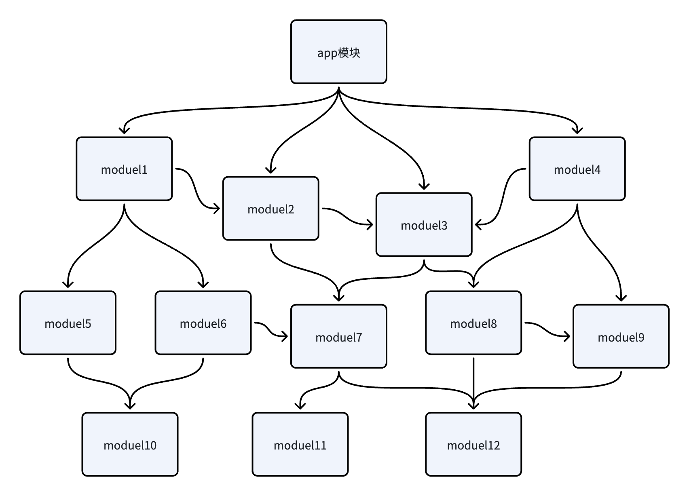
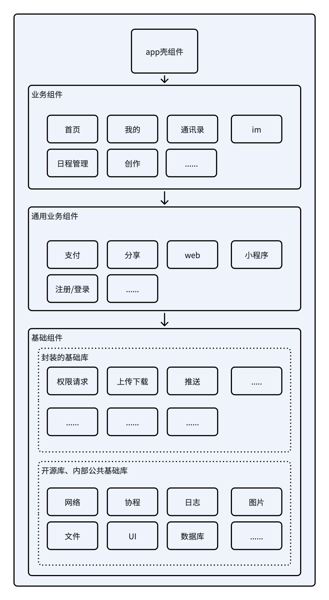
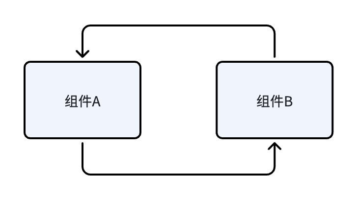
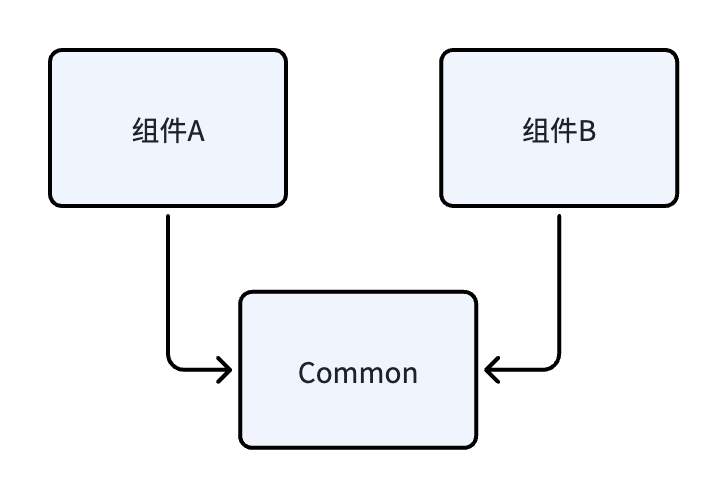
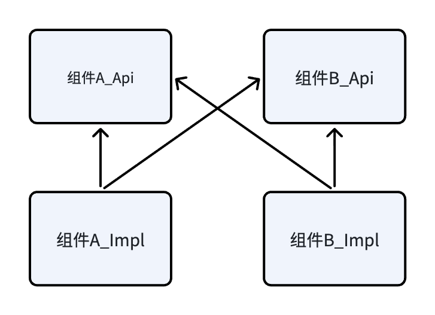
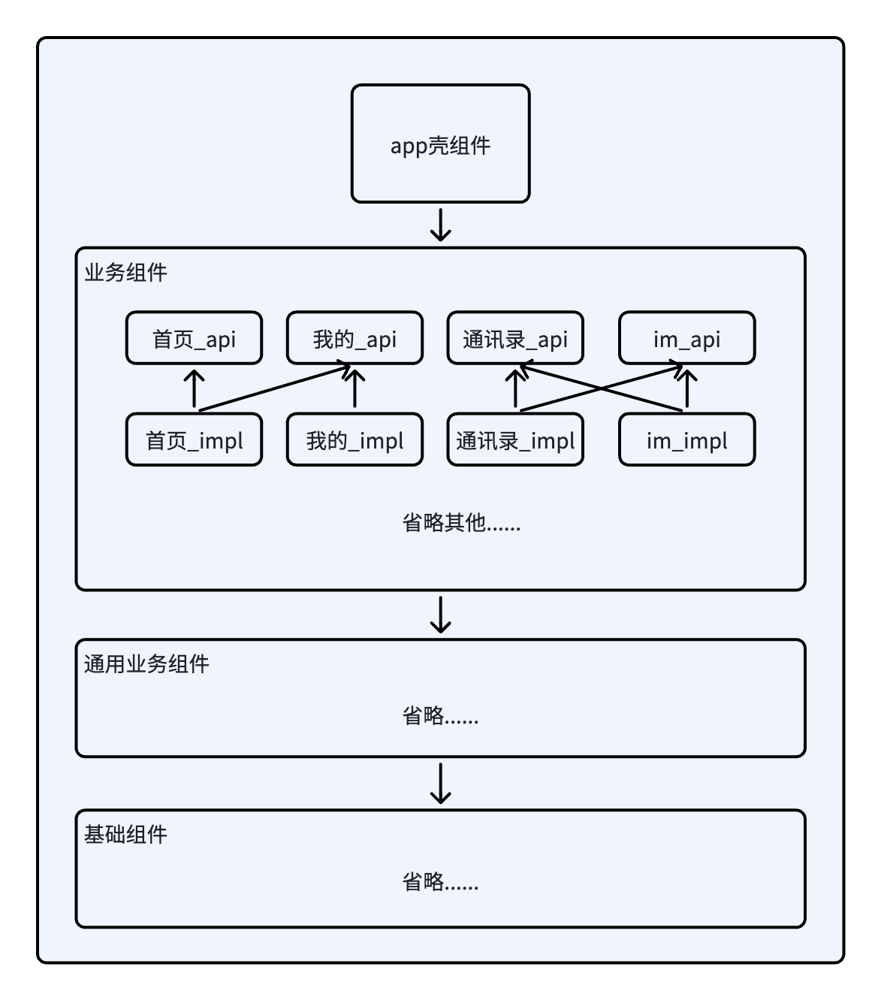

模块化的目的是使业务逻辑单元化；组件化的目的是使业务逻辑通用化，可以复用的代码下沉封装

影子工程

参考：
[Android组件化方案](https://blog.csdn.net/guiying712/article/details/55213884)
[安居客Android项目架构演进](https://zhuanlan.zhihu.com/p/25420181)
[组件化架构设计](https://www.jianshu.com/p/06931c9b78dc)
[Android 路由框架ARouter最佳实践](https://blog.csdn.net/zhaoyanjun6/article/details/76165252)
[网易友品 Android 客户端组件化演进](https://mp.weixin.qq.com/s/Xvx8hqjTA21sfaCvGEJSUw)
[一篇文章搞懂Android组件化](https://mp.weixin.qq.com/s/g1XIJ7vPl5yj1_thuV6b9Q)
[手把手带你 实践组件化](https://mp.weixin.qq.com/s/8_8gGpkpO2QFNkWgSRBwIg)
https://juejin.cn/post/7033954652315975688?from=from_parent_mindnote
https://juejin.cn/post/6844903457082572814?from=from_parent_mindnote
https://juejin.cn/post/6896099703474749453

多模块注意问题：
[R.java 的生成规则](https://www.wanandroid.com/wenda/show/9067)
最终打包出来的那些资源id，是会重新分配的（同一个资源生成的id，就算不在同一个R.class里，打包出来时也是相同的）。

一个测试：

app依赖了模块test；test模块中的string.xml有个test_value；在test模块中引用(com.test.R)，看到这个test_value的id值是-1900002；而在app中(com.app.R)引用时，id值为-1900023；这时候可以看出，相同的资源，id确实是不同。打包成apk后，把它拖进AS里，点开classes.dex：首先找到app包名下的R$string，右键查看字节码，发现test_value的id值由原来的-1900023，变成了0x7f10005d；接着找test模块包名下的R$string，查看字节码发现id值一样是0x7f10005d；由此看来，id值在打包成apk的时候，确实是重新分配了，而且同一个资源的id值，也统一了。

[这么多R.java 有卵用呀](https://wanandroid.com/wenda/show/9974)
[项目中同名资源，会不会覆盖，规则如何](https://www.wanandroid.com/wenda/show/9088)

* 把整个APP按照业务功能拆分成多个组件，每个组件只包含本业务
* 每个组件可以独立运行
* 最终，整个APP作为一个壳，由各个组件集成而成

与插件化的区别：
* 组件化多个aar，最终为单一APK，插件化多个apk
* 

需求
* 对工程的任意修改调试都要编译整个工程，效率低
* 不利于多人团队协同开发
* 无法做到功能复用
* 业务模块耦合严重

缺点
* 需要设计
* 需要花时间拆分
* 对于规模不大的项目来说意义不大


如何组件化

* 项目分层，分模块，分组件
* 组件通信 
  1. 页面跳转 路由框架 ARouter
  2. 数据、事件流：服务  IProvider SPI
  3. 事件同步 EventBus

* 组件单独编译测试
* 资源冲突
* 初始化
* 配置模块位置，例如把两个模块放到同一个目录，可以在setting.gradle中配置 project(':basecomponents').projectDir = new File( 'components/basecomponents' )


https://github.com/darryrzhong/Android-MvvmComponent-App/blob/master/library-network/src/main/java/com/zhouyou/http/request/BaseBodyRequest.java

https://github.com/Dawish/GoogleArchitectureDemo

### 组件间通信
一步步改进设计一个组件间通信库
1. 直接使用反射，一是不好维护每个类的名称，二是性能略微降低
2. 定义接口，它的实现类使用注解，然后编译时注解生成每个实现类对应的代理类，代理类都包含一个方法返回该实现类的实例，代理类的名称以接口名称再拼接Delegete之类的方式，然后可以通过拼接名称发射得到代理类，调用代理类的方法得到实现类实例。好维护了，但还是要反射
3. 使用ASM修改字节码，将每个构造实现类实例的逻辑写在一个类中，if-else根据传入的接口的class返回它的实现类实例，都通过这个类去得到接口的实现类实例

### 路由
和组件间通信类似，对Activity加上注解，注解带上url，编译时注解生成一个类文件，用于包含路由表。跳转界面，读取路由表时，还需要反射该类；另外结合修改字节码的话，可以避免这个反射。


## Android项目组件化做法实践
### 概述

Android项目发展至今，从最开始的单工程，到如今多模块代码工程已经成为常态，比如常说的模块化、组件化。也有特别多的文章介绍相关的做法，其中很多会去特别区分模块化和组件化，但可以认为组件化只是模块化的一种形态，不用特别去抠字眼，而是根据业务情况选择适合的具体做法。

这里的内容不是介绍组件化的详细改造流程，这方面可以找到众多的文章介绍。而是介绍一下在实际的工作经历中，Android工程的组件化中常用的一些工具库和做法，但这些做法并不具备普适性。可以参考这些做法，针对项目采取更合适更好的做法。

### 项目结构

#### 直接的模块化


这是一个简单的模块化的情况，如果没有特别设计的话，多模块项目基本都会自然形成这种结构，并且一般会有两种情况：

1. 一种是把所有的业务代码都放在app模块中，app模块内分多个包来分别放置各种UI业务代码，通过包文件目录的方式来分离各个业务，这些业务之间可以直接互相依赖和调用，然后依赖的各种功能放在下层模块中。

2. 另一种是app模块只放主页的业务或者只是简单的Application级别的一些业务，而把各个业务分为多个模块，app模块依赖这些模块，这些业务模块之间如果需要相互通信，则是下沉一个公共层模块。比如说在公共层模块写一个StateFlow，模块A去修改它，模块B监听它，达到通信的目的。


项目规模小的话，影响不会太明显。如果业务不断扩大发展，第一种情况可以预想到各项业务交织在一起，没有编译隔离的限制，牵一发而动全身，不利于维护、扩展和测试。第二种情况会稍好一些，但这个下沉的公共层最终也会耦合各个业务的代码，各项业务都会去修改它，然后持续膨胀。

#### 结构分层后的模块化（组件化）
结构大致如下：



将各个模块分了层次，依赖关系受到所在层次的约束。

- app壳组件：只放Application级别相关的业务，比如初始化全局使用的SDK、全局数据。依赖各项业务组件、通用业务组件，也可以依赖基础组件。
- 业务组件：可以依赖通用业务组件和基础组件。
- 通用业务组件：通用业务组件可以依赖基础组件，例如地图、视频播放等
- 基础组件：包含开源库、内部基础库、以及基于它们封装的基础功能库。例如通用UI和资源、网络、日志等

### 通信方式

使用组件化的结构后，整体的依赖方式都是上层依赖下层，上层依赖下层即可直接通信，但作为同一层级的业务组件之间是需要相互通信的，比如【IM组件】需要用到【日程组件】，【日程组件】也需要用到【IM组件】，那么同一层级的业务组件如何相互通信，以及它们的依赖关系如何考虑？

相互通信分为两种类别：

- 消息通知：发送消息通知对方，但不方便接收返回值，比如EventBus、Android广播这类机制。
- 方法调用：调用对方提供的接口，既能主动调用，也可以通过观察者模式或者回调接收消息，可以更全面的处理主动通信和被动接收通信的场景。

方法调用必然需要存在依赖关系，如果组件A需要调用组件B，组件B也需要调用组件A


也就形成了这样的**环形依赖**，而模块之间环形依赖无法构建。


常规的就是下沉公共模块的做法：



我们采用的是依赖倒置：


- 每个业务组件分为impl模块和api模块
- api模块中放对外暴露的接口，impl模块实现该接口，所以impl模块需要依赖自己组件的api模块
- 组件通过依赖其他组件的api模块，来相互调用，而不是依赖impl模块。既避免了环形依赖，也保持了组件间的隔离解耦合。


所以项目中的业务组件实际结构如下：


### 服务注册
依赖了对方的api模块，如何实际调用到impl模块的实现对象呢？必然需要将实现对象注入到某个地方，另一个组件去拿到对方的实现对象完成调用。

#### 手动注册
比如我们写一个手动注册的demo：

1. 在A组件的Api模块中定义接口

```Kotlin
// 模块A_Api
interface A_Api {
    fun foo()
}
```

2. 在A组件的Impl模块中实现接口

```Kotlin
// 组件A_Impl
class LibA : A_Api {
    override fun foo() {
        println("call A foo")
    }
}
```

3. 注册实现对象

```Kotlin
ServiceManager.registerService(A_Api::class.java, LibA())
```

4. 在B组件中获取和调用A

```Kotlin
ServiceManager.getService(A_Api::class.java)?.foo()
```

ServiceManager是一个基础组件，A和B组件都会依赖它，通过这个容器注册和获取其他组件的实现对象。


#### 自动注册

通过注解生成代码完成自动注册：

1. 在A组件的Api模块中定义接口

```Kotlin
// 模块A_Api
interface A_Api : IService {
    fun foo()
}
```

2. 在A组件的Impl模块中实现接口，并通过注解生成代码自动注册

```Kotlin
// 组件A_Impl
@ServiceImpl
class LibA : A_Api {
    override fun foo() {
        println("call A foo")
    }
}
```

3. 在B组件中获取和调用A

```Kotlin
ServiceManager.getService(A_Api::class.java)?.foo()
```

A\_Api接口需要继承IService接口的原因是，ServiceManager中是以接口class作为key，实现类实例作为value的方式，在自动注册的时候，要让ServiceManager知道用哪个接口class作为LibA的key，因为LibA类可能实现多个接口。


##### 自动注册的实现方式

手动注册需要考虑注册时机、注册的代码写在哪。所以有了自动注册的方式，核心就是生成代码，常用的有APT和AGP Transform两种方式（或者一起用）。

1. APT

首先在 ServiceManager 库中已经定义好创建实现类实例的接口

```Kotlin
interface ServiceFactory<T: IService> {
    fun createInstance(): T 
}
```

对每个使用 `@ServiceImpl `声明的类，都会生成一个对应的工厂类，实现该接口：

```Kotlin
class A_Api__ServiceFactory : ServiceFactory<A_Api> {
    override fun createInstance(): A_Api {
        return LibA()
    }
}
```

ServiceManager 已经写好代码，伪代码如下：

```Kotlin
class ServiceManager {
    //...... 省略其他代码

    fun <T : IService> getService(clazz: Class<T>): T {
        if(存在缓存){
            return 缓存
        }
        val className = "com.xx.servicemanager" + clazz.simpleName + "__ServiceFactory"
        val instance = Class.forName(className).newInstance() as T
        添加到缓存
        return instance
    }

    //......
}
```

通过APT生成了按照约定命名的对应的工厂类，就可以在ServiceManager中反射拿到它们。


2. AGP Transform

Android Gradle Plugin 1.5版本增加了Transform，我们可以自定义Transform并且结合ASM或者javassist修改字节码文件。

```Kotlin
class ServiceManager {
    //...... 省略其他代码

    fun <T : IService> getService(clazz: Class<T>): T {
        if(存在缓存){
            return 缓存
        }
        val instance = serviceFinder.getService(clazz)
        添加到缓存
        return instance
    }

    //......
}

import com.xx.LibA
import com.xx.LibB
import com.xx.LibC
// ......生成import

class ServiceFinder {
    fun <T : IService> getService(clazz: Class<T>): T {
        // 这里原本留空，在Transform过程中填入代码
        return if(clazz.name == "com.xx.A_Api") {
            LibA() as T
        } else if(clazz.name == "com.xx.B_Api") {
            LibB() as T
        } else if(clazz.name == "com.xx.C_Api") {
            LibC() as T
        }
    }
}
```

绿色部分即为在Transform过程中，使用ASM修改字节码的结果。相比APT，使用Transform自由度更大，并且降低了对编译速度的影响（有实际项目证明，APT太多对大型项目构建编译速度影响较大）。


> 一些注意点：这个实现方式不主动unregister的话，ServiceImpl类的对象相当于是单例，会一直存在，所以一般不要在ServiceImpl类中持有大内存对象，或者context等，避免内存泄露。而是仅用于暴露接口、传输数据，作为一个中转者。
> 

#### 使用例子

1. Application级别的信息

比如Application Context在大多数组件中都需要访问，所以我们也使用了ServiceManager，定义了一个AppDelegator接口：

AppDelegator_Api组件：

```Kotlin
interface AppDelegator {

    fun registerApplicationContext(context: Context)

    fun getApplicationContext(): Context
    
    fun getAppVersionCode(): String
    
    fun getAppVersionId(): String
    
    fun getAppVersionName(): String
    
    // 。。。。。更多的application级别信息    
}

// 写一个工具函数，方便外部调用
val appDelegator: AppDelegator
    get() = ServiceManager.getService(AppDelegator::class)
```

然后在AppDelegator_Impl组件中实现接口：

```Kotlin
@ServiceImpl
class AppDelegatorImpl : AppDelegator {

    override fun registerApplicationContext(context: Context) {
        ......
    }

    override fun getApplicationContext(): Context {
        ......
    }
    
    override fun getAppVersionCode(): String {
        ......
    }
    
    override fun getAppVersionId(): String {
        ......
    }
    
    override fun getAppVersionName(): String {
        ......
    }
    
    // 。。。。。更多的application级别信息    
}
```

app组件注册 Application Context ：

```Kotlin
// app modul build.gradle
implementation project(':appdelegatorapi')

// src code
class App : Application() {
    override fun attachBaseContext(base: Context) {
        super.attachBaseContext(base)
        appDelegator.registerApplicationContext(getApplicationContext())
    }
}
```

其他组件需要访问 Application Context 或者其他应用级对象数据，就可以这样使用：

```Groovy
// build.gradle
implementation project(':appdelegatorapi')

// src code
appDelegator.getApplicationContext()
```

2. ActivityStack

比如有些情况，我们需要知道当前栈顶的Activity，或者当前App是否处于前台，也可以用一个组件来维护这个信息。

ActivityStack_Api 组件：

```Kotlin
interface ActivityStackApi {
    fun getTopActivity(): Activity?
    fun isForeground(): Boolean
    ......
}

val activityStackDelegator: ActivityStackApi
    get() = ServiceManager.getService(ActivityStackApi::class)
```

ActivityStack_Impl 组件：

```Kotlin
// 结合 Application registerActivityLifecycleCallbacks 来实现

@ServiceImpl
class ActivityStackImpl {
    fun getTopActivity(): Activity? {
        // ......
    }
    
    fun isForeground(): Boolean {
        // .....
    }
}
```

同样的，在其他组件，通过以下代码访问：

```Groovy
// build.gradle
implementation project(':activitystackapi')

// src code
activityStackDelegator.getTopActivity()
```

#### 为什么没有用现成的依赖注入框架

为什么没有使用dagger2、hilt之类的依赖注入框架：

1. 如果开发团队众多、人员数量庞大、地理分布分散，没有对dagger2、hilt的使用偏好，不易推广和统一规范使用，dagger2/hilt的侵入性较大，不便改造项目。

2. 需要满足很多额外的需求，例如都会使用反射兜底（前文的demo代码没有写）、管控service对象的生命周期、service实例首次初始化的回调、比如项目有插件化，插件apk中的类并没有一起构建，但也想支持插件apk中的service实现。等等...

> Java自带的SPI服务发现功能，使用了反射，并且也只有最基础的实例获取功能，所以一般也不考虑。
> 

### 路由

#### 直接使用Intent

在同模块内跳转Activity，可以直接引用Activity的class类：

```Kotlin
val intent = Intent(context, ChatActivity::class.java)
context.startActivity(intent)
```

但在组件化的情况下，业务组件无法直接引用在其他组件Activity的class类，Intent也提供了其他的方式，比如我们可以使用字符串指定该Activity的包名和类名：

```Kotlin
// 使用指定包名和类名字符串的方式
val intent = Intent()
intent.setClassName("com.xx.xyz", "com.xx.xyz.ChatActivty")
context.startActivity(intent)
```
显然这个方式有硬编码的问题，不易维护，其他组件信息有所变动，就需要各处均改动。如果进一步，我们把各个组件的Activity的包名和类名字符串下沉到一个模块来维护，可以减少修改成本。

#### 使用组件间通信
我们还使用过ServiceManager的方式，也就是服务注册中介绍的组件间通信方式：

Chat_api组件：

```Kotlin
interface ChatApi {
    fun openChatActivity(context: Context)
}
```

Chat_Impl组件：

```Kotlin
@ServiceImpl
class ChatImpl {
    override fun openChatActivity(context: Context) {
        val intent = Intent(context, ChatActivity::class.java)
        context.startActivity(intent)
    }
}
```

其他组件：

```Kotlin
ServiceManager.getService(ChatApi::class).openChatActivity(context)
```

组件间的方式，调用方不需要知道Activity的具体信息，只管调用接口即可。

#### 路由库
Android的路由库，开源的比如**ARouter**比较出名，还有一些公司内部开发的闭源库。它们的核心做法是一致的，都是通过注解收集各个组件的Activity的路由信息，并结合APT生成代码或者修改字节码，

Chat_impl组件：

```Kotlin
@Route(path = "chat/chat_page")
class ChatActivity : AppCompatActivity{
    
}
```

其他组件：

```Kotlin
// 其他组件跳转
DemoRouter.build("chat/chat_page")
    .withParam("parma1", "测试")
    .withParam("parma2", 0)
    .open()
```

"chat/chat_page" 可以选择放到 Chat_api 组件维护，或者把所有组件的 Activity 路由信息下沉到公共模块维护。但此时维护这个url就简单很多，因为它不和包名、类名关联，即使Activity类修改了包名、类名也没有关系。

路由库的简单使用，看起来和直接使用包名、类名字符串没有太大的区别。只是减少模版代码，屏蔽Activity包名、类型信息，不过它们另外提供的一些功能对一些场景还是比较有用的：

- 拦截器：比如检测未登录拦截，路由到登录页面
- 参数注入
- 跳转失败降级策略：如果传入的url没有对应的页面，可以设置处理策略
- 提供 IDE 插件便捷的关联路径和目标类
- 甚至提供跨原生、web、flutter等界面的跳转，屏蔽具体实现
- ...

#### 路由库的路由查找原理

方式和前文的服务注册是类似的，通过对Activity注解，在APT或者AGP Transform的时候，收集到Activity的包名和类名，放在某个类中使用例如map来维护，使用路由库跳转页面时就根据传入的url得到实际的包名和类名，内部还是使用Intent完成跳转。


### 启动任务
一个App启动过程中，会有很多需要初始化的代码调用，比如一些sdk的初始化、基础库的初始化。在组件化的情况下，简单的做法，我们可以把每个组件需要初始化的方法暴露给app模块（比如通过ServiceManager的方式），然后在app模块的Application对应生命周期中调用。或者使用Jetpack StartUp、ContentProvider（会拖慢app冷启动速度）。

但如果要设计更完善的启动任务库，还需要考虑更多的功能：

- 任务执行的时机
- 任务执行的线程
- 任务执行的进程
- 任务执行的优先级
- 任务之间的依赖关系
- 各个任务执行顺序和时长，用于调试以及启动速度优化，方便定位到团队或个人
- ...


例如定义一个启动任务接口：

```Kotlin
interface InitTask {
    // 唯一标识
    fun id(): String
    
    // 描述信息，可用于调试、
    fun desc(): String
    
    // 是否必须在主线程执行
    fun mustRunInMainThread(): Boolean

    // 执行进程
    @Process
    fun targetProcess(): Int
    
    // 执行时机
    fun executePeriod(): InitPeriod
    
    // 依赖的task id
    fun denpendencies(): IntArray<Int>
    
    // ......
}
```

执行进程的一些类别定义：

```Kotlin
@IntDef(
    MAIN_PROCESS, // 主进程
    ALL_PROCESS, // 所有进程
    WEBVIEW_PROCESS, // webview 进程
    PUSH_PROCESS, // 推送进程
    ......
)
@Target(AnnotationTarget.FUNCTION)
@Retention(AnnotationRetention.SOURCE)
annotation class Process
```

执行时机的一些定义：

```Kotlin
enum class InitPeriod {
    // application attachBaseContext - super.attachBaseContext
    APP_ATTACHBASE2SUPER,
    
    // application super.attachBaseContext - attachBaseContext end
    APP_SUPER2ATTACHBASEEND

    // application onCreate - super.onCreate
    APP_ONCREATE2SUPER,
    
    // application super.onCreate - onCreate end
    APP_SUPER2ONCREATEEND,

    // MainActivity onCreate - super.onCreate
    MAIN_ONCREATE2SUPER,
    
    // MainActivity super.onCreate - onCreate end
    MAIN_SUPER2ONCREATEEND,
    
    // MainActivity onResume - super.onResume
    MAIN_ONRESUME2SUPER,
    
    // MainActivity super.onResume - onResume end
    MAIN_SUPER2ONRESUMEEND,
    
    // 启动流程结束后
    IDLE,
    
    // ......其他时机
}
```

简单的例子：

自定义各项启动任务实现类，然后交给启动任务库去调度执行。启动任务库根据任务的执行进程、线程、触发时机、优先级、依赖关系，调度执行，启动任务库一般会采用**有向无环图**来构造任务执行顺序。所以启动任务库的设计与开发的工作量还是较多的，而对于使用来说则非常简单。


#### 注解的方式

类似的，如果要考虑定义启动任务，并且自动被启动任务库添加并执行，也可以考虑使用注解：

```Kotlin
interface InitTask {
    fun execute()
}

@InitTask(
    id = "task3",
    desc = "用于xxxx",
    mustRunInMainThread = true,
    initPeriod = InitPeriod.APP_SUPER2ONCREATEEND,
    dependencies = ["task1", "task2"]
)
class MyTask : InitTask {
    override fun execute() {
        // ......执行某些工作
    }
}
```

然后使用APT或者AGP Transform之类的方式，收集各个组件中的Task。

### 其他

#### 资源文件冲突

不同模块对不同的资源使用了同一个命名，会产生资源覆盖问题。比如app模块中有一个图片叫R.drawable.icon，libA模块也有一个图片叫R.drawable.icon，最终构建后会优先使用app的资源，则会导致libA模块的图片显示错误。

这个问题比较容易处理，可以对不同组件的资源文件（layout、drawable等）添加前缀的方式即可，避免命名相同。Android Gradle Plugin也提供了相应的配置来做前缀约束。

#### 业务组件单独运行
一些组件化的做法中，希望把业务组件可以单独作为app编译构建，不需要集成其他组件，达到快速开发调试的目的。这里核心就是要切换com.android\.libary和com.android.application，以及配置applicationId和manifest中添加application。

这个做法在个人实际感受中，感觉比较鸡肋，因为实际开发中，一个业务组件多多少少都依赖了众多组件，需要共同运行，才能保证功能正常执行。项目较大的情况，修改gradle脚本重新sync也比较耗时，并且在苹果的M1芯片发布后，编译构建也显著加快了，增量编译问题不大，所以我之前的项目中并没有做这个需求。

#### 统一版本依赖
组件众多的情况，不同组件使用的依赖库的版本不一致，容易导致依赖冲突，以及一些行为变更，比如某个组件使用了更高版本的依赖库，根据Gradle的依赖版本策略，会导致整个项目的该依赖库版本都设置为这个高版本，就可能产生一些意料外的行为变更。这个情况，我们之前采用的是将各个依赖库版本写在同一个文件中，并且编写Gradle脚本来处理，然后声明依赖就像这样：

```Kotlin
implementation 'com.squareup.retrofit2:retrofit'
implementation 'org.jetbrains.kotlinx:kotlinx-coroutines-core'
```

没有写上版本，而是交给编写的Gradle脚本去统一处理。


当前，Gradle 7\.X 版本提供的Version Catalogs已经可以较好地解决这个问题。


### 总结

以上内容介绍了一些多组件项目会用的一些主要相关工具和库，但对于特定项目来说，并不是都有必要，都需要根据具体考虑。但都是为了这些目的：

- 代码隔离，高内聚低耦合
- 职责清晰，改动引发的风险更小
- 便于多人开发
- 代码复用
- 提升编译速度
- ...

常用的技术：反射、动态代理、APT注解处理器、AGP Transform + ASM / javassit（APT太多的话会拖慢编译构建，可以考虑KSP或者字节码操作）
