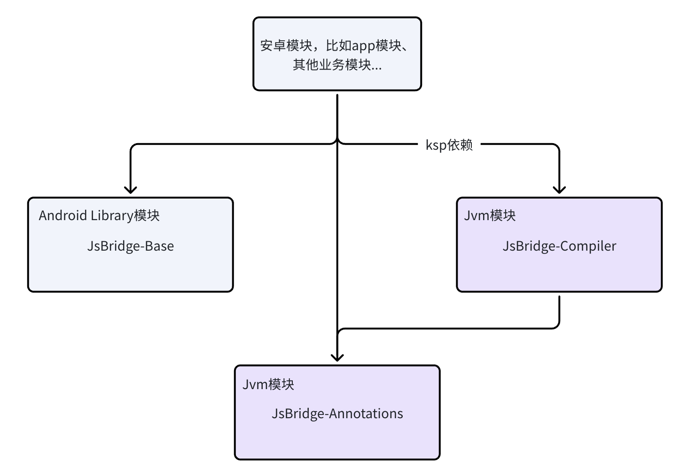

# 概述
当前的移动端App开发，很多项目都会集成Web技术，Android中使用WebView可以展示前端Web页面，并且WebView的web页面（JavaScript）往往要和Native（Java/Kotlin）相互通信，所以需要使用相应的通信方式。

# WebView API
在了解通信方式之前，我们先了解一下WebView提供的API，对WebView提供的功能有更系统的认知。
## 基本使用
声明网络权限
```
// 一般需要声明网络权限
<uses-permission android:name="android.permission.INTERNET"/>
```

常用配置
```
// 支持JavaScript
webView.settings.javaScriptEnabled = true
//是否打开Dom本地存储，有些web页面使用了Dom Storgage（Web Storage）存储机制，这种情况需要打开
webView.settings.domStorageEnabled = true

// 设置WebViewClient，可以自定义各种事件通知请求的回调
binding.webView.webViewClient = WebViewClient()
// 设置WebChromeClient，可以自定义JS弹窗、标题、进度等
binding.webView.webChromeClient = WebChromeClient()

// 设置WebView背景色
binding.webView.setBackgroundColor(color)
```

加载url，即可完成web页面展示。url可以是http远程资源或本地文件。
```
// 加载url对应的web页面
binding.webView.loadUrl(url)
```

## 其他API介绍
1. WebView自身API
```
// 基本信息

String getUrl() // 获取当前url
String getTitle() // 获取当前标题
Bitmap getFavicon() // 获取当前favicon
int getProgress() // 加载进度
static void setWebContentsDebuggingEnabled // 调试

// 配置
WebSettings getSettings()
void setWebViewClient(@NonNull WebViewClient client) // WebViewClient可以设置多种事件回调
void setWebChromeClient(@Nullable WebChromeClient client) // WebChromeClient可以处理js弹窗、图标等

// JavaScript

void addJavascriptInterface(@NonNull Object object, @NonNull String name) // 注入JS对象
void removeJavascriptInterface(@NonNull String name)
// Android异步执行WebView当前显示页面中的JavaScript的方法。需要在UI线程调用
void evaluateJavascript(@NonNull String script, @Nullable ValueCallback<String> resultCallback)

// 加载URL

void loadUrl(@NonNull String url, @NonNull Map<String, String> additionalHttpHeaders) // 加载URL，可配置header
void loadUrl(@NonNull String url) // // 加载URL
void postUrl(@NonNull String url, @NonNull byte[] postData) // 使用POST请求
void loadData(@NonNull String data, @Nullable String mimeType, @Nullable String encoding) // 加载字符串数据，比如字符串是一个html数据
void loadDataWithBaseURL(@Nullable String baseUrl, @NonNull String data,
            @Nullable String mimeType, @Nullable String encoding, @Nullable String historyUrl)
void reload() // 重新加载当前url
void stopLoading() // 停止当前加载

// WebView网络是否可用
void setNetworkAvailable(boolean networkUp)

// 销毁WebView的内部状态，在从View树中移除后才能调用，调用此方法后不不能再调用WebView的其他方法
void destroy()

// 保存当前页面到指定文件（比如html）
void saveWebArchive(@NonNull String filename)

// 历史页面回退栈管理
boolean canGoBack()
void goBack()
boolean canGoForward()
void goForward()
boolean canGoBackOrForward(int steps)
void goBackOrForward(int steps)
void clearHistory()

// 是否启用无痕浏览
boolean isPrivateBrowsingEnabled()

// 页面滑动
boolean pageUp(boolean top)
boolean pageDown(boolean bottom)
void flingScroll(int vx, int vy)

// WebView内容ui相关
void postVisualStateCallback(long requestId, @NonNull VisualStateCallback callback)
void setInitialScale(int scaleInPercent)
void invokeZoomPicker()
HitTestResult getHitTestResult()
void zoomBy(float zoomFactor)
boolean zoomIn()
boolean zoomOut()
int getContentHeight()
int getContentWidth()

// 暂停/恢复
void onPause() // 暂停WebView动画、定位等
void onResume()
void pauseTimers() // 暂停当前Application所有的WebView的layout、parse和javascript timer
void resumeTimers()

// 。。。。。。其他省略
```

2. WebSettings API
```
// 省略getter

void setJavaScriptEnabled(boolean flag) // 启用JavaScript，默认false
void setDatabaseEnabled(boolean flag) // 启用数据库存储API，默认false
void setDomStorageEnabled(boolean flag) // 启用DOM存储API，默认false
void setGeolocationEnabled(boolean flag) // 启动定位API，默认true。需要定位权限，实现WebChromeClient#onGeolocationPermissionsShowPrompt
void setJavaScriptCanOpenWindowsAutomatically(boolean flag) // 让JavaScript可以自动打开Window，默认false
void setSafeBrowsingEnabled(boolean enabled) // 启用安全浏览
void setAllowFileAccess(boolean allow) // 是否可以访问文件，比如 file:///android_asset，API 30以以上默认false，之前默认true
void setAllowContentAccess(boolean allow) // content url是否可以访问


void setSupportZoom(boolean support) // 是否支持缩放，默认true
void setMediaPlaybackRequiresUserGesture(boolean require) // 设置播放媒体是否需要用户手势，避免自动播放，默认true
void setBuiltInZoomControls(boolean enabled)
void setDisplayZoomControls(boolean enabled)
void setAlgorithmicDarkeningAllowed(boolean allow) // 深色模式
void setLoadWithOverviewMode(boolean overview) // 是否使用overview mode加载页面，默认值 false，当页面宽度大于WebView宽度时，缩小至屏幕大小
void setUseWideViewPort(boolean use) // 设置是否支持 viewport 属性，
void setSupportMultipleWindows(boolean support) // 是否支持多窗口，默认值false
void setLayoutAlgorithm(LayoutAlgorithm l) // 布局算法，默认为LayoutAlgorithm#NARROW_COLUMNS
void setTextZoom(int textZoom) // 文字缩放百分比，默认值 100
void setStandardFontFamily(String font) // 设置标准字体名称，默认为 sans-serif
void setFixedFontFamily(String font) // 设置等宽字体，默认为 monospace
void setSansSerifFontFamily(String font)
void setSerifFontFamily(String font)
void setCursiveFontFamily(String font)
void setFantasyFontFamily(String font)
void setMinimumFontSize(int size)
void setMinimumLogicalFontSize(int size)
void setDefaultFontSize(int size)
void setDefaultFixedFontSize(int size)

void setLoadsImagesAutomatically(boolean flag) // 是否自动加载图片，默认true
void setBlockNetworkImage(boolean flag)


void setDefaultTextEncodingName(String encoding) // 设置文本编码
void setUserAgentString(@Nullable String ua) // 设置user agent
void setNeedInitialFocus(boolean flag) // 调用 WebView#requsetFocus 时，会设置焦点。默认true
void setCacheMode(@CacheMode int mode) // 设置缓存模式
void setDisabledActionModeMenuItems(@MenuItemFlags int menuItems)
```

# Web和Native通信方式
前面了解了WebView的各种API，可以看到其中几个API可以用于JS/Native的通信。
## JavaScript -> Android
首先来看JavaScript调用Java/Kotlin代码，WebView提供了JavaScript代码调用Java/Kotlin代码的多种方式。

### 1. 通过WebView的 addJavascriptInterface() 注入对象
这个是最主流的方式。注入Java对象到Webview，然后JavaScript可以通过window对象间接访问这个Java对象，达到调用Java/Kotlin代码的目的。

**Android代码**：
```
class JsBridge {
    @JavascriptInterface
    public String getString() { return "test string"; }

    @JavascriptInterface
    public String log(text: String) { Log.d("text") }
}

// 设置支持 JavaScript
webView.settings.javaScriptEnabled = true
// 添加 JsBridge 实例，在 JavaScript 中通过 window.jsBridge 可以访问到此对象
webView.addJavascriptInterface(JsBridge(), "jsBridge");
webView.loadUrl(url)
```
使用 `@JavascriptInterface` 注解的public方法可以被JavaScript访问，对象将注入到 JavaScript 的 `window` 对象中，`addJavascriptInterface`方法的第二个参数将作为 JavaScript 在 `window` 中访问该JsBridge实例的属性名称。

> `addJavascriptInterface`可以调用多次，添加多个注入的对象，但如果传入name一样，后面添加的将覆盖之前添加的。

**Web代码**：
```
<!DOCTYPE html>
<html lang="en">
<head>
    <meta charset="utf-8">
    <title>Document</title>
    <script>
        function callAndroid(){
          // 将调用到Android中JsBridge对象的getString()方法，返回值赋值给 s 变量
          let s = window.jsBridge.getString();
          // 将调用到Android中JsBridge对象的log(text)方法，将参数"测试文本"传到Android代码
          window.jsBridge.log("测试文本")
        }
    </script>
</head>
<body>
<button type="button" onclick="callAndroid()">按钮</button>
</body>
</html>
```
点击按钮将调用Android中声明的`getString()`和`log(text: String)`方法。`getString()`的使用情况表明JavaScript可以调用Android中的Java/Kotlin代码，并且可以将调用Android方法的返回值传回JavaScript。`log(text: String)`的使用情况表明JavaScript可以把数据传到Android的Java/Kotlin代码中。

以上基本使用示例，可以了解到`addJavascriptInterface`注解提供了JavaScript到Java/Kotlin的方法调用，支持传参和返回值。那么下面将继续分析`addJavascriptInterface`对各种调用方式的支持情况：

#### 支持的数据类型
`@JavascriptInterface` 注解的方法，支持Java的`基本数据类型`和`String`作为参数和返回值
```
// Kotlin
@JavascriptInterface
fun showHint(a: String, b: Int, c: Double): String{
    Log.d("TAG", "showHint $a $b $c")
    retrun "测试文本"
}

// JavaScript
let x = window.androidClient.showHint("1", 2 ,3);
console.log("showHint return " + x)
```
这个例子验证了String、Int、Double作为参数和返回值，均可正常运行。

验证`数组`作为方法参数的情况：
```
// Kotlin
@JavascriptInterface
fun showHint(a: Array<String>) {
    Log.d("TAG", "showHint ${a[0]} ${a[1]}")
}

// JavaScript
window.androidClient.showHint(["One", "Two"]);
```
Kotlin代码可以正常接收到JavaScript传来的数组

验证`数组`作为方法返回值的情况：
```
// Kotlin
@JavascriptInterface
fun showHint(): Array<String> {
    return 
}

// JavaScript
window.androidClient.showHint(["One", "Two"]);
```
无法正常调用，不支持数组作为返回值

验证返回不是基本类型也不是String的其他类型：
```
// Kotlin
@JavascriptInterface
fun showHint(): CustomType {
    return CustomType()
}

// JavaScript
let x = window.androidClient.showHint();
console.log(x) // JS收到{}，也就是未设置属性的对象
```

**数据类型支持情况总结**：Java基本数据类型和String可以作为参数和返回值，基本数据类型的数组和String数组只能作为参数，如果要使用自定义类型，可以使用Json等格式的字符串类型达到目的。

#### 参数不匹配的情况
1. 类型不匹配
```
// Kotlin
@JavascriptInterface
fun showHint(a: Int, b: String) {
    Log.d("TAG", "$a $b")
}

// JavaScript
window.androidClient.showHint(1.5, 2); // Android打印 1 2

window.androidClient.showHint("1", 2);  // Android打印 0 2

window.androidClient.showHint("哈哈", {}); // Android打印 0.0 undefined
```
* showHint(1.5, 2)：打印 1  2，说明Number类型之间可以转换，非String类型可以转为String
* showHint("1", 2)：打印 0  2，说明非Number类型转为Number失败，将使用默认值
* showHint("哈哈", {})：打印 0.0  undefined，说明转String失败将使用undefined


如果声明参数类型不是基本类型也不是String类型，而是其他类型：
```
// Kotlin
@JavascriptInterface
fun showHint(a: CustomType?) {
    Log.d("TAG", "$a") // 无论JS传参是什么，只会接收到null
}
```

**参数类型不匹配的情况总结**：Java/Kotlin方法接收的JavaScript传入参数类型只能是Java的内置类型或String和它们的数组，否则param为null、或为undefined（当用String接收时）。Number类型之间可以转换，但可能丢失精度。

2. 数量不匹配
```
// Kotlin
@JavascriptInterface
fun showHint(a: Int, b: Int) {
    Log.e("TAG", "$a  $b")
}

// JavaScript
window.androidClient.showHint(1)  // 报错 "Uncaught Error: Method not found"
window.androidClient.showHint(1, 2, 3)  // 报错 "Uncaught Error: Method not found"
```
说明传入参数和声明的参数数量不匹配，都会报错找不到方法。

3. JavaScript命名参数
JavaScript命名参数调用Android中`@JavascriptInterface`注解的方法，命名参数不会生效，仍然按参数的实际顺序传参。
```
// Kotlin
@JavascriptInterface
fun showHint(a: Int, b: Int) {
    Log.e("TAG", "$a  $b")
}

// JavaScript
window.androidClient.showHint(b = 1, a = 2) // 仍然打印 1 2
```


#### 方法重载的情况
`@JavascriptInterface` 支持注解多个不同参数数量的重载方法，将根据JS的传参数量情况选择对应的方法。如果参数数量相同，参数类型不同，只会选择第一个声明的方法。所以不建议使用重载，容易产生错误。

#### 线程
`@JavascriptInterface`注解的方法会在JavaBridge线程被调用，所以执行代码需要注意，必要时切换线程

#### 异步
* `@JavascriptInterface`注解的方法对于JavaScript为同步调用，如果方法没有返回值，js得到的返回值为undefined。
* 如果要要异步回调，由于传参不支持自定义类型，所以无法传递Callback对象，只能使用字符串传递方法名称，Android中再使用`evaluateJavascript`调用JS的回调函数。
* `@JavascriptInterface`注解的方法，不能使用Kotlin suspend，因为方法会增加一个Continuation参数，导致反射找不到方法

#### addJavascriptInterface 原理简单了解
JavaScript是一门脚本语言，需要使用JSEngine来解析和执行（例如谷歌V8引擎），JSEngine在执行JS代码时，会构造出运行时环境（Context），Web场景的Context内置了全局对象window和其他一些内置对象。

并且JSEngine通常会被集成到宿主中，最出名的宿主就是浏览器。为了让JS可以访问宿主的能力，JSEngine对外提供了扩展API，允许宿主向JS运行时环境注入特有的能力（注入API），并且向宿主暴露了一些hook接口，用于实现相互通信。

WebView.addJavascriptInterface最终会调用到web引擎的C++代码中的[AddJavascriptInterface](https://android.googlesource.com/platform/external/webkit/+/refs/heads/main/Source/WebKit/android/jni/WebCoreFrameBridge.cpp) 函数，调用[bindToWindowObject](https://android.googlesource.com/platform/external/webkit/+/refs/heads/main/Source/WebCore/bindings/v8/ScriptController.cpp) 绑定到js上下文 。JS调用注入的对象就是通过JS引擎通过反射调用Java/Kotlin代码。

参考文档：https://chromium.googlesource.com/chromium/src/+/master/android_webview/docs/java-bridge.md

### 2. 通过 WebViewClient 的 shouldOverrideUrlLoading() 方法回调拦截 url
重写`shouldOverrideUrlLoading`也是JS调用Java/Kotlin通信的一种方式，但不如使用上文介绍的`addJavascriptInterface`便捷和高效，所以作为了解即可。

在JS代码中，可以触发url加载，有多种方式，下面介绍常用的两种：
```
// js代码

// 1. 可以修改 window.location 的值，设置url。schema可以自行设置，这里示例使用jsbridge
window.location = 'jsbridge://xxxx'

// 2. 也可以使用不可见的 iframe 元素
let document.createElement('iframe');
iframe.style.display = 'none';  
iframe.src = 'jsbridge://111'
document.body.appendChild(iframe);
iframe.src = 'jsbridge://222'
```

JS代码中触发了url加载，在Android中可以通过重写WebViewClient的shouldOverrideUrlLoading()方法，监听到url加载，然后从url信息中得到通信的数据。
```
// Android代码
binding.webView.webViewClient = object : WebViewClient() {

    override fun shouldOverrideUrlLoading(view: WebView, request: WebResourceRequest): Boolean {
        // 如果我们想用自己的代码逻辑拦截处理就返回true，如果还是让WebView自行处理就返回false
        if(needHandle(request)){
            return true
        }
        return super.shouldOverrideUrlLoading(view, request)
    }
}
```
WebViewClient重写`shouldOverrideUrlLoading`方法，就可以根据`WebResourceRequest`的请求信息，自行拦截处理。不过这种方式就不方便像`addJavascriptInterface()`方式一样直接返回值，而要使用WebView的`evaluateJavascript`方法调用JS代码。

> webView只能识别http、https和file之类的协议，要支持一些特殊协议也可以使用 shouldOverrideUrlLoading


### 3. 通过 WebChromeClient 的onJsAlert()、onJsConfirm()、onJsPrompt（）方法回调拦截JS对话框alert()、confirm()、prompt()消息
类似第二种方式，监听JS触发的操作，不算常规通用的通信方式。


**以上3种方式，第2种和第3种都算比较偏门的做法，而第1种方式算是最主流和便捷的，所以一般情况建议采用第1种方式**

## Android -> JavaScript：
前面介绍了JS代码主动调用Android代码的方式，本节介绍Android主动调用WebView页面中的JavaScript的几种方式。

### 1. 调用WebView的 evaluateJavascript() 执行js代码 
`evaluateJavascript()`是Android 4.4版本添加的API，可以异步执行当前web页面context中的JavaScript代码，并且可以接收执行的结果回调。
```
mWebView.evaluateJavascript("javascript:jsFunction()", new ValueCallback<String>() {
        @Override
        public void onReceiveValue(String value) {
            //value为js函数的返回值
        }
    });
```
`jsFunction()`为JavaScript中的函数名称，这里的例子中执行的JS代码仅为一个函数，实际可以执行多个语句。代码字符串开头不加 javascript: 也可以执行。

### 2. 调用WebView的loadUrl()
```
// jsCode为WebView当前页面的一段JS代码
webView.loadUrl("javascript:jsCode");
```
通过这个方式也可以执行JS代码。但`loadUrl()`不能像`evaluateJavascript()` 得到结果回调。

# JsBridge的实现方案
## 初步设计
### 定义通信协议
使用`@JavascriptInterface`注解的方法被JavaScript调用时，调用的函数名称和参数必须和Java/Kotlin中声明的一致，并且由于参数类型只能使用基本类型和字符串，如果要传递复杂对象就要使用Json等格式的字符串来表示。

而使用`evaluateJavascript`执行JavaScript代码也类似，Java/Kotlin调用的JavaScript函数，必须和JavaScript中声明的一致。

所以必须保证Web和Native都使用约定好的方法名称，才能执行成功。**在实际的项目开发中，这就需要Android、iOS和Web三方共同约定好各个接口和参数以及返回数据或者回调数据格式。**


### Js调用Java/Kotlin

#### 1. 定义传入参数格式

例如最基本的使用，JavaScript调用Java/Kotlin的方法，可以传入一个Int和一个String类型参数：

```Kotlin
class Foo {
    @JavaScriptInterface
    fun test(a: Int, b: String) {
        //
    }
}
```

但在很多情况，参数可能会是一个复杂数据，通常会用一个对象来表示，然而JS和Java/Kotlin的通信并不支持自定义对象，此时我们可以使用Json等格式的序列化文本数据，也就是String来传输任意参数。


例如JavaScript传入一个User信息的json字符串：

```JSON
{
    "age": 12, // 年龄
    "name": "Tom", // 名称
    "shoes": ["Nike", "Adidas", "ANTA"], // 拥有的鞋
    "address": {
        "city": "Chengdu", // 住址
        "postcode": "610000" // 邮编
    }
}
```


在Kotlin代码定义接口时，就可以只声明一个字符串，然后解析字符串内容即可：

```Kotlin
@JavaScriptInterface
fun test1(json: String) {
    // 这里简单使用JSONObject，也可以使用Gson、Moshi等json解析库
    val jsonObject = JSONObject(json)
    val age = jsonObject.getInt("age")
    val name = jsonObject.getString("name")
    val shoes = jsonObject.getJSONArray("shoes")
    val address = jsonObject.getJSONObject("address")
    val city = address.getString("city")
    val postcode = address.getString("postcode")
}
```


同样的，前面所举例的`test(a: Int, b: String)`函数，也可以改写为只使用一个json字符串参数的形式：

```Kotlin
@JavaScriptInterface
fun test(json: String) {
    val jsonObject = JSONObject(json)
    val a = jsonObject.getInt("a")
    val b = jsonObject.getString("b")
}
```


那么进一步，**我们将所有注册的接口函数的参数都约定为一个Json字符串，这样统一的形式有利于统一的接口设计和流程，便于设计JsBridge封装库。**

#### 2. 声明单一方法，动态注册

统一参数为单个json字符串之后，还可以将`@JavascriptInterface`声明的方法也统一为一个（好处就是便于抽象封装设计）。但如果方法为一个，如何区分不同的功能调用？

此时就需要让传入的Json字符串参数添加更多的信息，比如方法名，从而执行不同的功能。如下：

```JSON
{
    // 方法名称
    "method": "foo",
    // 参数，可以使用json字符串，或者json对象，约定好就行
    "params": {
        "param1": 1,
        "param2": "content",
        "param3": {
            "a": 1,
            "b": true
        }
    }
}
```

这样我们就只需要声明一个使用`@JavascriptInterface`注解的方法，所有的方法调用都通过它执行：

```Kotlin
class JsBridgeInterface {

    // Js通过调用此方法，执行所有需要native执行的功能
    @JavascriptInterface
    fun callNative(json String) {
        // 解析json，得到方法名称以及参数等信息
        val jsonObject = JSONObject(json)
        val method = jsonObject.getString("method")
        // 通过方法名，找到对应的Handler
        val handler = JsBridgeHandlers.get(method)
        if (handler != null) {
            // 得到参数
            val params = jsonObject.getString("params")
            // 执行Handler
            handler.execute(params)
        }
    }
}

webView.addJavascriptInterface(JsBridgeInterface())
```

JsBridge中提供`JsBridgeHandler`接口，用于外部实现并注册。

```Kotlin
interface JsBridgeHandler {
    fun method(): String
    fun execute(params: String)
}
```


并且提供`JsBridgeHandlers`，让开发者通过它注册各个方法的执行者`JsBridgeHandler`

```Kotlin
// 开发者编写代码

// 自定义HandlerA
class HandlerA: JsBridgeHandler {
    override fun method() = "methodA"

    override fun execute(params: String) {
        //......
    }
}

// 自定义HandlerB
class HandlerB: JsBridgeHandler {
    override fun method() = "methodB"

    override fun execute(params: String) {
        //......
    }
}

// 注册这两个Handler到JsBridgeHandlers中
JsBridgeHandlers.register(HandlerA())
JsBridgeHandlers.register(HandlerB())
```


从而形成如下结构：


JavaScript传递参数，Java/Kotlin解析参数得到方法名称，通过方法名称找到对应的Handler，从而执行对应的代码。这样比原始的方式更加灵活，可以更动态地让JsBridge的使用者注册和移除接口，而不用每次都去修改实际的 JavascriptInterface 类（也就可以封装到库内部），并且将不同功能分为不同的Handler模块，利于代码维护。

> 或者将参数分为方法名和参数json也是类似的效果，只要和web/iOS统一即可。
> 
> ```Kotlin
> class JsBridgeInterface {
>     @JavascriptInterface
>     fun callNative(methodName: String, params: String) {}
> }
> ```
> 
> 

#### 3. 返回值

`@JavascriptInterface `方法可以直接返回值，也可以统一为Json格式的字符串返回给JS即可。使用这样的方式的话，`JsBridgeHandler`接口的`execute`方法则需要做调整，返回值为字符串：

```Kotlin
interface JsBridgeHandler {
    fun method(): String
    fun execute(params: String): String
}
```

也可以不直接返回值，而是使用回调的方式返回结果给JS，在下面将讨论这种方式。


### Java/Kotlin调用Js

#### 1. 回调JS

通常编程中想要回调则需要得到一个对象（比如实现某接口的对象、或者函数指针），但JavaScript无法传递对象给Java/Kotlin，所以要采用间接的方式回调。Js可以在传给Java/Kotlin的参数中添加`callback`字段，用于表示一个Js函数的名称，Java/Kotlin回调Js就是通过`WebView.evaluateJavascript`来调用Js中的callback函数。

这样的话，Js传给Java/Kotlin的Json中增加callback字段，表示Js的函数名称：

```JSON
{
    "method": "foo",
    "params": {...},
    // 回调函数名
    "callback": "callbackName"
}
```


Js内部同样也需要有回调函数的容器，JS传递包含函数名、参数、回调函数ID的信息给Java/Kotlin，Java/Kotlin执行完成后通过`WebView.evaluateJavascript`来调用Js中的callback函数：


Js也可以提供一个统一入口函数给Java/Kotlin调用，此时Java/Kotlin回调Js就需要类似这样的Json数据，包含`callbackId`参数，Js内部通过`callbackId`找到对应的函数执行：

```Kotlin
{
    "callbackId": "xxx",
    "params": {...},
}
```

#### Java/Kotlin主动发起调用JS

主动调用JS和上述的回调方式本质是一样的，所以同样也可以约定好数据格式，通过`WebView.evaluateJavascript`调用即可。


### Json解析模板代码

完成上述设计后，基本的JsBridge功能已经具备，但在Json解析流程会存在较多的模板代码，每一个自定义的JsBridgeHandler中，都会解析Json字符串，每个JsBridgeHandler中的参数都是根据实际约定的方法而定。


如下自定义的两个JsBridgeHandler都存在解析Json字段的模板代码：

```Kotlin
class HandlerA: JsBridgeHandler {
    override fun method() = "methodA"

    override fun execute(params: String) {
        val jsonObject = JSONObject(json)
        val a = jsonObject.getString("a")
        val b = jsonObject.getString("b")
        val c = jsonObject.getInt("c")
        // ......
    }
}

class HandlerB: JsBridgeHandler {
    override fun method() = "methodB"

    override fun execute(params: String) {
        val jsonObject = JSONObject(json)
        val foo = jsonObject.getString("foo")
        val bar = jsonObject.getString("bar")
        val xxx = jsonObject.getInt("xxx")
        // ......
    }
}

// ...... 其他 JsBridgeHandler 子类
```

可以看到类似的模板代码是很多的，那么我们**可以使用apt/ksp或者字节码生成技术**，来生成或修改代码，让我们在使用时可以直接得到已经解析Json后的实际参数。


例如一种可以考虑的方式，使用`@JsBridgeMethod`注解声明方法：

```Kotlin
@JsBridgeMethod("methodA")
fun foo(a: String, b: String, c: Int) {
    // ......
}
```


根据`@JsBridgeMethod`注解中的方法名字符串，和各个参数的名称，为我们生成`HandlerA`代码，内部会调用 `foo` 方法，从而简化使用：

```Kotlin
// 生成代码
class HandlerA: JsBridgeHandler {
    override fun method() = "methodA"

    override fun execute(params: String) {
        val jsonObject = JSONObject(json)
        val a = jsonObject.getString("a")
        val b = jsonObject.getString("b")
        val c = jsonObject.getInt("c")
        
        // 转调 foo 方法
        foo(a, b, c)
    }
}
```

通过这样的处理，既保持了统一方法参数的设计，也提供了参数的便捷解析使用。


> 配合操作字节码修改代码的话，也可以实现自动收集`JsBridgeHandler`，而不用手动注册。
> 


### WebView上下文信息

如果在`JsBridgeHandler`内部想要访问WebView或者所在的Activity、Context，如果没有良好的设计就容易产生代码耦合或者编写代码比较麻烦。


比如可能需要给自定义的`JsBridgeHandler`类加上参数，外部传入Activity，可以选择在构造函数，或者`execute`方法中传入等方式，这里以在`execute`方法中传入为例：

```Kotlin
class HandlerA: JsBridgeHandler {
    override fun method() = "methodA"

    override fun execute(activity: Activity?, params: String) {
        // ...
    }
}
```

而为了便捷使用，我们也可以利用自动生成代码来完成，在`@JsBridgeMethod`注解的方法参数中添加*`WebViewContext`**类型参数*：

```Kotlin
@JsBridgeMethod("methodA")
fun foo(*@JsBridgeContext webViewContext: WebViewContext, *a: String, b: String, c: Int) {
    *webViewContext.getActivity()*
    // ......
}
```


`WebViewContext`* *为JsBridge内部提供的类，通过它可以得到当前Js所在页面的WebView、Activity：

```Kotlin
class WebViewContext(webView: WebView?) {
    private val webViewRef = WeakReference(webView)
    
    fun getActivity(): Activity? {
        return webViewRef.get()?.*context as? Activity*
    }
    fun getWebView(): WebView? {
        return webViewRef.get()
    }
}
```

有了如上设计，还差一步就是`WebViewContext`在哪里传入，这里举个例子：

比如**JsBridge**提供的`JsBridgeInterface`就需要传入WebView：

```Kotlin
class JsBridgeInterface(private val webView: WebView) {

    @JavascriptInterface
    fun callNative(json String) {
        val jsonObject = JSONObject(json)
        val method = jsonObject.getString("method")
        val handler = JsBridgeHandlers.get(method)
        if (handler != null) {
            val params = jsonObject.getString("params")
            // 构造WebViewContext
            val webViewContext = WebViewContext(webView)
            // 执行Handler的execute时，传入WebViewContext
            handler.execute(webViewContext, params)
        }
    }
}

webView.addJavascriptInterface(JsBridgeInterface(webView))
```

最终采用什么方式还是要根据实际项目情况而定。


### 初步设计总结

JsBridge的基本功能包含了以下部分：

1. 约定参数、返回值、回调的数据格式

2. 注册每个Js方法，转发调用（可以考虑生成代码、自动注册等）

3. 自动解析Json、WebView上下文 模板代码

根据实际项目情况可能还有其他的需求，根据实际情况再具体考虑。

## 实现方式

### 1. 使用流程

采用注解结合生成代码的方式，生成对应的每一个`@JavascriptInterface`方法，以及自动解析Json参数。


目前设计了4个注解，结合使用：

```Kotlin
@JsBridgeModule
class Test {
    @JsBridgeMethod
    fun foo(a: Int, b: String) {
        //...
    }
     
    @JsBridgeMethod
    fun bar(a: Int, @JsBridgeParam("bbb") b: String) {
        //...
    }
    
    @JsBridgeMethod
    fun caa(@JsBridgeContext webViewContext: WebViewContext, a: Int) {
        //...
    }
}
```

- **@JsBridgeModule**：表示这是一个JavaScriptInterface模块，将生成对应的类用于注册到WebView

- **@JsBridgeMethod**：表示这是一个JavaScriptInterface方法，将生成对应的@JavascriptInterface方法

- **@JsBridgeParam：**@JsBridgeMethod注解的方法参数名称将作为json的字段，比如b就会解析json中key为"b"的字段，如果希望key和参数声明名称不一样，则可以使用**@JsBridgeParam**注解，比如上面代码将解析json中的"bbb"字段传入到b参数。

- **@JsBridgeContext：**配合**WebViewContext**类型使用**，**用于得到**WebViewContext**对象，方便获取WebView上下文信息。


如上代码将生成如下代码：

```Kotlin
public class Test_JsBridge {
  private val originObject: Test

  private val moshi: Moshi = Moshi.Builder().build()

  private val adapter: JsonAdapter<Map<String, Any>> =
      this.moshi.adapter(Types.newParameterizedType(Map::class.*java*, String::class.*java*,
      Any::class.*java*))

  public constructor() {
    this.originObject = Test()
  }

  @JavascriptInterface
  public fun foo(json: String) {
    val map = this.adapter.fromJson(json)
    val a = map!!.get("a") as Int
    val b = map!!.get("b") as String
    return this.originObject.foo(a, b)
  }

  @JavascriptInterface
  public fun bar(json: String) {
    val map = this.adapter.fromJson(json)
    val a = map!!.get("a") as Int
    val b = map!!.get("bbb") as String
    return this.originObject.bar(a, b)
  }

  @JavascriptInterface
  public fun caa(json: String) {
    val map = this.adapter.fromJson(json)
    val webViewContext = WebViewContext(JsBridgeManager.jsBridgeModuleMap[this])
    val a = map!!.get("a") as Int
    return this.originObject.caa(webViewContext, a)
  }
}
```

每个**@JsBridgeMethod**都对应一个**@JavascriptInterface**方法，并且自动解析了Json数据，以及传入WebViewContext对象。


使用方式：

```Kotlin
// 内部会注册JavaScriptInterface对象到WebView，并缓存webView到JsBridgeManager容器中，
// 便于各个方法获取WebViewContext
JsBridgeManager.registerLocalJsBridge(
    Test_JsBridge(),
    webView,
    *viewLifecycleOwner // 结合生命周期，防止内存泄露，destory时自动移除缓存的webView*
)
```


> @JsBridgeModule注解的xxx会生成代码 xxx\_JsBridge，可以考虑把xxx和xxx\_JsBridge的对应关系也生成代码，之后使用xxx::class来获取xxx\_JsBridge实例，屏蔽硬编码。
> 

### 2. 模块结构


#### JsBridge\-Annotations模块

包含设计的各个注解，是一个JVM模块

JsBridgeModule：

```Kotlin
@Retention(AnnotationRetention.*SOURCE*)
@Target(AnnotationTarget.*CLASS*)
annotation class JsBridgeModule
```

JsBridgeMethod：

```Kotlin
@Retention(AnnotationRetention.*SOURCE*)
@Target(AnnotationTarget.*FUNCTION*)
annotation class JsBridgeMethod(
    val name: String = "",
)
```

JsBridgeParam：

```Kotlin
@Retention(AnnotationRetention.*SOURCE*)
@Target(AnnotationTarget.*VALUE_PARAMETER*)
annotation class JsBridgeParam(
    val name: String,
)
```

JsBridgeContext：

```Kotlin
@Retention(AnnotationRetention.*SOURCE*)
@Target(AnnotationTarget.*VALUE_PARAMETER*)
annotation class JsBridgeContext
```

#### JsBridge\-Compiler模块

使用KSP处理注解，生成代码。使用KSP只能是一个JVM模块。

#### JsBridge\-Base模块

包含JsBridge中的基础功能，比如提供WebViewContext类。


#### 上层应用模块

使用注解编码代码，并使用ksp依赖JsBridge\-Compiler模块来生成代码。


### 待优化点

#### 1. 考虑使用字节码操作

KSP生成代码，但无法修改现有代码，所以在生成代码的时候，产生了一个新的类，代理原始类（可以查看上面使用流程生成的代码Test\_JsBridge），注册时需要使用生成的代理类，其实对使用上存在不便。如果使用字节码方式去修改现有代码，可以更加无感知的直接使用原始类。

KSP在多模块情况下，不同模块生成的代码无法相互感知，只能每个模块独立处理，并且只能处理源代码，而字节码操作方式可以感知所有模块的源码以及class文件，使用场景更宽泛，但使用不如KSP方便。

由于当前JsBridge是几天内快速开发，没有足够的时间更充分考虑API设计和实现方式，所以后续如果继续完善或者改造JsBridge，则可以在KSP和字节码操作技术之间做考虑（也可以同时使用）。


#### 2. API设计

设计一个库，除了保证使用便捷和稳定性，API的设计也是非常重要的，这需要慎重考虑和实际使用验证，从而沉淀出良好的API。当前API和注解的设计是短暂考虑后完成的，还需要在使用中继续改进。


#### 更多的功能

目前只实现了项目实际需要的少量功能，还有一些可能会使用的功能如有必要可以开发。

例如一些场景的支持：

- Json数据解析支持多层嵌套结构：比如Json数据内的某个字段的值是一个Json对象（嵌套Json而非单层数据）或数组，还需要增加注解和对应KSP生成的代码。

- 声明的@JsBridgeMethod方法可以支持全局、局部的场景。比如注册一个全局方法，所有的WebView都可以使用，而不用重复注册；注册局部方法，就只针对指定的单个WebView。


支持完善的场景，需要更多的工作才能完成。
