# ELF文件格式和链接

# 前言
C源码文件经过编译、汇编和链接等多个步骤后，最终生成可执行文件，可以在操作系统中运行。但链接是在干什么？可执行文件的内容是什么？如果只是了解简单的概念，没有深入了解这些内部细节，就难以真正理解程序的运行机制，也无法灵活应对各种开发和调试场景。


在不同的操作系统中有不同的可执行文件格式，Linux中为**ELF**（Executable and Linkable Format），macOS中为**Mach\-O**，Windows则是**PE**（Portable Executable），虽然这几种格式属于不同的操作系统，但是它们的文件内容格式设计大同小异，我们可以选择其中一个作为分析目标即可。而因为Linux系统的代码开源，更方便学习了解，所以本文选择Linux系统的ELF格式来深入了解。


本文档对ELF文件格式介绍的同时，也会介绍相关的编译链接流程和程序运行机制的内容。


> 在Linux平台，这3种常见的文件都是ELF文件类型：
>
> - relocatable file：可重定位文件（扩展名为 \.o ）
> - shared object file：共享对象文件（扩展名为 \.so ）
> - executable file：可执行文件
>
> 有些程序虽然没有编译为ELF格式的文件，比如Python脚本、Java字节码等，但它们最终还是要依赖ELF可执行文件启动Python解释器和Java虚拟机之类的程序来执行，所以在Linux上执行应用程序都会直接或间接地使用到ELF文件。


**需要注意的一些点**：

1. ELF文件的内容和编译器、链接器、操作系统、CPU指令架构等都有关系，所以需要接触Clang、LLVM、Linux、x86和ARM架构等概念，但也只需要有基本的了解程度即可，如果不熟悉就需要多查一下相关资料
2. 本文档中涉及的程序编译、链接和运行操作都是在 Linux ARM64 平台，如果操作系统平台不一样，需要注意存在的个别差异，比如ARM和x86的机器指令不一样，但对学习ELF几乎没有影响


**推荐的参考资料**：

1. ELF文件规范：https://github\.com/ARM\-software/abi\-aa/blob/main/aaelf64/aaelf64\.rst、https://refspecs\.linuxbase\.org/elf/ARMELFA08\.pdf、https://refspecs\.linuxfoundation\.org/elf/elf\.pdf
2. 《程序员的自我修养：链接、装载与库》
3. 《深入理解计算机系统》

# ELF文件格式总览

> 在阅读后文具体分析 ELF 文件的内容之前，对于这里的 ELF 文件格式总览介绍的理解和感受肯定是模糊的，所以总览部分的内容可以先粗略了解一下，在阅读之后的具体分析内容后再回来看会更容易理解。

ELF文件内容由以下部分组成：

1. **ELF 头部**（ELF Header）：位于文件的开头，包含了文件的基本信息，如文件类型（可执行文件、可重定位文件等）、机器类型（如 x86、ARM 等）、入口点地址（可执行文件的起始执行地址）等。通过读取 ELF 头部，操作系统可以快速了解文件的基本属性。

2. **程序头部表**（Program Header Table）：它包含了多个程序头项，每一项描述了一个段（Segment）的信息，如段的类型（代码段、数据段等）、段的起始地址、段的大小等，通过段的起始地址和段的大小就可以知道这个段内有哪些**节**（Section），所以一个段其实就对应若干个节。操作系统根据程序头部表将文件内容映射到进程的虚拟内存中的相应位置。

3. **节**（Sections）：是目标文件中的具体数据单元，包含了程序的代码、数据、符号表、重定位信息等。常见的节包括 \.text 节（存放程序的机器指令）、\.data 节（存放已初始化的全局变量和静态变量）、\.bss 节（存放未初始化的全局变量和静态变量）等。

4. **节头部表**（Section Header Table）：它包含了多个 Section Header 项，每一项描述了一个节（Section）的信息，如节的名称、节的类型（代码节、数据节等）、节的大小、节在文件中的位置等。


虽然ELF文件分为这几个部分，但在不同的形式下，组成有所不同，这是[ELF规范文档](https://refspecs.linuxfoundation.org/elf/elf.pdf)中的描述：

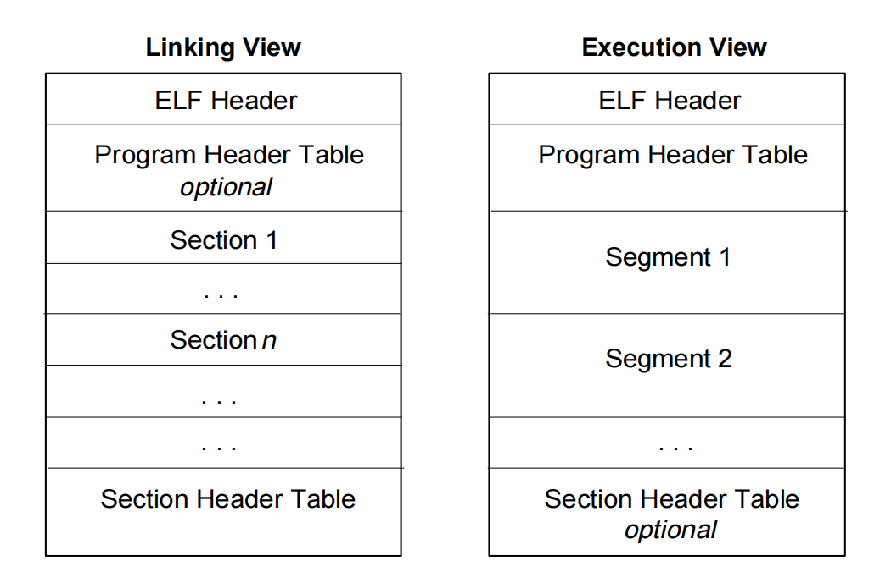

Linking View 链接视角其实就是**可重定位文件**的情况，**程序头部表（program header table）**部分标注了可选（optional），在Ubuntu Linux中验证发现可重定位文件实际没有这个部分。


Execution View 执行视角就是**共享对象文件**和**可执行文件**，它们的**程序头部表**部分是必须存在的，节头部表标注了可选（optional），在Ubuntu Linux中验证可执行文件中**程序头部表**和**节头部表都**是存在的。


并且，Execution View 中画的段（Segment）只是逻辑上的，**程序头部表**描述了有哪些段、每个段包含哪些节，文件中存在的实际还是 Section，只是根据**程序头部表内**的数据**，**可以将连续的多个 Section 看作一个 Segment。


所以，更实际地看，ELF文件的组成情况是这样的：

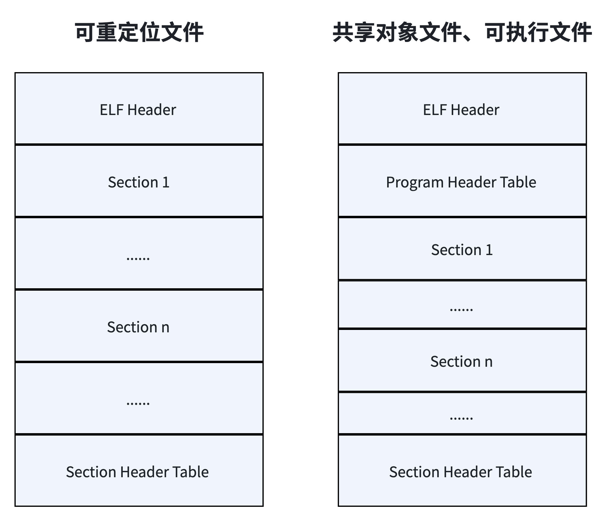

> 因为可重定位文件还需要经过链接生成共享对象文件或者可执行文件，它本身不会被直接装载到进程的虚拟内存空间，所以没有程序头表（program header table），而可执行文件和共享库文件会被装载到进程虚拟空间中，所以它们都有程序头表
> 

ELF文件组成之间的关联性，以可重定位文件为例，可以用下图总结：

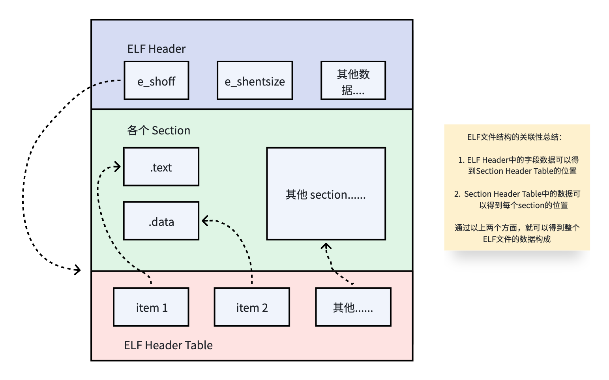

# 分析案例

这里写了两个简单的C源码文件，用于分析ELF文件内容（均在 **Linux ARM64 **操作）。

`main.c`文件：

```C
int global = 1; // 初始化的全局变量 
int global_uninit; // 未初始化的全局变量

int add(int a, int b); // 仅声明

void main() {
    static int static_var = 1; // 初始化的静态变量
    static int static_uninit_var; // 未初始化的静态变量
    
    int a = 1;
    int b = 2;
    int result = add(a, b); // 会调用 add.c 文件中的函数
}

```


`add.c`文件：

```C
// add.c
int add(int a, int b) {
    return a + b;
}
```


使用Clang编译器，生成可重定位文件，可以用于分析ELF文件格式和静态链接

```bash
clang -c main.c // 生成 main.o 可重定位文件
```

如果分析可执行文件，则执行以下命令生成可执行文件：

```bash
clang main.c add.c // 生成可执行文件
```

> 分析ELF文件内容，可以借助 Linux 中的 `readelf` 和 `objdump` 命令工具。
> 
> 如果要查看字节内容，可以使用 `xxd`命令，比如`xdd -p main.o`可以查看该文件的16进制形式内容。
>
> 也可以考虑使用GUI工具：https://github\.com/horsicq/XELFViewer


---

## 附件

这里把 main.o 文件的16进制内容放在这里，如果没有配置操作系统和编译环境，可以直接在这里查看。阅读后文内容时，有需要也可以返回到这里查看。


main.o 文件的16进制内容：

```Plain Text
7f454c460201010000000000000000000100b70001000000000000000000
000000000000000000003003000000000000000000004000000000004000
0c000100ff8300d1fd7b01a9fd43009128008052a8c31fb848008052e80b
00b9a0c35fb8e10b40b900000094e00700b9fd7b41a9ff830091c0035fd6
0100000001000000005562756e747520636c616e672076657273696f6e20
31382e312e332028317562756e74753129001000000000000000017a5200
017c1e011b0c1f002800000018000000000000003800000000440e20480c
1d109e029d04600c1f20480e00dedd000000000000000000000000000000
000000000000000000000000000000008c0000000400f1ff000000000000
000000000000000000000000000003000200000000000000000000000000
00000000bd0000000000020000000000000000000000000000000000b800
000000000400000000000000000000000000000000003f00000001000400
040000000000000004000000000000002800000001000500000000000000
00000400000000000000b300000000000500000000000000000000000000
00000000ae0000000000060000000000000000000000000000000000a900
000000000800000000000000000000000000000000004f00000012000200
000000000000000038000000000000008800000010000000000000000000
000000000000000000005400000011000400000000000000000004000000
000000001500000011000500040000000000000004000000000000002400
0000000000001b0100000b00000000000000000000001c00000000000000
050100000200000000000000000000000b002e72656c612e74657874002e
636f6d6d656e7400676c6f62616c5f756e696e6974002e627373006d6169
6e2e7374617469635f756e696e69745f766172006d61696e2e7374617469
635f766172006d61696e00676c6f62616c002e6e6f74652e474e552d7374
61636b002e6c6c766d5f61646472736967002e72656c612e65685f667261
6d6500616464006d61696e2e63002e737472746162002e73796d74616200
2e646174610024642e340024642e330024642e320024642e310024782e30
000000000000000000000000000000000000000000000000000000000000
000000000000000000000000000000000000000000000000000000000000
000000000000000000009300000003000000000000000000000000000000
000000006902000000000000c20000000000000000000000000000000100
000000000000000000000000000006000000010000000600000000000000
000000000000000040000000000000003800000000000000000000000000
000004000000000000000000000000000000010000000400000040000000
000000000000000000000000380200000000000018000000000000000b00
00000200000008000000000000001800000000000000a300000001000000
030000000000000000000000000000007800000000000000080000000000
000000000000000000000400000000000000000000000000000023000000
080000000300000000000000000000000000000080000000000000000800
000000000000000000000000000004000000000000000000000000000000
0c0000000100000030000000000000000000000000000000800000000000
000028000000000000000000000000000000010000000000000001000000
000000005b0000000100000000000000000000000000000000000000a800
000000000000000000000000000000000000000000000100000000000000
00000000000000007e000000010000000200000000000000000000000000
0000a8000000000000004000000000000000000000000000000008000000
000000000000000000000000790000000400000040000000000000000000
000000000000500200000000000018000000000000000b00000008000000
080000000000000018000000000000006b000000034cff6f000000800000
00000000000000000000680200000000000001000000000000000b000000
00000000010000000000000000000000000000009b000000020000000000
0000000000000000000000000000e8000000000000005001000000000000
010000000a00000008000000000000001800000000000000
```


main.o 文件的16进制内容，按各个部分隔开，便于查看（可以先阅读后面的内容再回来查看）：

```Plain Text
【ELF Header部分】：

7f454c46 02（表示64位） 01 01 00 EI_OSABI 00 EI_ABIVERSION 000000 00000000  0100（可重定位类型） b700（表示是ARM64） 01000000（e_version） 0000000000000000（e_entry）
0000000000000000 程序头表偏移，没有就为0   3003000000000000（节头表偏移，0x0330 也就是十进制816）  00000000（e_flags）  4000（文件头的大小） 
0000 程序头表的大小    0000 程序头表中表项的个数   4000 节头表中表项的大小  0c00  节头表中表项的个数  0100 e_shstrndx

------------------------------------------------------------------

【Sections部分】：

-- 1 -- .text section： 
ff8300d1fd7b01a9fd43009128008052a8c31fb848008052e80b
00b9a0c35fb8e10b40b900000094e00700b9fd7b41a9ff830091c0035fd6

-- 2 -- .data section：
0100000001000000

-- 3 -- .comment section：
005562756e747520636c616e672076657273696f6e20
31382e312e332028317562756e7475312900

-- 4 -- .eh_frame section：
1000000000000000017a5200
017c1e011b0c1f002800000018000000000000003800000000440e20480c
1d109e029d04600c1f20480e00dedd00000000000000

-- 5 -- .symtab section：
0000000000000000
000000000000000000000000000000008c0000000400f1ff000000000000
000000000000000000000000000003000200000000000000000000000000
00000000bd0000000000020000000000000000000000000000000000b800
000000000400000000000000000000000000000000003f00000001000400
040000000000000004000000000000002800000001000500000000000000
00000400000000000000b300000000000500000000000000000000000000
00000000ae0000000000060000000000000000000000000000000000a900
000000000800000000000000000000000000000000004f00000012000200
000000000000000038000000000000008800000010000000000000000000
000000000000000000005400000011000400000000000000000004000000
00000000150000001100050004000000000000000400000000000000

-- 6 -- .rela.text section：
2400000000000000 1b0100000b000000 0000000000000000

-- 7 -- .rela.eh_frame section：
1c0000000000000005010000020000000000000000000000

-- 8-- .llvm_addrsig section：
0b

-- 9 -- .strtab section：
002e72656c612e74657874002e
636f6d6d656e7400676c6f62616c5f756e696e6974002e627373006d6169
6e2e7374617469635f756e696e69745f766172006d61696e2e7374617469
635f766172006d61696e00676c6f62616c002e6e6f74652e474e552d7374
61636b002e6c6c766d5f61646472736967002e72656c612e65685f667261
6d6500616464006d61696e2e63002e737472746162002e73796d74616200
2e646174610024642e340024642e330024642e320024642e310024782e30
00

0000000000

------------------------------------------------------------------

【Section Header Table部分】：

// sht 表示 section header table，sht[index]表示其中的第几项

sht[0]： 000000000000000000000000000000000000000000000000
000000000000000000000000000000000000000000000000000000000000
00000000000000000000

sht[1]： 9300000003000000000000000000000000000000
000000006902000000000000c20000000000000000000000000000000100
0000000000000000000000000000

sht[2]： 06000000010000000600000000000000
000000000000000040000000000000003800000000000000000000000000
000004000000000000000000000000000000

sht[3]： 010000000400000040000000
000000000000000000000000380200000000000018000000000000000b00
00000200000008000000000000001800000000000000

sht[4]： a300000001000000
030000000000000000000000000000007800000000000000080000000000
0000000000000000000004000000000000000000000000000000

sht[5]： 23000000
080000000300000000000000000000000000000080000000000000000800
000000000000000000000000000004000000000000000000000000000000

sht[6]： 0c0000000100000030000000000000000000000000000000800000000000
000028000000000000000000000000000000010000000000000001000000
00000000

sht[7]： 5b0000000100000000000000000000000000000000000000a800
000000000000000000000000000000000000000000000100000000000000
0000000000000000

sht[8]： 7e000000010000000200000000000000000000000000
0000a8000000000000004000000000000000000000000000000008000000
000000000000000000000000

sht[9]： 790000000400000040000000000000000000
000000000000500200000000000018000000000000000b00000008000000
08000000000000001800000000000000

sht[10]： 6b000000034cff6f000000800000
00000000000000000000680200000000000001000000000000000b000000
0000000001000000000000000000000000000000

sht[11]： 9b000000020000000000
0000000000000000000000000000e8000000000000005001000000000000
010000000a00000008000000000000001800000000000000
```


# ELF Header

ELF Header是 ELF 文件的第一部分，源码中它的内容定义如下：

[Linux64位系统ELF Header数据结构源码](https://github.com/torvalds/linux/blob/master/include/uapi/linux/elf.h#L241)

```C
#define EI_NIDENT        16

typedef struct elf64_hdr {
  unsigned char        e_ident[EI_NIDENT];        // 16 个字节
  Elf64_Half e_type;                              // 2 个字节
  Elf64_Half e_machine;                           // 2 个字节
  Elf64_Word e_version;                           // 4 个字节
  Elf64_Addr e_entry;                             // 8 个字节
  Elf64_Off e_phoff;                              // 8 个字节
  Elf64_Off e_shoff;                              // 8 个字节
  Elf64_Word e_flags;                             // 4 个字节
  Elf64_Half e_ehsize;                            // 2 个字节
  Elf64_Half e_phentsize;                         // 2 个字节
  Elf64_Half e_phnum;                             // 2 个字节
  Elf64_Half e_shentsize;                         // 2 个字节
  Elf64_Half e_shnum;                             // 2 个字节
  Elf64_Half e_shstrndx;                          // 2 个字节
} Elf64_Ehdr;
```

根据源码定义的结构，可以看出Linux 64位系统的 ELF Header 部分总共有64个字节，按顺序就可以依次得到每个字段的数据。

main.o 文件的前64个字节如下：

```Plain Text
7f454c460201010000000000000000000100b700010000000000000000000000 
000000000000000030030000000000000000000040000000000040000c000100
```


下面👇我们按顺序逐个分析：

## e_ident

e_ident是 header 的第一部分，总共是16个字节，它的内容是：7f454c46 02 01 01 00 00  000000 00000000 


它分为如下几个部分：

- EI_MAG

前4个字节 7f454c46 为魔数：第一个字节固定为0x7F，后面3个字节就是E、L、F的ASCII码


- EI_CLASS

第5个字节为02，表示为64位类型

|名称|值|含义|
|---|---|---|
|ELFCLASSNONE|0|不合法类型|
|ELFCLASS32|1|32位类型|
|ELFCLASS64|2|64位类型|


- EI_DATA

第6个字节为01，表示小端字节序

|名称|值|含义|
|---|---|---|
|ELFDATANONE|0|非法数据编码|
|ELFDATA2LSB|1|表示小端字节序（Little Endian），低位字节存储在低地址|
|ELFDATA2MSB|2|表示大端字节序（Big Endian），高位字节存储在低地址|

- EI_VERSION

第7个字节为01，表示ELF文件header的版本号


- EI_OSABI

第8个字节为00，标识此文件使用的特定于 OS 或 ABI 的 ELF 扩展，如果没有使用扩展则为0。没有使用扩展则表示遵循 Unix-System V ABI（应用程序二进制接口），这是最通用的 ABI 标识符，意味着该文件没有特定于某个操作系统的 ABI 扩展，通常用于最大程度的兼容性。


- EI_ABIVERSION

第9个字节为00，指示特定 ABI 的版本号，没有使用则为0


- EI_PAD

后面7个字节补0，用于确保 e_ident 数组的长度达到 16 字节


## e_type

然后就是 e_type，表示 ELF 文件的类型：

|名称|值|含义|
|---|---|---|
|ET_NONE|0|无文件类型|
|ET_REL|1|可重定位文件|
|ET_EXEC|2|可执行文件|
|ET_DYN|3|共享对象文件|
|ET_CORE|4|核心转储文件。包含程序在崩溃时的内存映像，用于调试|

字节为`0100`，因为是小端字节序，所以就是0x0001，也就是可重定位类型


## e_machine

表示 ELF 文件对应的处理器架构，main.o 中的对应字节为`b700`，当前是在Linux arm64平台，0x00b7 对应ARM64（10进制为183）

[Linux中定义的机器类型](https://github.com/torvalds/linux/blob/master/include/uapi/linux/elf-em.h)


## e_version

表示ELF文件版本，main.o 中的对应字节为`01000000`，也就是版本为1


## e_entry 

表示入口点虚拟内存地址，对应字节为`0000000000000000`，因为 main.o 是可重定位文件，并不是可执行文件，所以目前没有实际的入口地址，则全部置0


## e_phoff

表示程序头表（Program header table）在文件中的偏移位置，对应字节为`0000000000000000`， 因为main.o 可重定位文件没有这个部分，所以全部为0。（后文的【可执行文件的装载和进程】段落会介绍程序头表的内容）


## e_shoff

表示 Section header table 在文件中的偏移位置，对应字节为`3003000000000000`，所以 main.o 文件的节头部表的起始位置为 0x0330，也就是十进制的 816 字节位置。在下一段中会分析 Section header table 的内容。


## e_flags

与处理器相关的标志，具体含义依赖于目标架构，main.o 文件中的对应字节为`00000000`


## e_ehsize

文件头部（ELF Header）的大小，对应字节为`4000`，也就是十进制的64字节，表示 main.o 文件中的头部长度为64字节，和我们前面根据源码定义的结构体计算的结果一样。


## e_phentsize

程序头表的大小，对应字节为`0000` ，因为 main.o 可重定位文件没有程序头表


## e_phnum

程序头表中表项的个数，字节同样为`0000` ，因为 main.o 没有程序头表


## e_shentsize

section header table 中表项的大小，对应字节为`4000`，表示 main.o 中每个节头表项大小都是十进制的64字节


## e_shnum

section header table 中表项的个数，对应字节为`0c00` ，表示 main.o 的 section header table 中有12个表项


## e_shstrndx

字符串表项在section header table中的索引，对应字节为`0100`，表示在section header table的第0x0001项为字符串表项。（后文中会介绍字符串表）


## 命令工具查看

根据数据结构和字节序列手动分析完 ELF Header 部分，我们再使用命令`readelf -h main.o`查看 main.o 的文件头数据，可以看到和我们自己分析的结果一样：

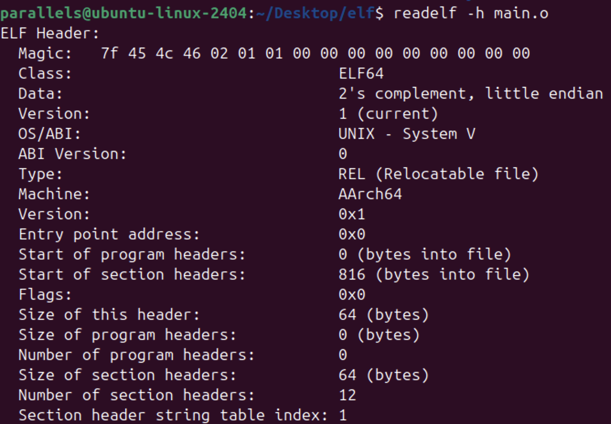


总的来看，ELF Header 的内容就是对ELF文件的整体描述。

# Section Header Table

Section Header Table 描述了各个 Section 的相关信息。


通过 ELF header 中的 e_shoff 我们已经知道偏移为816字节的位置就是 section header table 的开始位置，e_shentsize 表示table中每个item的大小为64字节。


也就是说，从 main.o 文件的816字节偏移开始，每64个字节都是一个section header item。比如 index 为0的 item 的字节范围为 [816, 879]，index 为1的 item 字节范围为 [880, 943]，index 为2的 item 字节范围则为 [944, 1007]，依此类推。（但要注意的是，**偏移是从0开始的**，所以例如 index 为0 的 item 范围为 [816, 879]，那么它的数据就是第 817 个字节到第 880个字节）


> （在【附件】中可以看到，Section Header Table 的内容位于 main\.o 文件的末尾部分）
> 


每一项的数据结构 Section Header 的源码定义如下：

```C
typedef struct elf64_shdr {
  Elf64_Word sh_name;                /* Section name, index in string tbl */
  Elf64_Word sh_type;                /* Type of section */
  Elf64_Xword sh_flags;                /* Miscellaneous section attributes */
  Elf64_Addr sh_addr;                /* Section virtual addr at execution */
  Elf64_Off sh_offset;                /* Section file offset */
  Elf64_Xword sh_size;                /* Size of section in bytes */
  Elf64_Word sh_link;                /* Index of another section */
  Elf64_Word sh_info;                /* Additional section information */
  Elf64_Xword sh_addralign;        /* Section alignment */
  Elf64_Xword sh_entsize;        /* Entry size if section holds table */
} Elf64_Shdr;
```


因为每一项的结构都是一样的，所以我们选择其中一项来分析即可，本文**选择 index 为 2 的section**，也就是 main\.o 文件的字节偏移范围  \[944, 1007\]，也就是第 945 到第 1008 的字节范围，并根据数据结构定义，给各个字段的字节之间加上空格分隔开，方便查看：

```C
06000000 01000000 0600000000000000 0000000000000000 4000000000000000
3800000000000000 00000000 00000000 0400000000000000 0000000000000000
```

## sh_name

字节为`06000000`，表示section的名称索引，需要用这个index到字符串表section中去查找。

可以在本文下一段的字符串表 .strtab 中去查看，`06000000`也就表示是从 index 开始到分隔符00之前的字节对应的字符串，即`2e74657874`，ASCII码也就是 .text，.text段就是常说的代码段，会存储ELF中的机器指令。

所以，index 为 2 的 section 就是名称为 .text 的section。


## sh_type

字节为`01000000`，表示section的类型，.text section 的类型就是 SHT_PROGBITS（程序指令）

|名称|值|含义|
|---|---|---|
|SHT_NULL|0|无效|
|SHT_PROGBITS|1|包含程序指令信息|
|SHT_SYMTAB|2|符号表|
|SHT_STRTAB|3|字符串表|
|SHT_RELA|4|表示带显式添加数的重定位表段|
|SHT_HASH|5|符号哈希表|
|SHT_DYNAMIC|6|包含动态链接信息|
|SHT_NOTE|7|包含文件某些方面的信息|
|SHT_NOBITS|8|不占用文件空间，比如bss段|
|SHT_REL|9|表示不带显式添加数的重定位表段|
|SHT_SHLIB|10|保留类型，未使用|
|SHT_DYNSYM|11|动态链接的符号表|


## sh_flags

section的标志，本例中为 `0600000000000000`，也就是 SHF_ALLOC 和 SHF_EXECINSTR 的或运算结果，表示 .text 包含可执行的机器指令，并且进程需要给 .text 分配虚拟内存。

|名称|值|含义|
|---|---|---|
|SHF_WRITE|0x1|表示节的数据在进程执行期间可写，例如全局变量或静态变量所在的节，加载时，这些节需要分配可写的内存区域|
|SHF_ALLOC|0x2|表示节在进程执行期间需要占用内存，比如数据段|
|SHF_EXECINSTR|0x4|表示节包含可执行的机器指令，比如数据段|
|SHF_RELA_LIVEPATCH|0x00100000|用于标记节包含实时补丁相关的数据或代码。实时补丁是一种在程序运行时动态更新代码或数据的技术|
|SHF_RO_AFTER_INIT|0x00200000|表示节在初始化后变为只读|
|SHF_MASKPROC|0xf0000000|保留类型|

> 在可执行文件的装载和进程部分，可以了解到 \.text 会装载到内存中
> 


## sh_addr

表示section在进程内存中的虚拟地址，对应字节为`0000000000000000`，因为 main.o 是可重定位目标文件，还没有确定虚拟内存地址，所以 .text 的虚拟地址为0


## sh_offset

表示section内容在文件中的字节偏移量，因为Section Header Table 的每一项只是描述一个 Section 的基本信息，但它的具体内容存储在文件的其他位置。.text section的对应字节为`4000000000000000`，也就是说 .text section 的内容从 0x0040 字节偏移位置开始。


## sh_size

表示section内容在文件中的字节长度，通过 sh_offset 和 sh_size 就可以知道section的范围了。.text section的对应字节为`3800000000000000`，所以 .text section长度是0x38个字节。


> 如果 sh_type 类型是NOBITS，则该 section 不会占用文件空间，即使sh_size不为0
> 


## sh_link 和 sh_info

sh_link 表示当前 section 关联的另一个 section 的 index，.text section的 sh_link 字节为`00000000`，具体的解释依赖于 sh_type；

sh_info 表示 section的额外信息，.text section 的 sh_info 字节为 `00000000` ，具体的解释也依赖于 sh_type。


解释如下：

|sh_type|sh_link|sh_info|
|---|---|---|
|SHT_DYNAMIC|该节使用的字符串表在节头表中的index|0|
|SHT_HASH|该节使用的符号表在节头表中的index|0|
|SHT_REL|该节使用的符号表在节头表中的index|应用这个重定位表的节在<br>节头表中的index|
|SHT_RELA|||
|SHT_SYMTAB|具体含义由操作系统定义|具体含义由操作系统定义|
|SHT_DYNSYM|||
|其他|SHN_UNDEF|0|

比如 .text section 的类型为 SHT_PROGBITS，也就是表中的“其他”，所以 sh_info 为0


> 这里没有逐个分析其他 section header 的内容，下文会直接通过命令行查看 section header table 的全部内容，可以看到比如 .rela.text 的 sh_type 为 SHT_RELA，sh_link 为 11，section header table 中 index 为 11 的 section 就是 .symtab 符号表，因为重定位表section需要用到符号表section中的符号信息；而 sh_info 为 2，说明使用这个 .rela.text  重定位表的 section 为 section header table 中 index 为 2 的 .text section。
> 


## sh_addralign

有些section有地址对齐的约束

1. **内存对齐**：

    在程序加载到内存时，操作系统会根据 `sh_addralign` 字段的值分配内存，使节的起始地址满足对齐要求。这对于提高内存访问效率和性能非常重要，特别是在处理器对齐要求较高的情况下。

2. **文件对齐**：

    在链接和生成可执行文件时，链接器会根据 `sh_addralign` 字段的值安排节在文件中的位置，使节的起始偏移满足对齐要求。这对于确保文件结构的正确性和提高文件访问效率非常重要

.text段的对齐要求的字节为 `0400000000000000` ，即4个字节


## sh_entsize

有些section内部包含一定数量的entry，比如符号表，这个字段表示每个entry的字节大小。.text 的对应字节为 `0000000000000000`，因为.text段内的数据不是数组的数据组织方式，所以为0。


> 比如 section header table 的数据就是连续的 elf64_shdr 数据结构字节序列，每个 elf64_shdr 的长度为64字节，一个 elf64_shdr 数据就是一个 entry，下文中介绍的符号表也是这种数据组织方式，只不过符号表中每个 entry 的数据结构为 elf64_sym。
> 


## 命令工具查看

使用`readelf -S main.o`可以查看 main.o 文件中的 section header table 的内容，比如我们通过字节数据和定义的数据结构分析的 .text 内容，就位于打印结果的第[2]项，得到的结果和这里通过命令行工具查看的结果一致，同时，我们也可以看到其他的section header内容：


# Section

Section Header Table描述了每个section的基本信息，我们就可以通过其中的 sh_offset 字节偏移和 sh_size 字节大小，得到每个section在ELF文件的字节范围。每个 section 有自己的内容格式，这里就以几个典型的 section 为例，查看它们的内容：


## 代码段 .text

代码段的作用就是存储程序指令，main.c 源文件编译后生成的 main.o 文件就把编译后的指令放在了这里。


通过 Section Header Table 中的信息，可以知道 .text 的起始位置偏移为 0x40，长度为 0x38，也就是如下字节：

```Plain Text
// 加了空格分隔

ff8300d1 fd7b01a9 fd430091 28008052 a8c31fb8 48008052 e80b00b9
a0c35fb8 e10b40b9 00000094 e00700b9 fd7b41a9 ff830091 c0035fd6
```


再使用命令行工具查看，和上面的字节数据完全对应（要注意顺序为小端字节序）：

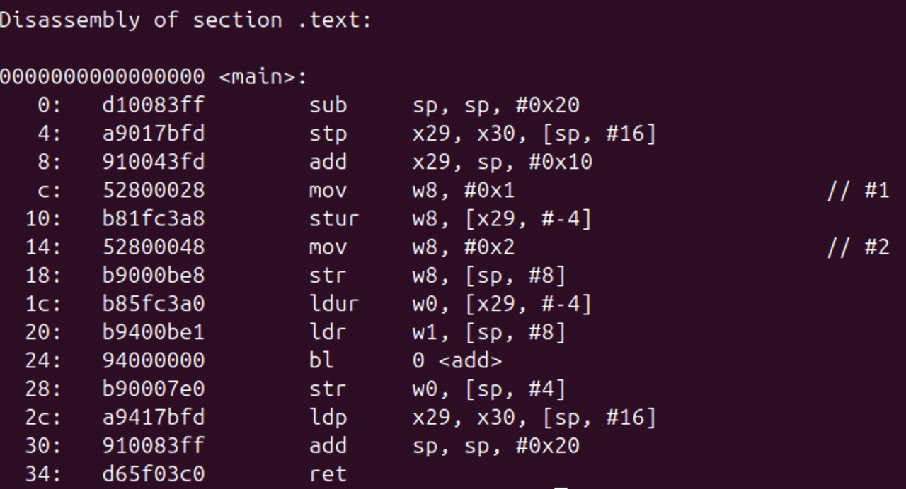


## 数据段 .data

数据段会存储已初始化的全局变量和静态变量的值。


我们先使用命令工具查看 .data 的内容：

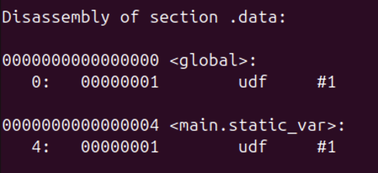


再查看 .data 的字节数据：`01000000 01000000`，因为是小端字节序，所以就是0x00000001，和命令工具打印的结果一致。


> .data 的字节数据并没有变量名称，为什么命令工具打印的结果知道变量名称？这就是下面介绍的符号表 .symtab 的作用之一
> 


## 字符串表 .strtab

字符串表用于存储ELF文件中符号和section等对应的字符串名称，在ELF文件中设计这个字符串表，主要有以下目的：

1. 节省空间：可以避免重复字符串存储，减少文件体积

2. 方便管理：为符号、节名等提供一个集中的存储位置和标准化的查找方式，便于编译器、链接器、调试器等工具管理和使用

3. 统一寻址：ELF中需要字符串的地方，都可以使用一个保存字符串在字符串表中的偏移量的变量即可，这个变量的类型统一，类型的字节长度也是确定的，利于数据结构的设计


根据 Section Header Table 中的信息，可以得到 .strtab 的字节数据：

```Plain Text
// 这里是 main.o 的 .strtab 的内容，是各个字符的ascii码，
// 字符串表的首尾和每个字符串之间都使用空字符（0x00）来间隔，所以这里加了空格分隔方便阅读

00 2e72656c612e74657874 00 2e636f6d6d656e74 00 676c6f62616c5f756e696e6974
00 2e627373 00 6d61696e2e7374617469635f756e696e69745f766172
00 6d61696e2e7374617469635f766172 00 6d61696e 00 676c6f62616c 
00 2e6e6f74652e474e552d737461636b 00 2e6c6c766d5f61646472736967 
00 2e72656c612e65685f6672616d65 00 616464 00 6d61696e2e63 00 2e737472746162
002e73796d746162 00 2e64617461 00 24642e34 00 24642e33 00 24642e32
00 24642e31 00 24782e30 00

// 比如 第一个内容为 .rela.text
// 0x00 -> 空字符
// 0x2e -> .
// 0x72 -> r
// 0x65 -> e
// 0x6c -> l
// 0x61 -> a
// 0x2e -> .
// 0x74 -> t
// 0x65 -> e
// 0x78 -> x
// 0x74 -> t
```


命令行工具查看如下：

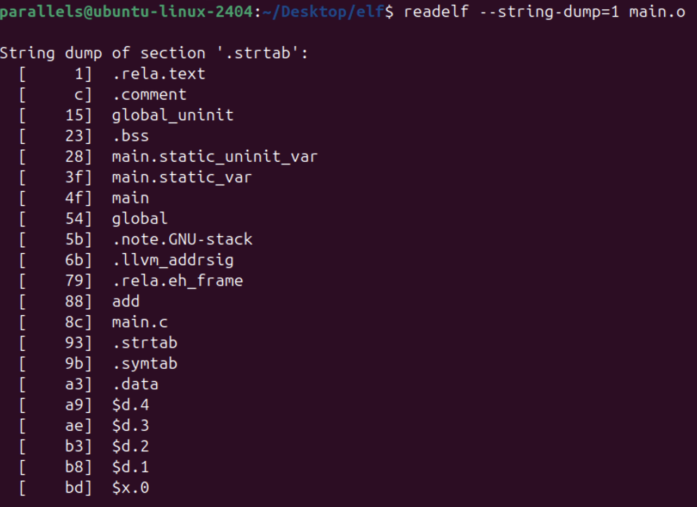


## 符号表 .symtab

ELF文件中，符号表（Symbol Table）存储了程序中所有符号的信息，比如每个符号的名称、类型、绑定属性、可见性、所在section等。


我们这里先使用命令行工具查看 main.o 文件的符号表内容，符号表中包含了14条数据，每个数据都对应一个符号的相关信息：

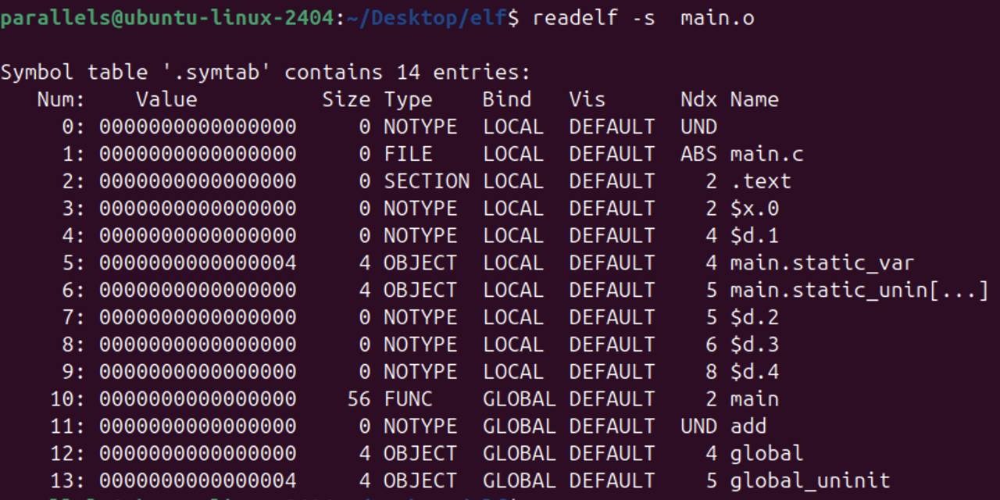


64位系统中，符号表中的每一项数据的数据结构定义都是 `Elf64_Sym` 类型，每个item长度为24个字节，符号表的内容就是若干个连续的 Elf64_Sym 数据。

```C
// 数据结构定义：

typedef struct elf64_sym {
  Elf64_Word st_name;                /* Symbol name, index in string tbl */
  unsigned char        st_info;        /* Type and binding attributes */
  unsigned char        st_other;        /* No defined meaning, 0 */
  Elf64_Half st_shndx;                /* Associated section index */
  Elf64_Addr st_value;                /* Value of the symbol */
  Elf64_Xword st_size;                /* Associated symbol size */
} Elf64_Sym;
```

可以看到数据结构中的字段对应了使用命令工具看到的信息。


下面是每个字段的含义：

- **st_name**：4个字节，表示符号名称在字符串表中的索引，0表示无名称

- **st_info**：1个字节**，**`st_info` 字段包含两个部分：低4位为符号类型，高4位为绑定属性

|**符号类型**|值|含义|
|---|---|---|
|STT_NOTYPE|0|未指定类型，通常用于编译器和链接器内部使用的临时符号或在符号类型不明确的情况下使用。|
|STT_OBJECT|1|程序中的全局变量或静态变量（变量、数组等）|
|STT_FUNC|2|函数或者其他可执行代码|
|STT_SECTION|3|表示一个section的符号，这种类型的符号主要用于重定位|
|STT_FILE|4|文件符号通常表示源文件的名称，用于记录目标文件是由哪个源文件编译而来的，它一定是 STB_LOCAL 类型，并且它的 st_shndx 一定是SHN_ABS|

|**绑定属性**|值|含义|
|---|---|---|
|STB_LOCAL|0|局部符号，不可见于其他文件|
|STB_GLOBAL|1|全局符号，可见于所有文件|
|STB_WEAK|2|弱符号，类似于全局符号，但优先级较低|

- **st_other**：1个字节，其他信息，通常为 0

- **st_shndx**：2个字节，如果符号定义在本目标文件中，那么这个成员表示符号所在的section的index，如果符号不是定义在本目标文件中，或者对于有些特殊符号，那么st_shndx的值表示以下含义：

|st_shndx特殊值名称|值|含义|
|---|---|---|
|SHN_UNDEF|0|表示未定义的符号，这个符号在本目标文件被引用，但定义在其他目标文件中|
|SHN_LIVEPATCH|0xff20|标记实时补丁相关的节索引。实时补丁是一种在程序运行时动态更新代码或数据的技术|
|SHN_ABS|0xfff1|表示该符号包含了一个绝对值，比如表示文件名的符号，不会被重定位|
|SHN_COMMON|0xfff2|用于表示未初始化的全局变量，在链接时会被分配到 `.bss` 段|

- st_value：8个字节，符号的值

    - 在**可重定位文件**中，如果符号是SHN_COMMON类型，那么st_value表示该符号的对齐属性；如果不是SHN_COMMON类型，st_value表示符号在段中的偏移，即符号对应的函数或变量位于 st_shndx对应的section中偏移st_value的位置

    - 在**可执行文件和共享目标文件**中，st_value表示符号的虚拟地址

- st_size：8个字节，符号的字节大小，对于函数符号，`st_size` 是函数的大小；对于数据对象符号，`st_size` 是变量的大小。其他类型为0


根据 Section Header Table 中的数据可以得到 .symtab section的字节内容，我们根据 Elf64_Sym 的定义，添加空格分隔，便于阅读：

```Plain Text
00000000 00 00 0000 0000000000000000 0000000000000000
8c000000 04 00 f1ff 0000000000000000 0000000000000000 
00000000 03 00 0200 0000000000000000 0000000000000000
bd000000 00 00 0200 0000000000000000 0000000000000000
b8000000 00 00 0400 0000000000000000 0000000000000000
3f000000 01 00 0400 0400000000000000 0400000000000000
28000000 01 00 0500 0000000000000000 0400000000000000
b3000000 00 00 0500 0000000000000000 0000000000000000
ae000000 00 00 0600 0000000000000000 0000000000000000
a9000000 00 00 0800 0000000000000000 0000000000000000
4f000000 12 00 0200 0000000000000000 3800000000000000
88000000 10 00 0000 0000000000000000 0000000000000000
54000000 11 00 0400 0000000000000000 0400000000000000
15000000 11 00 0500 0400000000000000 0400000000000000
```

我们结合字节数据、数据结构定义和命令工具打印的结构，验证一下：


1. 第12项数据 add：`88000000 10 00 0000 0000000000000000 0000000000000000`

    - st_name 为`88000000`，字符串表 .strtab 中 0x88 位置的字符串就是 add，说明符号为add。

    - st_info 为`10`，二进制就是 00010000，高4位为1，所以绑定属性为 Global，低4位为0，所以类型为NOTYPE

    - st_other 为`00`

    - st_shndx 为`0000`，表示 SHN_UNDEF，说明 add 定义在外部

    - st_value 为 `0000000000000000`，可重定位文件并且类型为 SHN_UNDEF 的情况下，st_value表示符号所在section的偏移，但 add 是外部符号，还没有链接重定位，所以目前为0

    - st_size 为 `0000000000000000`，链接前类型为 SHN_UNDEF，所以为0


2. 第13项数据 global：`54000000 11 00 0400 0000000000000000 0400000000000000`

    - st_name 为`54000000`，字符串表 .strtab 中 0x54 位置的字符串就是 global，说明符号为 global。

    - st_info 为`11`，二进制就是 00010001，高4位为1，所以绑定属性为 Global，低4位为1，所以类型为 OBJECT，表示 global 是一个全局或静态变量

    - st_other 为`00`

    - st_shndx 为`0400`，表示 global 所在section的 index，也就是 .data section，因为已初始化的全局变量会放在 .data 中

    - st_value 为 `0000000000000000`，可重定位文件并且类型为 OBJECT 的情况下，st_value表示符号所在section的偏移，global是 .data 中的第一个数据，所以偏移为0

    - st_size 为 `0400000000000000`，表示 global 的数据长度为4个字节


可以看到都和命令工具打印的结果完全对应上。


其他符号，比如 `global_uninit` 和 `main.static_var` 等，这里就不一一分析了，直接查看命令工具打印的结果即可，比如 `global_uninit` 的 bind 为 GLOABL（全局），类型为 OBJECT（变量），它所在的section index 为 5，即 .bss，未初始化的全局变量和静态变量都会放在这里。


关于**符号（Symbol）**：ELF的符号起源于汇编语言中的符号或者标签的概念，经过标准化和扩展，成为ELF文件中的重要组成，编译器会为函数、全局变量、局部静态变量等生成对应的符号，符号可以用于文件内和多模块文件之间的地址重定位以及其他作用。


比如 `main.o` 的 `.text section` 中调用 add 函数的指令，访问的地址是0，因为 add 是外部函数，还需要和 add\.c 生成的 add\.o 文件链接后才能确定地址，所以 add 符号就到了这个对应关系的作用，链接时会合并 main\.o 和 add\.o 的信息，调用 add 函数的指令现在就可以重新设置地址偏移。


符号还可以用于调试和其他更多的扩展用途，比如符号表中看到的 $x $d 这种奇怪的符号，就是 ARM 架构特有的，可以查看文档了解它们的作用：

https://github.com/ARM-software/abi-aa/blob/main/aaelf64/aaelf64.rst#565mapping-symbols


> static_var静态变量对应的符号为 main.static_var，这涉及到编译器的功能之一：符号修饰机制和函数签名，可以调整符号的名称，用于避免编译后的变量和函数的符号名称相同，或者其他作用。比如C++的命名空间、重载等特性就利用了符号修饰和函数签名来实现，extern "C"就是C++为了避免符号修饰导致无法正确和C语言中的符号对应上而产生的。
> 


## 重定位表 .rela.text

链接器在处理目标文件时，需要对代码段和数据段中那些对绝对地址的引用的位置进行重定位。这些重定位的信息都记录在ELF文件的重定位表中，对于每个需要重定位的代码段和数据段都会有一个相应的重定位表。比如main.o中的 .rela.text 就是针对 .text 段的重定位表，因为 .text 段中至少有一个绝对地址的引用，而 .data 段没有对绝对地址的引用，所以 mian.o 中只有针对 .text 段的重定位表。


一个重定位表同时也是ELF的一个section，里面的每一条数据都对应一个需要重定位的位置，通过每条数据就可以知道需要对哪些数据执行重定位操作。


重定位表类型为 SHT_RELA （重定位表还有 SHT_REL 这种类型），数据结构如下：

```C
typedef struct elf64_rela {
  Elf64_Addr r_offset;        /* Location at which to apply the action */
  Elf64_Xword r_info;        /* index and type of relocation */
  Elf64_Sxword r_addend;        /* Constant addend used to compute value */
} Elf64_Rela;
```

- **r_offset**：表示需要重定位的位置偏移。对于**可重定位文件**来说，这个值就是要修正的位置的第一个字节相对于所在段起始位置的偏移；对于**可执行文件或共享对象文件**来说，这个值是该重定位入口所要修正的位置的第一个字节的虚拟地址。

- **r_info**：重定位入口的类型和符号，低32位表示重定位入口的类型，高32位表示重定位入口的符号在符号表中的index。

- **r_addend**：用于偏移修正


main.o的重定位表内容：

```Plain Text
2400000000000000 1b010000 0b000000 0000000000000000
```

- r_offset ：偏移就是 0x24

- r_info：

    - 低32位对应的类型为0x011b，十进制为283，可以在https://github.com/torvalds/linux/blob/master/arch/arm64/include/asm/elf.h#L55 源码中看到 ARM64 架构的类型定义，也就是 `R_AARCH64_CALL26`

    - 高32位对应的 index 为0x0b，也就是 index 为11的 `add` 符号

- r_addend 为0


使用命令工具查看重定位表的结果，和上面分析的结果一致。

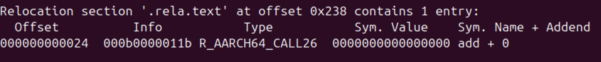


### 重定位表的再验证

main.c 的源码中，只有 add 是需要重定位的，所以重定位表中只有一项 add。我们这里编写一个 main2.c 文件，在 main.c 的基础上再增加了一些代码，查看稍微复杂一些的情况下，重定位表的内容。

```C
int global = 1;         // 已初始化的全局变量 → .data 段
int global_uninit;      // 未初始化的全局变量 → .bss 段

int add(int a, int b); // 仅声明

void main() {
    static int static_var = 1;         // 已初始化的静态变量 → .data 段
    static int static_uninit_var;      // 未初始化的静态变量 → .bss 段
    
    
    /* ---------- 增加这4行代码，验证重定位表的变化 ------- */
    global = 33;
    global_uninit = 32;
    static_var = 23;
    static_uninit_var =22;
    /* ----------------------------------------------- */

    int a = 1;
    int b = 2;
    int result = add(a, b); // 会调用 add.c 文件中的函数
}

/* ---------- 增加这个函数，也访问全局变量 ---------------- */
int foo() {
    global = 55;
    global_uninit = 54;
}
/* --------------------------------------------------- */
```

对应 .text 如下：

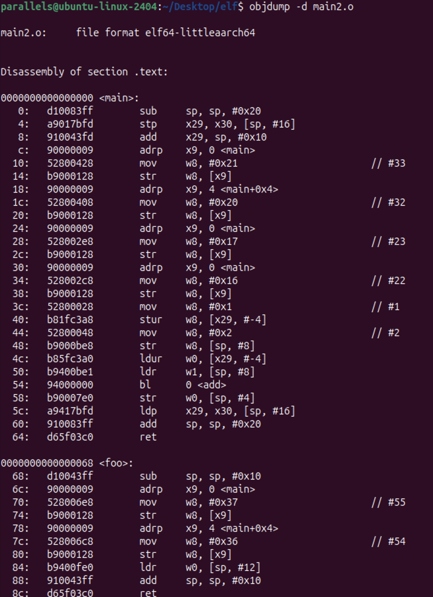


符号表增加了 .data 和 .bss 和 foo：

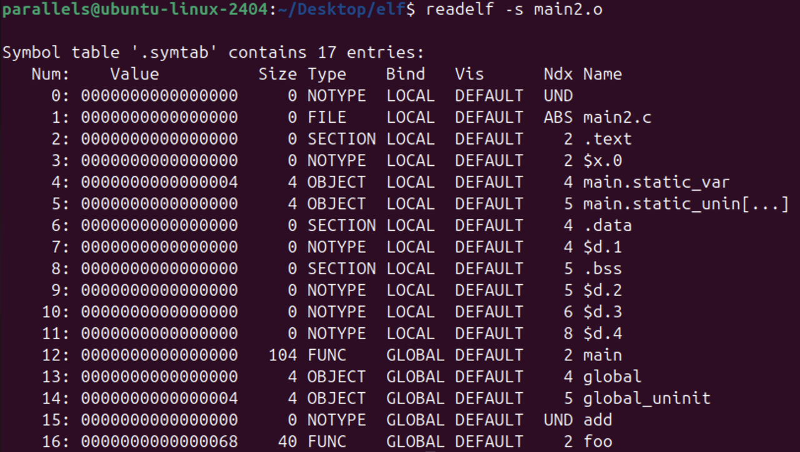


重定位表中增加了`R_AARCH64_ADR_PREL_PG_HI21`和`R_AARCH64_LDST32_ABS_LO12_NC`类型的数据（对ELF文件格式和链接过程的理解只需要知道这些类型也是用来重定位的就行了，这里不深究这些类型具体的含义）

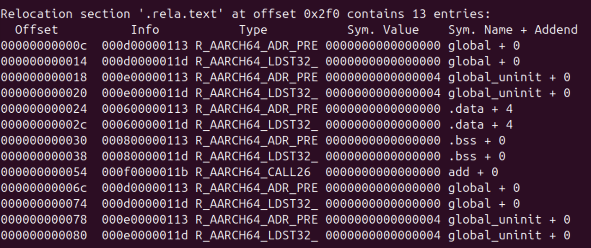

比如第一和第二条数据： offset 为 0x0c 和 0x14 的 说明 main 函数指令的 0x0c 和 0x14 偏移位置需要重定位，并且对应的是 global 变量的赋值操作（赋值操作分为多条机器指令执行）


最后两条数据：offset 为 0x78 和 0x80 对应 foo 函数指令的偏移位置，也就是对 global_uninit 全局变量的赋值操作指令需要重定位。


## 常见的Section类型

- .bss：用于存储未初始化的全局变量和静态变量。它在编译时不占用文件空间，而是在程序加载到内存时由操作系统初始化为零

- .comment：用于存储编译器或链接器生成的注释信息。它通常包含编译器的版本信息、编译选项等。

- .data：包含已初始化的变量值

- .debug：包含符号化的调试信息，内容未规定。所有前缀为.debug的section均为系统保留使用

- .dynamic：包含动态链接相关信息。.o后缀的可重定位目标文件没有这个section

- .hash：包含符号哈希表

- .line：包含用于调试的行号信息，描述源码和机器码之间的对应关系

- .strtab：字符串表

- .symtab：符号表

- .text：包含程序指令

- .rela.text：重定位段

- .eh_frame：用于异常处理与栈回溯

- .rela.eh_frame：.eh_frame的重定位表

- .init 和 .fini ：.init 和 .finit的代码分别会在main函数之前和之后执行

- ...

不同类型的 section 的都有各自的数据内容形式，除了一些最常见的section，其他的可以用到时再具体了解


> 包含点前缀的section名称为系统使用，用户可以自定义没有点前缀的section名称，避免和系统冲突
> 


# 静态链接

**前面几个部分，都是在介绍ELF的格式内容，略显枯燥，但从介绍静态链接开始，就可以更直观地感受到它们发挥的作用了 🫣🫣🫣🫣🫣🫣🫣🫣🫣🫣🫣🫡🫡🫡🫡🫡🫡🫡🫡🫡🫡🫡**


前面以 main.o 这个可重定位文件为分析目标，基本了解了ELF文件的结构。现在来看使用可重定位文件完成静态链接的过程。


链接器会执行两步操作：

1. 空间与地址分配：解析所有的输入目标文件，获得它们的各个段（这里不明确区分节和段）的长度、属性和位置，根据类别合并所有输入目标文件的段，比如所有的\.text段合并为一个\.text段，并将输入目标文件的符号表合并为一个全局符号表，

2. 符号解析和重定位：读取输入文件中段的数据、重定位信息，执行符号解析和重定位、调整代码中的地址等。第二步为链接的核心，特别是重定位操作。


## 合并段和分配段的虚拟地址

我们来实际操作一下，看看链接操作前后的虚拟地址变化情况。

```C
// 通过clang -c 得到 main.o add.o
clang -c main.c add.c


// 使用 ld 链接器，-e main 表示将main作为程序入口，ld链接器默认的程序入口为_start
ld add.o main.o -e main -o a.out
```

> clang 完成链接工作也是依赖 ld 链接器，但这里特意直接使用 ld 链接器来完成链接，因为如果直接使用clang，它内部调用 ld 时会设置很多参数，导致生成的可执行文件中包含额外的很多内容（但却是必要的），目前暂不关心它们，所以直接使用 ld 生成更“干净”的可执行文件。
> 
> 而由于我们自己调用 ld 链接器，没有设置完整的参数，所以这个a\.out实际不能成功执行，因为完整的可执行程序还需要链接其他库，可以通过 `clang --verbose main.o add.o -o a.out` 看到生成实际可执行的文件，设置了很多参数，比如还链接了其他的一些库。
> 


执行上述命令后，对比main.o、add.o 和 a.out 的部分section的 Address 这一列的地址变化：


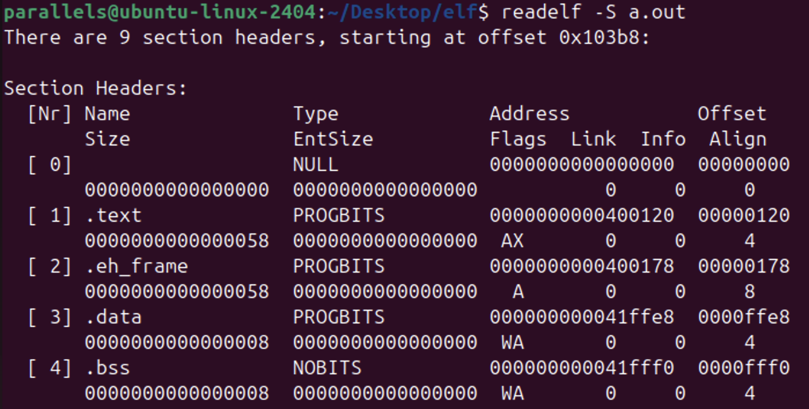

main.o 和 add.o 中的 .text、.data 和 .bss 段的虚拟地址都是0，而生成的 a.out 则为这3个段都分配了虚拟内存地址，并且相同名称的段合并在一起了。而且 main.o 的.text 段的size为0x38，add.o的.text段的size为0x20，a.out 的.text段的size为0x58。**说明链接操作会合并相同类型的段和分配段的虚拟地址。**


## 符号地址的确定

同时，符号表中的地址（value 这一列）也会发生变化，可以对比main.o 和 a.out 的符号表差别：


`main.o`中的main符号的地址为0，而在`a.out`中，main的地址为0x400140，可以在下图中看到.text段中的main方法地址就是 0x400140：


**以上情况说明了链接过程会确定符号的地址**


## 符号解析和重定位

再对比上面👆两个图，也可以看到 main.o 中调用 add 方法的 bl 指令，跳转地址为0，而a.out中已经设置了有效的地址。

> 有兴趣了解 arm 架构的 bl 指令使用的地址的计算方式，可以看这里：
>
>
> main.o 中原始指令数据：
>
> 94000000 二进制为：100101（bl操作码）00 0000 0000 0000 0000 0000 0000
> 
>
> 计算过程（根据 bl 指令规定的公式）：
>
>（目标地址 - 指令地址）/ 4 = 偏移
>
>（0x400120 - 0x400164）/ 4 =  -0x11
>
> -0x11用28位补码表示：11 1111 1111 1111 1111 1110 1111
>
>
> 得到 a.out 修正的指令结果：
>
>
> 所以为 `100101 （bl操作码）11 1111 1111 1111 1111 1110 1111 （偏移）`，也就是97ffffef


前面已经看到链接器在链接目标文件后，得到的文件已经重定位了地址，那么链接器是怎么知道哪些指令要被调整以及怎么调整的？这时就需要用到前面讲到的**重定位表** .rela.text


每个要被重定位的地方叫一个重定位入口，可以看到main.o中重定位表中有一个重定位入口。重定位入口的偏移表示该入口在要被重定位的段中的位置，并且包含了符号信息，这里可以看到偏移为24的位置就是.text段的指令中使用add的位置，所以就会在链接时，把`main.o`和`add.o`里面的add符号对应起来，调整add在.text段中的虚拟地址。


每个重定位的入口都是对一个符号的引用，那么当链接器需要对某个符号的引用进行重定位时，它就要确定该符号的目标地址，这时候链接器就会去查找由所有输入目标文件的符号表组成的全局符号表，找到相应的符号执行重定位。


从 [main\.o的符号表](https://ytjxbrd9hw.feishu.cn/docx/LaaRdU7dGo4iw2x9jaec2dtjnV7#share-HMb3deOJ5oeo5qxg5facqtihnve)  中查看，add就是UND类型，所有这种未定义的符号都可以在全局符号表 [a\.out的符号表](https://ytjxbrd9hw.feishu.cn/docx/LaaRdU7dGo4iw2x9jaec2dtjnV7#share-HZnVdCP4Do2jMfxXjaRc6dPJnwg) 中找到，a.out 的全局符号表中 add 是FUNC类型，并且有虚拟地址，从而修正地址。


总结一下静态链接中的链接和重定位流程：

- 将多个目标文件中对应的段进行合并，代码段和代码段合并，数据段和数据段合并等

- 合并符号表为全局符号表

- 通过重定位表获得目标文件中需要重定位的符号的地址

- 通过地址去全局符号表中找到符号相关信息，比如它在哪个section（代码段、数据段等）中和具体的位置

- 修正具体代码段、数据段中符号的地址


## 完整的静态库链接

把main.o和add.o链接起来，生成的a.out还无法成功执行，即使再链接上libc.a这个静态库，也无法成功执行。因为在Linux系统上，还需要链接一些辅助性的目标文件和库。

```C
parallels@ubuntu-linux-2404:~/Desktop/elf$ gcc --verbose main.o add.o -o exe.out
Using built-in specs.
COLLECT_GCC=gcc
COLLECT_LTO_WRAPPER=/usr/libexec/gcc/aarch64-linux-gnu/13/lto-wrapper
OFFLOAD_TARGET_NAMES=nvptx-none
OFFLOAD_TARGET_DEFAULT=1
Target: aarch64-linux-gnu
Configured with: ../src/configure -v --with-pkgversion='Ubuntu 13.3.0-6ubuntu2~24.04' --with-bugurl=file:///usr/share/doc/gcc-13/README.Bugs --enable-languages=c,ada,c++,go,d,fortran,objc,obj-c++,m2 --prefix=/usr --with-gcc-major-version-only --program-suffix=-13 --program-prefix=aarch64-linux-gnu- --enable-shared --enable-linker-build-id --libexecdir=/usr/libexec --without-included-gettext --enable-threads=posix --libdir=/usr/lib --enable-nls --enable-bootstrap --enable-clocale=gnu --enable-libstdcxx-debug --enable-libstdcxx-time=yes --with-default-libstdcxx-abi=new --enable-libstdcxx-backtrace --enable-gnu-unique-object --disable-libquadmath --disable-libquadmath-support --enable-plugin --enable-default-pie --with-system-zlib --enable-libphobos-checking=release --with-target-system-zlib=auto --enable-objc-gc=auto --enable-multiarch --enable-fix-cortex-a53-843419 --disable-werror --enable-offload-targets=nvptx-none=/build/gcc-13-Nz4ro4/gcc-13-13.3.0/debian/tmp-nvptx/usr --enable-offload-defaulted --without-cuda-driver --enable-checking=release --build=aarch64-linux-gnu --host=aarch64-linux-gnu --target=aarch64-linux-gnu --with-build-config=bootstrap-lto-lean --enable-link-serialization=2
Thread model: posix
Supported LTO compression algorithms: zlib zstd
gcc version 13.3.0 (Ubuntu 13.3.0-6ubuntu2~24.04) 
COMPILER_PATH=/usr/libexec/gcc/aarch64-linux-gnu/13/:/usr/libexec/gcc/aarch64-linux-gnu/13/:/usr/libexec/gcc/aarch64-linux-gnu/:/usr/lib/gcc/aarch64-linux-gnu/13/:/usr/lib/gcc/aarch64-linux-gnu/
LIBRARY_PATH=/usr/lib/gcc/aarch64-linux-gnu/13/:/usr/lib/gcc/aarch64-linux-gnu/13/../../../aarch64-linux-gnu/:/usr/lib/gcc/aarch64-linux-gnu/13/../../../../lib/:/lib/aarch64-linux-gnu/:/lib/../lib/:/usr/lib/aarch64-linux-gnu/:/usr/lib/../lib/:/usr/lib/gcc/aarch64-linux-gnu/13/../../../:/lib/:/usr/lib/
COLLECT_GCC_OPTIONS='-v' '-o' 'exe.out' '-mlittle-endian' '-mabi=lp64' '-dumpdir' 'exe.out.'
 /usr/libexec/gcc/aarch64-linux-gnu/13/collect2 -plugin /usr/libexec/gcc/aarch64-linux-gnu/13/liblto_plugin.so -plugin-opt=/usr/libexec/gcc/aarch64-linux-gnu/13/lto-wrapper -plugin-opt=-fresolution=/tmp/ccpM2YKN.res -plugin-opt=-pass-through=-lgcc -plugin-opt=-pass-through=-lgcc_s -plugin-opt=-pass-through=-lc -plugin-opt=-pass-through=-lgcc -plugin-opt=-pass-through=-lgcc_s --build-id --eh-frame-hdr --hash-style=gnu --as-needed -dynamic-linker /lib/ld-linux-aarch64.so.1 -X -EL -maarch64linux --fix-cortex-a53-843419 -pie -z now -z relro -o exe.out /usr/lib/gcc/aarch64-linux-gnu/13/../../../aarch64-linux-gnu/Scrt1.o /usr/lib/gcc/aarch64-linux-gnu/13/../../../aarch64-linux-gnu/crti.o /usr/lib/gcc/aarch64-linux-gnu/13/crtbeginS.o -L/usr/lib/gcc/aarch64-linux-gnu/13 -L/usr/lib/gcc/aarch64-linux-gnu/13/../../../aarch64-linux-gnu -L/usr/lib/gcc/aarch64-linux-gnu/13/../../../../lib -L/lib/aarch64-linux-gnu -L/lib/../lib -L/usr/lib/aarch64-linux-gnu -L/usr/lib/../lib -L/usr/lib/gcc/aarch64-linux-gnu/13/../../.. main.o add.o -lgcc --push-state --as-needed -lgcc_s --pop-state -lc -lgcc --push-state --as-needed -lgcc_s --pop-state /usr/lib/gcc/aarch64-linux-gnu/13/crtendS.o /usr/lib/gcc/aarch64-linux-gnu/13/../../../aarch64-linux-gnu/crtn.o
COLLECT_GCC_OPTIONS='-v' '-o' 'exe.out' '-mlittle-endian' '-mabi=lp64' '-dumpdir' 'exe.out.'
```

可以看到还链接了 crtn.o、cetendS.o、crtbeginS.o 等文件。


# 可执行文件的装载和进程

完成静态链接后，生成的可执行文件就可以用于执行，这里将介绍可执行文件如何被操作系统装载和执行的。


## 装载的方式

操作系统角度的可执行文件装载：

1. 创建一个进程，和分配独立的虚拟地址空间

2. 读取可执行文件头，建立虚拟空间和可执行文件的映射关系

3. 将CPU的指令寄存器设置为可执行文件的入口地址，启动运行


下图是Linux进程的内核数据结构，可以看到进程和可执行文件、虚拟内存之间的联系：

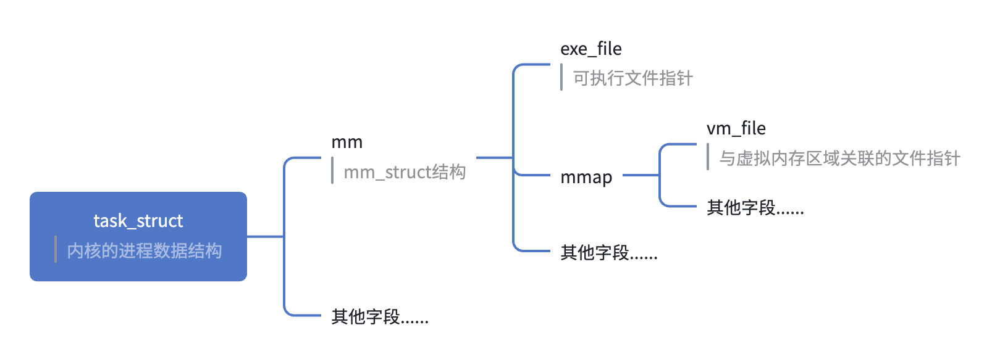

## 可执行文件内存分布

可执行文件运行时，虚拟内存主要分为各种段、堆和栈，下面逐一介绍它们。


前面使用ld链接生成的可执行文件还无法执行。我们现在使用clang以**静态链接**的方式来生成真实的可执行文件：

```C
clang -static main.o add.o -o static_exe.out
```

可以看到这个可执行文件有26个段（section）


> ELF文件被映射时，是以系统的页长度作为单位，那么每个section在映射时的长度都是系统页长度的整数倍，如果section长度下小于一个页，也会占用一个页的空间，所以操作系统会把相同权限或者相同类型的section合并为一个**段（segment）**的概念进行映射，以节省空间。
> 


### Program Header Table

最开始介绍了在可执行文件情况下，ELF文件会存在 **Program Header Table**，但前面主要以可重定位文件为分析目标，所以没有分析这个部分，但在可执行文件的情况，可以来查看它的Program Header Table（有了前面的分析思路，这里就不按字节分析了，直接了解内容即可）：


Program Header Table描述了ELF文件如何被操作系统映射到进程的虚拟空间。可以看到这里有6个Segment，每个Segment对应了一些section。


Segment0 中的section全都是不可写（没有W权限）并且需要内存分配（有A属性）的section  （可以看作广义的代码段）。Segment1 中的 section 则全都是可写的（可以看作广义的数据段）


其中 LOAD 类型的segment是需要被映射到虚拟内存的。


Program Header Table的 item 数据结构如下：

```C
typedef struct elf64_phdr {
  Elf64_Word p_type;
  Elf64_Word p_flags;
  Elf64_Off p_offset;                /* Segment file offset */
  Elf64_Addr p_vaddr;                /* Segment virtual address */
  Elf64_Addr p_paddr;                /* Segment physical address */
  Elf64_Xword p_filesz;                /* Segment size in file */
  Elf64_Xword p_memsz;                /* Segment size in memory */
  Elf64_Xword p_align;                /* Segment alignment, file & memory */
} Elf64_Phdr;
```

- p_type：segment的类型

|类型名称|值|含义|
|---|---|---|
|PT_NULL|0|无效或未使用的类型|
|PT_LOAD|1|可加载的段，包含程序的代码或数据，加载器会将这些段映射到进程的虚拟地址空间中。|
|PT_DYNAMIC|2|动态链接信息段，动态链接器使用这些信息来解析动态库的依赖关系和符号|
|PT_INTERP|3|表示一个包含程序解释器路径的段。通常用于指定动态链接器的路径|
|PT_NOTE|4|表示一个包含附加信息的段，如调试信息、版本信息等|
|PT_SHLIB|5|保留供将来使用，当前没有具体用途|
|PT_PHDR|6|表示一个包含程序头表本身的段。加载器使用这些信息来加载和解析其他段。|
|PT_TLS|7|表示一个包含线程局部存储（TLS）数据的段。每个线程都有自己独立的 TLS 数据|
|PT_GNU_EH_FRAME|0x6474e550|表示一个包含异常处理帧信息的段。用于支持 C++ 异常处理和栈展开|
|PT_GNU_STACK|0x6474e551|表示一个描述栈属性的段，如栈是否可执行。用于控制栈的执行权限|
|PT_GNU_RELRO|0x6474e552|表示一个包含只读数据的段。用于在程序初始化后将数据段标记为只读，以提高安全性|
|PT_GNU_PROPERTY|0x6474e553|表示一个包含程序属性信息的段。用于描述程序的特性和要求|

- **p_flags**：指定段的权限标志，包括 `PF_R`（可读）、`PF_W`（可写）、`PF_X`（可执行）。

- **p_offset**：segment在文件中的起始位置（以字节为单位），加载器使用这个偏移量从文件中读取段的数据。

- **p_vaddr**：segment在进程虚拟地址空间中的起始地址，

- **p_paddr**：segment在物理内存中的起始地址，这个字段在系统中通常不使用，主要用于某些特定的嵌入式系统，所以一般和p_vaddr一样。

- **p_filesz**：segment在文件中的大小（以字节为单位）。加载器使用这个大小从文件中读取段的数据

- **p_memsz**：segment在内存中的大小（以字节为单位）。加载器在内存中分配这个大小的空间，并将段的数据加载到内存中

- **p_align**：段在文件和内存中的对齐要求。对齐值为 2 的 p_align 次幂，比如 p_align 为10，则对齐值为2的10次方，即1024字节。加载器将段的起始地址对齐到这个值。


segment就是多个section的集合，比如segment0的p_offset为0，p_filesz为0x79ad3，也就是从文件开头到 .gcc_except_table section的结尾位置。


### 堆和栈

运行可执行文件时的虚拟内存除了用于段的映射，还需要用于堆和栈


编写一个简单的死循环代码（让它持续运行，以便使用查看它的内存映射情况），并编译和静态链接为可执行文件

```C
// loop.c
int main(){
    while(1){};
}

// 静态编译
clang -static loop.c -o loop.out

// 执行loop.out，并查看它的内存映射情况
./loop.out
cat /proc/{loop.out执行进程的id}/maps
```


可以看到进程有多个虚拟内存区域（VMA），但只有前3个是映射到可执行文件的segment，其他映射的设备号和文件节点都是0，说明它们没有映射到文件中，而是匿名虚拟内存区域。其中有两个匿名虚拟内存区域就是堆和栈，这两个VMA在几乎所有进程都存在。C语言中malloc()函数就是从堆里面分配的内存。线程需要使用栈，所以线程使用的内存都是在stack中分配。


> **`vdso`**：`vdso` 是一个特殊的共享库，内核将其映射到每个用户空间进程的地址空间中。`vdso` 提供了一些常用系统调用的用户空间实现，减少了系统调用的开销，提高了性能。（应该只是提供一些只读的系统调用，比如获取时间）
> 
> **`vvar`**：`vvar` 是一种特殊的内存区域，内核将其映射到用户空间进程的地址空间中。`vvar` 区域通常包含一些只读的内核数据，用户空间进程可以直接读取这些数据，从而减少系统调用的频率，提高系统性能
> 


所以总的来说，除了需要LOAD的segment（ELF文件头也会加载到内存），进程虚拟内存还有stack、heap以及其他不太需要关心（如vdso、vvar）的内存区域


### 进程栈初始化

进程刚启动时，操作系统会把命令行参数和系统环境变量都保存到进程虚拟内存的栈中，比如main函数的argc和argv就分别对应命令行参数数量和命令行参数指针数组。


## Linux内核装载ELF过程总结

在命令行中执行一个可执行程序，bash进程调用fork()函数创建新的进程，在新的进程中会调用execve()执行指定的ELF文件。在execve()系统调用之后，Linux内核执行真正的装载工作，sys_execve()进行参数检测后，调用do_execve()，首先会查找被执行的文件，读取它的前128字节（因为Linux的可执行文件不止ELF，还有shell脚本程序、Java等），根据具体的文件格式执行对应的装载处理过程。比如ELF的装载函数是load_elf_binary()


load_elf_binary()执行流程：

1. 检查文件有效性

2. 寻找动态链接的".interp"段，设置动态链接器路径

3. 根据ELF的程序头表，映射代码段、数据段等到虚拟内存中

4. 初始化ELF执行环境

5. 将系统调用的返回地址修改为可执行文件的入口点，这个入口点取决于链接方式。对于静态链接的ELF可执行文件，这个程序入口就是ELF文件的文件头中的e_entry地址，对于动态链接的ELF可执行文件，程序入口就是动态链接器。

load_elf_binary()返回到do_execve()，再返回到sys_execve()，再从内核态返回用户态，由于第5步已经把系统调用的返回地址修改为ELF可执行文件的入口地址，所以返回后就从ELF文件的入口地址开始执行。


# 动态链接

动态链接的基本思想是把程序按照模块拆分为各个相对独立部分，在运行时才将它们链接在一起形成一个完整的程序，而不是像静态链接一样把所有的程序模块都链接成一个单独的可执行文件。所以如果多个程序都用到同一个库，动态链接可以实现该库在磁盘和内存中都只占用一份空间，并且升级库也更方便，不需要重新链接程序，只需要替换动态库，在程序下次运行时自动装载新的动态库，相比更加灵活。


动态链接涉及运行时的链接和多个文件的装载，需要操作系统的支持。在Linux中，ELF动态链接文件被称为动态共享对象（dynamic shared object），一般都是以“.so”为扩展名的文件。比如 Ubuntu ARM64 中的C运行库libc，动态链接形式的版本路径为 /lib/aarch64-linux-gnu/libc.so，系统中只保留一份libc.so，所有C语言编写的程序都可以通过动态链接形式使用它。


## 案例

编写 program1.c、program2.c、lib.h、lib.c 4个C文件：

```C
// program1.c
#include "lib.h"

int main() {
    shared = 1;
    foo(1);
    return 0;
}


// program2.c
#include "lib.h"

int main() {
    shared = 2;
    foo(2);
    return 0;
}


// lib.h
#ifndef LIB_H
#define LIB_H

extern int shared;

void foo(int i);

#endif


// lib.c
#include <stdio.h>

int shared = 1;

void foo(int i) {
    printf("lib.so print %d\n", i);
}
```


编译流程如下：

```C
// 将lib.c编译为动态链接库
clang -fPIC -shared lib.c -o lib.so


// 分别编译链接program1和program2
clang program1.c ./lib.so -o program1
clang program2.c ./lib.so -o program2
```

program1 和 program2 都是用了 lib.so 中的 foo 函数和 shared 变量。


把 program1.c 编译为 program1.o，接着链接器将 program1.o 链接为可执行文件时，此时链接器需要确定program1.o 中引用的 foo() 函数的性质，如果 foo() 是一个定义在其他静态目标模块的函数，那么链接器就会按照静态链接的规则，重定位 main.o 中的 foo() 函数地址引用；如果 foo() 是定义在某个动态共享对象文件中的函数，那么链接器就会将这个符号引用标记为一个动态链接的符号，不对它执行重定位，等到执行装载程序时才执行。


那么链接器如何知道 foo() 是一个静态符号还是动态符号？这就是在链接时需要使用lib.so的原因，lib.so 中保存了完整的符号信息（因为运行时动态链接还是需要符号信息），把 lib.so 也作为链接的输入文件之一，链接器在解析符号时就可以知道：foo 是一个定义在 lib.so 中的动态符号，这样链接器就可以特殊处理 foo 的引用，使它成为一个对动态符号的引用。


## 动态链接运行时地址空间分布

对于静态链接，只需要映射一个文件，就是可执行文件本身。对于动态链接，除了可执行文件还有它所依赖的共享目标文件。


我们运行 program1 时，可以查看到当前进程的虚拟内存地址分布，可以看到 lib.so 和 program1 可执行文件都被映射到进程的虚拟内存空间。并且可以看到，还有一个共享对象为 ld-linux-aarch64.so.1 ，它是 Linux ARM64 系统中的**动态链接器**，它和普通共享对象一样被映射到了进程的虚拟地址空间，在系统开始运行 program1 前，首先会把控制权交给动态链接器，由它完成所有的动态链接工作后再把控制权交给 program1 开始执行。


查看我们自己编写的 lib.c 编译生成的 lib.so 的装载属性：


可以看到 lib.so 的类型为 共享对象文件，和之前静态链接的重定位文件类型不一样。**并且虚拟地址是从0开始的，说明共享对象的最终装载地址在编译时是不确定的，而是要在动态链接装载时动态分配确定。**


## 地址无关代码

动态链接模块被装载映射至虚拟空间后，可能多个进程动态链接了同一个 so 库，动态链接库中的可修改数据部分对于不同的进程来说有多个副本，但由于装载时重定位的方式需要修改指令部分，导致无法做到同一份指令被多个进程共享。


如果希望程序模块中共享的指令部分在装载时不需要因为装载地址的改变而改变，实现的基本思想就是把指令中那些需要被修改的部分分离出来，和数据部分（数据段）放在一起，这样指令部分就可以保持不变，而数据部分可以在每个进程都存在一个副本。这种方案就是被称为 **地址无关代码（PIC，Position Independent Code）** 的技术。


比如当前模块访问的一个变量被定义在其他模块中，模块间的数据访问目标地址要等到装载时才能确定，ELF的做法就是**在数据段里面建立一个指向这些变量的指针数组，也称为全局偏移表（Global Offset Table，GOT）**，当代码需要引用该外部变量时，就可以通过GOT中相应的数据来间接引用。


流程：当指令中需要访问外部定义的变量时，程序会找到GOT段，根据GOT中变量对应的项找到变量的目标地址。而程序开始运行时，链接器在装载模块的时候会查找每个变量所在的地址，然后填充GOT中的每一项。由于GOT放在数据段，所以它可以在模块装载时被修改，并且每个进程都有独立的副本，相互不受影响。


## 延迟绑定

动态链接情况下，程序模块间存在很多函数引用和全局变量访问，所以在程序指令开始执行前，动态链接会耗费时间用于模块之间的函数引用的符号查找和重定位。但在一个程序运行过程中，可能很多函数不一定被用到，所以可以采用延迟绑定的做法，就是在使用到时才进行绑定（符号查找、重定位等），可以加快程序的启动速度。（也就是懒加载提升性能的思想）


ELF使用PLT（procedure  linkage table）的方式实现延迟绑定。当我们调用某个外部模块的函数时，如果按照通常的方式应该是通过GOT相关的项进行间接跳转。PLT为了实现延迟绑定，在这个过程中又增加了一层间接跳转。调用函数并不是直接通过GOT跳转，而是通过一个叫PLT的结构来跳转，每个外部函数在PLT中都有一个相应的项。


为了实现延迟绑定，链接器在初始化阶段并没有把外部函数的地址填入GOT中。


## .got 和 .plt 的运行机制

**地址无关代码**技术用到的 GOT 和**延迟绑定**用到的 PLT，实际都是ELF文件中的 section，即 .got 和 .plt，我们来看看它们是怎么发挥作用的。


首先查看 porgram1 的 main 函数，其中调用 foo 函数的指令变成了调用偏移为 0x670 位置的`foo@plt`：


命令工具查看 program1 可执行程序的 .plt section内容，可以看到  0x670 位置的`foo@plt`位于此处：


main 函数中调用 foo 函数变成了跳转到这个`foo@plt`的地址，这里会把 0x20000 加上 32（16进制为0x20）得到 0x20020 赋值给 x17 寄存器，并跳到这个地址的值指向的另一个地址。


这里查看`.got`的内容，可以看到 0x20020 的位置位于`.got.plt`内，值为0x610，所以又会跳到`.plt`的开头位置。


> GOT一般被拆成了两个section，一个是不需要延迟绑定，用于存储全局变量，加载到内存中只需要被读取的`.got`，另一个是为了存储函数地址需要延迟绑定写入的`.got.plt`
> 


`.plt`中 0x610 位置的指令会调用动态链接器解析函数，执行函数的查找和重定位，但这个函数并不在我们的可执行程序 program1 内，而是执行时动态链接的系统动态库中。所以要查看 0x610 位置的指令真实跳转的地址，**需要在程序的运行时去查看，所以这里我们使用gdb调试运行 program1 来查看**。


### 调试分析

#### 调用 foo 前的情况

首先我们在 main 函数内调用 foo 函数之前的任意位置打一个断点：


程序运行时`foo@plt`的地址为 0xaaaaaaaa0670，此时反汇编一下 0xaaaaaaaa0670 位置的代码：


同时也看一下当前进程的虚拟内存映射情况，用于了解后面各个地址所在的区域：


`foo@plt` 内使用 br 指令会跳到 0xaaaaaaac0020 地址的值指向的地址，所以查看 0xaaaaaaac0020 地址的64位值为 0xaaaa0610 和 0x0000aaaa，拼起来就是 0x0000aaaaaaaa0610


按指令格式打印该地址 8行 的数据，就是 .plt 里面的指令，这里会跳到 0xaaaaaaabf000 + 0xff8 ，也就是地址0xaaaaaaabfff8 内指向的地址：


查看 0xaaaaaaabfff8 地址的 64 位的值，拼起来就是 0x0000fffff7fce74c


接着查看 0xfffff7fce74c （可以省略高位的0）位置的指令，也就是 `_dl_runtime_resolve` 函数


根据查看前面打印的虚拟内存映射情况，0xfffff7fce74c 位于 fffff7fbe000 ～ fffff7fe5000 之间，也就是 `ld-linux-aarch64.so.1`动态链接库的内存映射范围。源码在glic项目中，这里不作具体分析。


`_dl_runtime_resolve` 函数会帮我们查找和重定位 foo 函数的地址，并将函数地址保存到 .got.plt 的对应位置，并且还会执行该函数，然后返回。


#### 调用 foo 后的情况

调用 foo 之后，foo的地址肯定已经保存到 .got.plt 内了，之后再调用 foo 就不需要执行`_dl_runtime_resolve` 函数了，继续使用gdb调试验证一下。


我们将断点执行到调用 foo 之后的位置：


0xaaaaaaaa0670 内的指令仍然是跳转到 0xaaaaaaac0020 ，所以此时再查看 0xaaaaaaac0020 地址的值：


可以看到这个地址现在的值已经被修改为 foo 函数的实际地址，在虚拟内存映射情况中可以看到这个地址就位于我们自己编译的动态库lib.so中。


然后反汇编这个地址的指令，确实就是 foo 函数。


### 流程总结图


## 动态链接相关的其他 section

通过动态链接生成的可执行文件，比如前面生成的 program1，会有一些专用于动态链接的可执行文件的section类型，这里打印了它的全部seciton：


### .interp 段

解释器段，内容就是动态链接器的路径，操作系统在运行可执行文件时，通过它找到动态链接器来执行动态链接，不同操作系统的动态链接器路径可能不同。


> 在动态链接情况下，操作系统在装载可执行文件时，可执行文件里面对于外部符号的引用还是无效地址，所以此时操作系统会启动 **动态链接器**。而Linux的动态链接器就是一个so共享对象，操作系统同样通过映射的方式把它加载到进程的虚拟地址空间，操作系统会把控制权交给动态链接器，动态链接器对可执行文件进行动态链接工作，完成后再讲控制权交给可执行文件。
> 


### .dynamic 段

描述了动态链接的基本信息，比如依赖哪些动态库、动态链接符号表的位置、动态链接重定位表的位置、共享对象初始化代码的地址等。

```C
typedef struct {
  Elf64_Sxword d_tag;                /* entry tag value */
  union {
    Elf64_Xword d_val;
    Elf64_Addr d_ptr;
  } d_un;
} Elf64_Dyn;
```

ARM的 .dynamic 段的内容介绍可以查看此链接：

https://github.com/ARM-software/abi-aa/blob/main/sysvabi64/sysvabi64.rst#91dynamic-section


使用命令工具打印 .dynamic 内容如下：


### 其他

还有`.dynsym`、 `.dynstr`、`.rela.dyn`、`.rel.dyn` ` .rela.plt` `.rel.plt`等等section，可以自行了解。


## 动态链接的步骤

### 动态链接器自举

动态链接器本身也是一个共享对象，但它有一些特殊性，对于普通共享对象来说，它的重定位工作由动态链接器完成，而对于动态链接器本身，则需要特殊的处理：**动态链接器本身不能依赖其他共享对象，并且动态链接器本身所需的全局和静态变量的重定位工作由自身完成。**


### 装载共享对象

完成自举后，动态链接器将可执行文件和链接器本身的符号表合并到一个全局符号表中。然后链接器通过 .dynamic 中的 DT_NEEDED 类型的数据查找可执行文件依赖的共享对象，将这些共享对象的名字放入装载集合中，然后链接器从中取出每一个共享对象，找到对应的文件并读取ELF文件头和 .dynamic 段，然后将它的代码段和数据段映射到进程虚拟地址空间中。如果这个共享对象还依赖其他共享对象，则会递归装载。

当一个共享对象被装载，它的符号表会被合并到全局符号表中。


### 重定位和初始化

动态链接器遍历可执行文件和每个共享对象中的重定位表，将它们的GOT/PLT中每个需要重定位的位置进行修正。


完成重定位后，如果共享对象中有 .init 段，那么动态链接器就会执行 .init 段的代码，完成共享对象的初始化过程。比如C++的全局/静态对象的构造就需要通过 .init 来初始化。相应的 .finit 用于进程退出时执行。


如果可执行文件中也有 .init ，那么动态链接器不会执行它，而是由程序初始化代码负责执行。


## 显式动态链接

除了在编译链接时确定依赖的动态链接库这种形式，程序也可以在运行时主动执行动态链接，可以了解`dlopen` 、`dlclose`、`dlsym`和`dlclose`函数。


# 支撑程序运行的库

ELF可执行程序运行的入口点并不是main函数，而是由运行库为其提供的入口函数，ld链接器默认使用 _start 作为程序入口，标准库glibc中提供的 _start 由汇编实现，所以我们直接使用ld简单的链接并不能运行起来，还需要链接其他的必要库。


实际的程序入口会帮我们执行获取参数表、环境变量等工作，这也是为什么main函数可以接收到参数的原因：

```C
int main(int argc, char **argv) {
    ......
}
```


任何一个C程序，它的背后都有一套庞大的代码来支撑，比如包括入口函数、以及依赖的函数构成的函数集合和标准库函数的实现。


