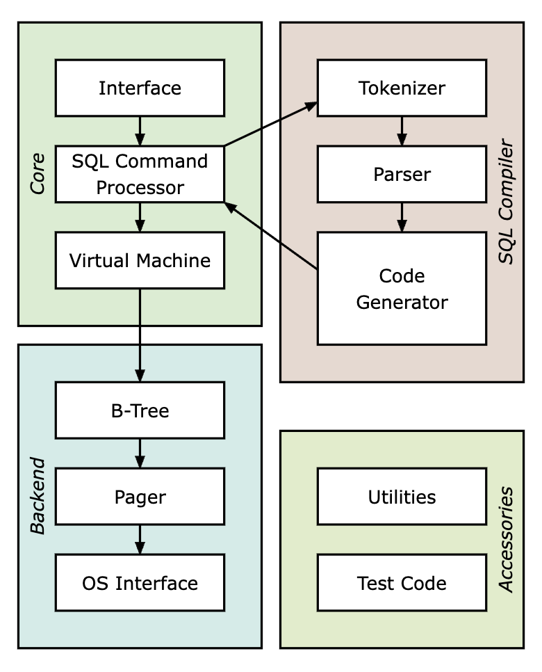
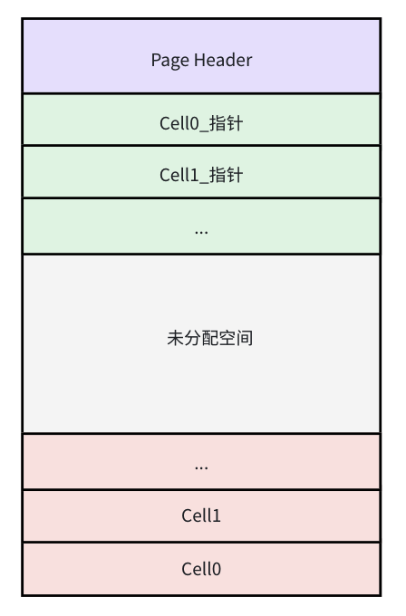
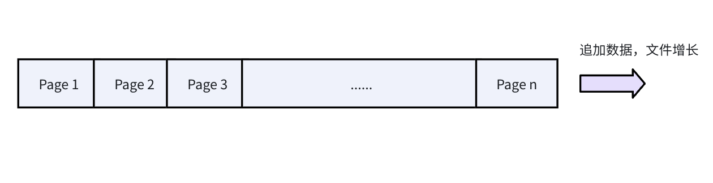
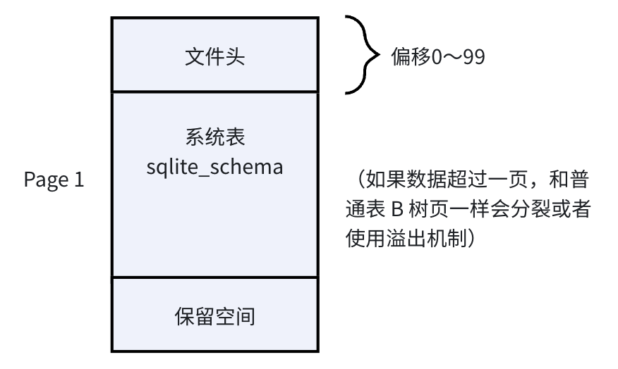
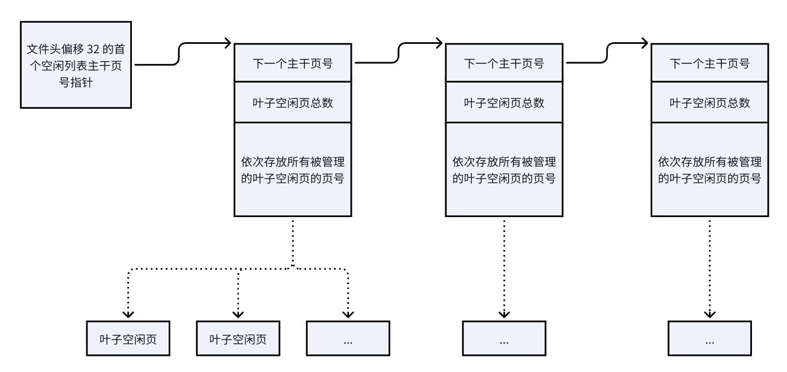
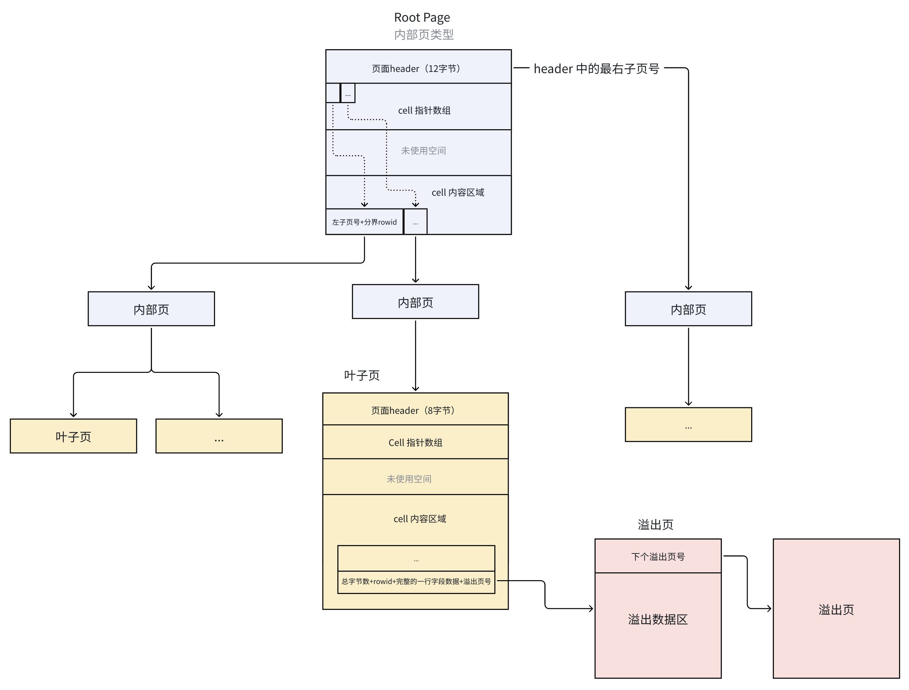

# SQlite 架构概览


SQLite 的工作原理是将 SQL 语句编译成字节码，然后利用虚拟机来执行这些字节码。SQlite 的主要组成部分如下：

1. 接口
本质就是用来使用 SQlite 的接口函数

2. Tokenizer 词法分析器
当需要执行包含 SQL 语句的字符串时，首先会将其传递给分词器。分词器将 SQL 文本拆分成不同的 Token（比如 SELECT、FROM 等），然后将这些 Token 传递给解析器。

3. Parser 语法分析器
语法分析器根据当前上下文给 Token 指定含义。通俗地说，根据这些词前后搭配、先后顺序（上下文），判断每个词在整条 SQL 里扮演什么角色、属于哪部分语法结构，最终拼接出完整的语法逻辑。

4. Code Generator 代码生成器
在语法分析器将各种 Token 组装成解析树之后，代码生成器会分析该解析树，并生成执行 SQL 语句操作的字节码

5. Bytecode Engine  字节码引擎
由代码生成器创建的字节码程序，会在虚拟机中运行。

6. B 树
SQLite 数据库在磁盘上通过 B 树实现存储，该实现位于 btree.c 源文件中。数据库中的每个表和每个索引都使用独立的 B 树结构。所有 B 树都存储在同一个磁盘文件中。文件格式的细节是稳定且定义明确的，并且可以保证在未来使用过程中保持兼容性。

7. Page Cache  页面缓存
SQLite 不会直接操作整个数据库文件，而是把整个文件切分成大量固定大小的小块，每一个小块就叫做 Page（数据页），默认大小为 4096 字节（4KB）。

上层的 B-Tree 模块 是页的主要使用者，所有表、索引的数据都以页为单位组织在 B-Tree 中，B-Tree 只会按「页号」向磁盘请求数据，不会直接读取原始文件。Page Cache 是 B-Tree 模块 和 磁盘 文件之间的「中转管理层」。B-Tree 只关心「我要第几页数据、我要修改数据」，所有和磁盘交互、缓存管理、数据安全相关的琐碎工作，全部交给 Page Cache 处理。

8. OS Interface 操作系统接口
为了在不同操作系统之间实现移植性，SQLite 使用了一种名为 VFS 的抽象对象。每个 VFS 都提供了用于打开、读取、写入和关闭磁盘文件的接口，同时还能够处理一些特定于操作系统的任务，比如获取当前时间或获得随机性以初始化内置的伪随机数生成器。

9. Utilities 工具
例如内存分配、无校验的字符串比较算法、可移植的文本转数字转换算法以及其他工具程序等。

10. Test Code 测试代码
在源代码树的“src/”文件夹中，那些名称以“test”开头的文件仅用于测试目的。

## 总结 Sqlite 的架构
总的来说，Sqlite 的架构分为解析系统和存储引擎，解析系统处理 SQL 语句，存储引擎才是真正的数据库处理工作。
* 解析系统：客户端 SQL 语句经过 `Tokenizer`、`Parser`、`Code Generator` 处理，得到字节码程序，然后交给 `Bytecode Engine` 执行
* 存储引擎：`B-Tree` 是数据组织者和寻址者，向 `Cache Page` 发起读写请求，`Cache Page` 通过 `OS Interface` 执行实际的文件操作、事务、锁等工作。

# 原理分析

## 数据库文件格式
SQLite 把整个数据库存储在一个单一的普通本地文件中，SQlite使用分离的 journal 文件保存事务恢复信息

SQLite支持常见的文件系统支持的文件名,但是有两条例外:
* 如果文件名是c语言NULL指针(例如:0),SQLite打开一个新的临时文件
* 如果文件名是 `:memory:`，SQLite创建一个只在内存中存在的数据库(in-memory database)
这两种情况下创建的数据库文件是临时的,只要数据库关闭,文件就会消失.

为了方便管理和读写数据库，SQLite 把每一个数据库都划分为一个叫做数据库页或简称为页的固定大小（比如4KB）的区域

页的种类有4种：叶子页（leaf），内部页（internal），溢出页（overflow），空闲页（free）。空闲页就是当前没有使用的页，其他页则正在被使用。B+树内部页面包含用于搜索的导航信息，叶子页存储实际的数据(例如表中每行的数据)。如果一行的数据太大，无法放在单个页面中，则部分数据存储在叶子页面中，其余部分存储在溢出页面中。

### 文件头
Page 1 是一个特殊的页面，它始终是B+树的内部页。该页面还包含一个 100 字节的文件头记录，该记录从文件偏移量0开始存储。文件头表示数据库文件的结构信息，SQLite在创建数据库文件时会初始化头部。文件头信息如下：
|偏移量|大小|描述|
|---|---|---|
|0|16|头字符串：“SQLite format 3\000”|
|16|2|数据库页面大小（以字节为单位）。必须是 512 到 32768（含）之间的 2 的幂，或者值为 1 表示页面大小为 65536|
|18|1|文件格式写入版本。1 表示传统版本；2 表示 WAL|
|19|1|文件格式读取版本。1 表示传统版本；2 表示 WAL|
|20|1|每个页面末尾未使用的“保留”空间的字节数。通常为 0|
|21|1|最大嵌入式数据部分比例。必须为 64|
|22|1|最小嵌入式数据部分比例。必须为 32|
|23|1|叶节点数据部分比例。必须为 32|
|24|4|文件变更计数器|
|28|4|数据库文件的大小（以页面为单位，总共有多少页）|
|32|4|第一个空闲列表主干页面的页面号|
|36|4|空闲列表页面的总数|
|40|4|Schema Cookie|
|44|4|Schema 格式编号。支持的模式格式为 1、2、3 和 4|
|48|4|默认页面缓存大小|
|52|4|在 auto_vacuum 或 incremental_vacuum 模式下，最大的根页的页面号，否则为零|
|56|4|数据库文本编码。值为 1 表示 UTF-8。值为 2 表示 UTF-16le。值为 3 表示 UTF-16be|
|60|4|由 user_version pragma 读取和设置的“用户版本”|
|64|4|incremental_vacuum模式为真（非零）。否则为假（零）|
|68|4|由 PRAGMA application_id 设置的“应用程序 ID”|
|72|20|预留以供扩展。必须为零|
|92|4|版本有效期编号|
|96|4|SQLITE_VERSION_NUMBER SQLite 版本号|

#### 文件格式版本号
写入格式版本是在创建或者修改这个数据库文件时，使用的存储格式编号，只有在第一次创建数据库、执行 VACUUM 重建数据库时，才会更新这个值。用来告诉读取程序这个数据库文件是按什么版本规范写入的。

读取格式版本是能正常读取这份数据库文件所需最低兼容格式编号。

> 当前标准 SQLite3 数据库的写入和读取格式版本都是 1

#### 每页保留字节
SQLite 核心的 B-Tree、Pager 模块只会使用页的「有效可用区」存放数据；保留字节是独立于正常数据区的固定尾部空间，专门给各类扩展模块存放页级元数据。这块空间的设计初衷，就是支撑加密、校验等增强功能，同时完全不侵入核心存储格式，不破坏原有页结构的兼容性。默认为 0。

> 单页有效可用大小 = 页总大小（offset 16 指定） - 保留字节数（offset 20）

#### 数据部分比例
偏移21、22、23的字段用于设置数据比例，分别固定为 64、32 和 32，本来用于修改 B 树算法的存储格式，**但目前不受支持**。

> 属于 SQLite 早期预留的扩展能力，最终没有对外开放，普通开发者几乎不需要关注

#### 文件变更计数器
**Page Cache（页面缓存）** 的配套机制，专门解决多进程 / 多连接并发访问同一个数据库文件时的缓存一致性问题。

每个进程打开数据库时，先读取这个计数器的值，在内存里保存一份快照，后续每次读取数据前，会再次比对头部的计数器值。如果值没变则认为数据库未被修改，直接使用内存缓存中的页，不用读磁盘；如果值变大了，则认为其他进程已经提交了写操作，本地缓存已经过期，必须清空缓存，重新从磁盘加载最新数据。

#### 空闲页面管理
当数据被删除、空间被释放时（比如使用 DELETE、DROP），SQLite 不会把空闲页还给操作系统、缩小数据库文件，而是把页标记为空闲，加入空闲链表等待复用。（可以使用 VACUUM 重建数据库，就会清理空闲页，数据库文件收缩到实际数据大小）

新增数据、新建索引需要新页时，Pager 优先从空闲链表头部取出空闲页复用，只有空闲链表为空时，才会在文件末尾追加全新的页，数据库文件才会真正变大。

空闲页使用偏移 32 和 36 的字段来管理。
* 主干页（trunk page）：本身也是空闲页，充当 “索引管理页”，一个主干页可以批量管理几十到上千个叶子空闲页。
* 叶子空闲页（leaf page）：真正闲置的数据页（原本是 B-Tree 页、溢出页等），被回收后等待复用；它本身不存链表指针，页号统一记录在主干页里。

每个主干页中包含下一个主干页号（偏移0，长度4字节）、本页管理的叶子页数量（偏移4，长度4字节）、本页管理的叶子页的全部页号（偏移8，每个都是4字节）。以默认 4KB 页大小计算：去掉前 8 字节头部，剩余 4088 字节可存放 1022 个叶子页号 —— 也就是说一个主干页就能管理上千个空闲页。

> 下一个主干页号为 0 表示这是链表最后一个主干页

```
文件头(偏移32) → 主干页1 → 主干页2 → ... → 主干页N（下一页号=0）
                    ↓            ↓                 ↓
                1000+个叶子页  1000+个叶子页    剩余叶子页
```

#### Schema Cookie
SQLite 每个连接打开数据库后，都会把 sqlite_master 系统表里的所有表、索引、视图、触发器定义解析到内存中缓存起来，避免每次执行 SQL 都去磁盘读取、解析元数据。但多进程 / 多连接场景下，其他连接可能修改表结构，导致本地内存里的元数据缓存过期。Schema Cookie 就是一个极低开销的校验标记。

工作流程：
1. **初始化缓存**：连接打开数据库时，读取当前 Schema Cookie 的值，在内存中保存一份快照，同时把所有表结构解析到内存缓存。
2. **执行前校验**：每次执行 SQL 前，快速读取文件头的 Schema Cookie，和内存快照比对：
  * **值一致**：表结构没变化，直接复用内存里的元数据缓存，预编译好的 SQL 语句也可以直接执行，无需重新编译。
  * **值不一致**：其他连接已经修改了表结构，本地缓存全部失效；SQLite 会自动重新读取 sqlite_master、解析最新的表结构，同时所有已预编译的语句全部标记为过期，需要重新编译。

#### Schema Format Number 模式格式编号
偏移 18/19 的读写版本管的是底层 B 树、页级物理存储格式，而 `Schema Format Number` 管的是高层 SQL 语义层面的元数据存储规则。包括这些：
* 表行记录的编码格式、列数规则
* ALTER TABLE 的支持能力
* 索引的排序规则
* 内置数据类型的编码方式

目前 SQLite 一共定义了 4 种格式编号：
1. 格式 1 可被所有版本的 SQLite 理解
2. 格式 2 添加了同一表中行可以具有不同列数的功能
3. 格式 3 支持通过 ALTER TABLE ADD COLUMN 添加带非空默认值的列，解决了格式 2 只能加 NULL 默认值列的限制
4. 格式 4 索引开始真正支持 DESC 降序排序，新增两种布尔型记录编码

> 现在所有主流 SQLite 版本（包括 Android 系统内置、Jetpack Room 依赖的版本），新建数据库默认都是格式 4


#### 建议缓存大小
SQLite 先读取文件头这个字段的值，作为本次连接 Page Cache 的初始容量上限，但它只是建议值，SQLite 没有强制义务必须遵守。

这个缓存指的就是 Pager/Page Cache 的内存缓存，包括常用的 B-Tree 页、溢出页、空闲页等所有类型的数据库页、被修改后还没刷盘的脏页。

#### auto_vacuum / incremental_vacuum 配套字段
从 SQLite 数据库删除数据后，可能会发现数据库文件（.db文件）的大小并没有减小，因为 SQLite 为了效率，不会立即把空间归还给操作系统。它只是把这些空出来的地方标记为“空闲”，放入一个“空闲列表”中，留着给未来新增的数据使用。但可能浪费很多空间。

如果想要调整这种策略，可以使用 `auto_vacuum`、`incremental_vacuum`，它有三种模式：
1. **0 或 NONE (默认模式)**：不自动回收。如果想回收，必须手动执行 `VACUUM` 命令
2. **1 或 FULL (全自动模式)**：全自动回收。开启后，每当有事务提交并删除了数据，SQLite 就会自动尝试回收空闲空间，并缩小数据库文件
3. **2 或 INCREMENTAL (增量模式)**：手动触发回收。它像一个“半自动”模式。开启后，SQLite 会记录下所有空闲页的信息，但不会自动收缩文件。你需要通过 PRAGMA incremental_vacuum(N) 命令来手动控制回收

全自动模式优点时无需手动干预，能持续保持数据库文件最小，缺点是由于每次提交都可能触发文件整理，会带来额外的性能开销。在写入频繁的场景下，可能影响并发性能，因为回收操作需要持有写锁。

增量模式启用了一种可以手动回收的机制，`PRAGMA incremental_vacuum(N)` 中的 N 指定了要从数据库文件末尾移除的空闲页面数量，比如可以选择在系统空闲时（如凌晨）执行回收，从而精确控制性能影响，避免在高峰时段因自动回收导致性能波动。


偏移 52 的字段作用是 `auto_vacuum` 或 `incremental_vacuum` 模式下，用于管理的“最大根页页码”。这个值是实现自动回收磁盘空间功能的关键元数据之一：
* 值为 0：表示数据库没有启用 `auto_vacuum` 或 `incremental_vacuum` 功能。在这种情况下，文件头偏移 64 处的字段也必须为 0。
* 值非 0：表示数据库已启用 `auto_vacuum` 或 `incremental_vacuum` 功能，此时，这个字段记录的是当前数据库中最大的根页（Root Page）的页码

> 根页（Root Page）是每个表或索引在B-tree结构中的起始页，可以理解为这棵树的“根”。

> 指针映射页（Pointer-Map Page, PtrMap）：当启用 auto_vacuum 后，SQLite 需要在文件中特殊的位置记录一些“指针映射”信息，以便快速找到并移动页面来回收空间。“最大根页的页码”这个信息，正是为了管理这些特殊的“指针映射页”而存在的

#### 文本编码
告诉 SQLite 数据库文件中所有文本字符串（如表名、列名、SQL语句、TEXT类型字段）是以什么字符编码存储的。对应的值如下：
1. UTF-8（最常用，默认）
2. UTF-16le（小端）
3. UTF-16be（大端）

确保不同系统、不同语言环境下打开同一个数据库文件，文本内容都能被正确解析。

#### 用户版本号
给应用程序开发者自由使用的“版本标签”。它完全由用户（你）控制，SQLite 内核本身完全不使用这个值来做内部校验。比如我们常用的数据库版本升级功能，就会使用它。

#### 应用程序 ID
SQLite 留给业务层自定义的数据库身份标识，SQLite 本身不会校验、不会使用这个值，完全交由应用程序自主管理。

比如 sqlite 官方有一个 magic.txt 文件，`Unix file` 命令的底层维护者（libmagic 项目）会定期同步 SQLite 官方的 magic.txt，把已登记的 ID 规则合并进系统的 magic 库中。这样就可以通过读取 application id 识别出属于哪个应用。

#### version-valid-for number 版本有效编号
SQLite 为了提升读取性能，会把频繁访问的“第1页”（存储了 `sqlite_schema` 主表）缓存在内存中。但如果有多个进程（比如两个程序）同时打开同一个 .db 文件，其中一个修改了数据，另一个内存里的缓存就会过期。

SQLite 通过两个字段的配合来解决这个问题，具体流程如下：
* 偏移 24（变更计数器）：这是一个全局版本号。只要数据库文件发生任何写入修改（INSERT、DELETE、CREATE 等），这个数字就一定会 +1（单调递增）。
* 偏移 92（版本有效编号）：这是一个快照标记。它记录的是 “上一次写入第1页时” 的变更计数器值。

如果 `偏移24 == 偏移92`，第1页肯定没变；如果 `偏移24 > 偏移92`，说明数据库肯定被改写过，但第1页不一定变了，此时 SQLite 为了保险起见，会选择让共享缓存失效（失效共享缓存），然后重新读取第1页并更新 `偏移92` 为最新的 `偏移24` 值。

> 这个设计主要是为了解决 **多进程并发读取** 的问题。如果没有这个字段，SQLite 就不得不每次读取都重新解析整个第1页，或者使用更复杂的文件锁校验，效率会大大降低。

### Lock-Byte Page 
SQlite 在多进程操作时需要进程间锁机制保证功能和数据正常，SQLite 的锁最终由 VFS 调用操作系统提供的文件锁。虽然现代操作系统通常支持可靠的文件锁，但是 SQLite 开发的早期还需要兼容一些旧的 Windows 网络文件系统，这些环境对于普通文件锁支持不完善，因此 SQLite 采用了一种折中方案：**在数据库文件中预留一块特殊区域，把这块区域中的字节作为“锁的位置”**。

这个区域就是 `lock-byte page`，用于存放文件锁字节（lock bytes）。它在文件中的偏移是硬编码固定，从 1073741824 字节（即 0x40000000，刚好 1GB 位置）开始，长度为 512 字节（假如页大小为4k，则该页剩余空间不会被使用）。

`Unix fcntl`系统调用支持对文件的具体字节偏移位置加锁，也就是字节粒度的锁，所以可以对`lock-byte page`范围内的任何一个字节加锁。

从 1GB 开始，各个字节加锁表示的含义：
* 偏移 0：PENDING_BYTE，挂起锁（排他锁）
* 偏移 1：RESERVED_BYTE，保留锁（排他锁）
* 偏移 2 到 511：SHARED 共享读锁（共享锁）

> 为什么共享锁要 510 个字节：历史兼容设计：早年 Win95/98 只支持强制锁（Mandatory Lock），被加锁的文件区域，连持有锁的进程自己都不能读写，所以必须单独留出一块完全不存数据的区域当锁区，否则加锁后对应页的数据就没法读写了，并且不允许多个进程对同一个文件偏移同时加读锁。SQLite 就准备了 510 个独立字节位置，每个读进程随机选一个位置加锁，最多支持 510 个并发读连接，锁范围互不重叠。

> 为什么选择 1G 的位置：早年绝大多数数据库体积都在几 KB ~ 几 MB 级别，远不到 1GB。把锁区放在 1GB 这个足够远的位置，数据库小于 1GB 时，文件里物理上不存在这 512 字节，完全不占用磁盘空间；锁机制依然可以正常工作，操作系统支持对「超出文件大小的偏移」加锁，不需要文件真的有这么大。并且当时 32 位系统是主流，32 位有符号整数的最大正偏移是 2^31 - 1（约 2GB），1GB（2^30）在 2GB 范围内，寻址不会有问题，同时又是一个足够大、足够远离正常数据区的位置。

#### 场景1：读进程加 SHARED 锁（SELECT 操作）
1. 进程打开数据库，初始为 `UNLOCKED` 状态，不持有任何锁。
2. 执行查询前，Pager 层向 VFS 发起「加共享锁」请求。
3. VFS 层从 lock-byte 页的 2~511 字节共享池中，随机选择一个未被占用的字节偏移。
4. 调用操作系统文件锁 API，对选中的这个字节位置加共享读锁。
5. 加锁成功 → 进程进入 `SHARED` 状态，可以安全读取数据库数据。
6. 多个读进程可以分别占用不同的字节位置，同时持有 `SHARED` 锁，天然支持读并发。
7. 查询结束、事务提交后，释放该字节上的共享锁，回到 `UNLOCKED` 状态。

#### 场景2：写进程加锁全流程（逐级升级）
写锁不是一步到位，SQLite 采用逐级升级策略：UNLOCKED → SHARED → RESERVED → PENDING → EXCLUSIVE，目的是尽量减少读写冲突。

写操作开始前，和读进程完全一致：
1. 从共享锁池选一个字节加共享锁，进入 `SHARED` 状态；
2. 先读取要修改的数据页、构建回滚日志，这一步和普通读一样。

当进程确认要执行写操作时：
3. VFS 层对 **偏移 1（RESERVED_BYTE）** 加排他锁
4. 该锁是排他的：同一时间只能有一个进程持有，保证同时只有一个写进程
5. 进入 `RESERVED` 状态（此时不阻塞读）

写进程准备真正修改磁盘数据，需要升级到排他锁，但不能直接强占：
6. VFS 层对 **偏移 0（PENDING_BYTE）** 加排他锁
7. 进入 `PENDING` 状态

`PENDING` 状态下，旧读进程不受影响，可以继续正常读，直到读完释放；新读进程被拦截：所有新的读进程再加 SHARED 锁前，会先检查 PENDING 字节有没有锁，有锁就直接拒绝，不再放新的读进来。这个设计避免了写操作直接把所有读都打断，同时保证写操作不会永远等不到锁。

升级到 `EXCLUSIVE` 锁（独占写）：
8. 写进程等待所有旧的 `SHARED` 锁全部释放，所有读进程都退出
9. 确认共享锁池没有任何锁后，VFS 层对 **整个共享锁池（偏移 2~511）** 加排他锁，把所有读锁位置全部占住
10. 进入 `EXCLUSIVE` 状态

此时进程完全独占数据库，可以安全修改数据页、写回滚日志、刷盘，不会有任何其他进程读写。

---------------

#### 传统回滚日志模式：
现代所有主流系统（Linux、Android、macOS、Windows NT 及以上）都支持**建议锁（Advisory Lock）**：
* 建议锁本质是内核维护的状态标记，只负责「记录谁加了锁、锁的类型」，完全不影响文件内容的读写；
* 锁的有效性靠进程共同遵守约定，内核不强制拦截读写；
* 更关键的是：可以对文件不存在的偏移位置加锁，不需要文件真的有这么大。

所以在传统回滚日志模式情况下，锁从强制锁改为建议锁，支持同位置多共享锁，因此实际只需要 1 个字节位置就能支持无限个读并发，510 字节池只剩历史兼容意义，现代实现不再执行「随机选字节加锁」的逻辑。

#### WAL 模式
WAL 模式下，数据库配套有三个文件：
* xxx.db：主数据库文件
* xxx-wal：预写日志文件，写操作只追加到这里
* xxx-shm：共享内存索引文件（wal-index），锁和 WAL 页索引都存在这里
所有并发协调、锁管理全部在 `.shm` 文件里完成，主数据库文件几乎不需要加锁，自然也就不需要 lock-byte page。

WAL 模式不再使用传统的五级锁状态机，换成了更细粒度的锁，并发能力更强：
1. WAL 读锁
2. WAL 写锁
3. checkpoint 锁

锁的载体从「主数据库文件的字节偏移」变成了「独立共享内存文件」，主文件不再承担锁的功能。


### Freelist 空闲页链表
数据库中被释放、不再存储有效数据的整页，会被统一收纳进空闲链表（Freelist）。这些页不会立刻从磁盘文件中删除，而是等待后续新增数据时优先复用。在文件头中，偏移 32 存储了第一个空闲列表主干页面的页面号（值为 0 表示链表为空，无空闲页），偏移 36 则存储了空闲页面的数量（主干页 + 叶子空闲页全部计入）。

Freelist 没有采用「每页存下一个页号」的单链表设计，而是使用 主干页（Trunk Page） + 叶子空闲页（Leaf Page） 的两级结构，目的是大幅减少链表遍历的磁盘 IO 次数。

主干页本质是一个单位 4 字节的大端整数数组：
* 偏移 0：下一个主干页号
* 偏移 4：当前主干页管理的叶子空闲页总数
* 偏移 8 到页尾：依次存放所有被管理的叶子空闲页的页号，每个4字节

> 每页最小可用空间为 480 字节，因此数组长度至少为 120 项。以默认 4KB 页大小计算，单个主干页最多可管理 1022 个叶子页。

> 所有空闲页的回收与分配都由 Pager 层自动完成，对上层业务完全透明。

### B-tree 页
SQLite 是单文件数据库，整个数据库都存在一个 .db 文件里。但不可能每次查数据都把整个文件读进内存，所以 SQLite 把整个文件分为很多页，读写以页为单位，常用的页可以缓存在内存里。B 树就是一种分层、有序的树形结构，专门用来快速查找。B-Tree 页是 SQLite 中存储业务数据与索引的主力页类型，所有表、索引各自对应一棵独立的 B 树，每棵 B 树由若干 B-Tree 页组成，通过页号互相引用形成树形结构。它把数据分成两类页，**叶子页**存真实的数据，相当于书的正文页，**内部页**只存 “目录索引”。

SQLite 里有两种独立的 B 树，对应**表**和**索引**：
* 表 B 树存储真实数据，每一张表，都对应一棵独立的表 B 树。排序依据是`rowid`（主键），表 B 树分为叶子页和内部页，叶子页里存的是完整的每行数据，内部页只存 “分界主键 + 子页号”。
* 索引 B 树：每一个索引，都对应一棵独立的索引 B 树。它的排序依据是“索引列的值”，索引 B 树也分为叶子页和内部页。叶子页里只存 “索引列的值 + 对应的 rowid”；内部页存 “分界索引值 + 子页号”，用来快速定位索引键的位置

> 表 B 树的内部页**分界主键**的意思是子树里最大的主键，比如数据「子页 5，分界键 100」，意思就是：所有 rowid ≤ 100 的数据，都在第 5 页里。再加上页头里的「右子页号」，所有大于本页最大分界键的数据，都在最右侧的子页里。


#### B-tree 页的格式
```
|-----------------|
| file header     | 100 字节，仅存在于 page 1（数据库文件第一页，也就是文件头）
|-----------------|
| page header     | 叶子页 8 字节，内部节点页 12 字节
|-----------------|
| cell pointer    | 单元格指针数组，每个指针 2 字节，按排序顺序存储，向下增长
| array           | 
|                 | v  
|-----------------|
| unallocated     | 未分配的可用空间
| space           |
|-----------------|   ^  向上增长
| cell content    | 单元格内容区，无序存储，夹杂着空闲块和碎片
| area            | 
|-----------------|
```

所以一般的B树页面结构图如下：


##### 1. page header
Page 1 的页头从第 100 字节开始，其他页从第 0 字节开始。页面头包含了描述整个页面状态的关键元数据：

|相对页起始偏移	|长度	|描述|
|---|---|---|
|0	| 1 字节|	标识当前页的 B-Tree 类型，合法值共 4 种，0x02：索引内部页，0x05：表内部页，0x0A：索引叶子页 ，0x0D：表叶子页|
|1  |	2 字节|	页内第一个 Freeblock（空闲块）的起始偏移；值为 0 表示页内无空闲块|
|3  |	2 字节|	当前页存储的数据单元（Cell）总数|
|5  |	2 字节|	Cell 数据内容区在页内的起始地址，标记数据区的左边界|
|7	| 1 字节|	碎片字节数：单元内容区域中零散的未使用字节总数|
|8  | 4 字节| 最右子页的页码：仅内部页（Interior Page）有此字段 |

> 表内部页、索引内部页会在通用 8 字节头之后，额外存储 4 字节的最右子页号。本页所有 Cell 的分界键，都会小于右子树的全部键值

##### 2. cell pointer array
紧接在页头之后，向下（高地址方向）增长。它是一个目录，记录了页面上每个数据单元（Cell）的位置，数组由若干个2字节的整数组成，具体数量就是页面头中偏移为3的数据。

数据单元的指针数组就是记录了每个数据单元的位置，相当于页面的“目录”。


##### 3. cell content area 
数据单元内容区域，是页面中真正存储数据行或索引项的地方，这个区域是从页面底部向上增长的。页面头部偏移为5的字段，记录了当前已使用区域的最上边界。

cell 的格式取决于当前页面的类型，比如存储实际数据的表 B 树叶子页的 cell 的内容包含以下4个部分：
1. 该行记录的总字节数（包括溢出部分，不包括rowid，也就是只统计行字段数据和溢出部分）
2. rowid（主键id）
3. 完整的一行字段数据
4. 溢出页号：仅当数据超长触发溢出时存在，指向第一个溢出页的页号

> 其中，一行字段数据的格式为：[ 记录头 总长度 varint ] + [ Serial Type 数组（每个字段一个 varint） ] + [ 字段内容紧密排列 ]。每个字段对应一个 Serial Type 数字，一个数字同时标识「数据类型」和「数据长度」。

而如果是表 B 树内部页，cell 数据用于索引定位，并不存储完整行数据。每个 Cell 对应一个子树分支，存储了「左子页号 + 分界 rowid」。左子页号（4字节）指向子 B 树页，该子树中所有行的 rowid 都小于等于本 Cell 的 rowid，分界 rowid（变长整数 varint）是该子树分支的最大 rowid，用于二分查找逐层定位。

每个 cell 的左子页号，加上 header 中的最右子页号，就可以整覆盖所有的子页，所有可能的 rowid 都有对应的子树可以进入。例如：

|子页来源	|负责的 rowid 区间|
|---|---|
|第 1 个 Cell 的左子页|	rowid ≤ 100|
|第 2 个 Cell 的左子页|	100 < rowid ≤ 200|
|第 3 个 Cell 的左子页|	200 < rowid ≤ 300|
|页头的最右子页|	rowid > 300|

##### Serial Type
表示数据是什么类型，以及它占用了多少字节。Serial Type 的值与其对应的数据类型和长度的关系如下：

|Serial Type 值|对应的数据类型|数据占用的字节数|
|---|---|---|
|0 |NULL，表示空值 |0 |
|1 |8位整数 |1 |
|2 |16位整数 |2 |
|3 |24位整数 |3 |
|4 |32位整数 |4 |
|5 |48位整数 |6 |
|6 |64位整数 |8 |
|7 |64位浮点数 |8 |
|8 |整数0（专用于存储 0，以节省空间） |0 |
|9 |整数1（专用于存储 1，以节省空间） |0 |
|10,11 |保留值 | |
|>= 12 且为偶数 |BLOB（例如 N=24 表示一个 6 字节的 BLOB） | (N-12)/2 |
|>= 13 且为奇数 |TEXT（例如 N=17 表示一个 2 字节的字符串） | (N-13)/2|


##### 实际例子在 cell content area 中的排列
假设有两行数据：
* 行 1：id=12, name='a'
* 行 2：id=15, name='b'

根据 cell 的格式，需要先计算其他部分才知道总字节数，主键id就是id，数据量小也不会溢出，所以我们来计算 `Serial Type`。

`name` 是文本类型，`a` 的字节长度为 1 个字节，文本的 `Serial Type` 公式：`类型值 = 13 + 2 × 字节长度`，所以 `Serial Type` 为 15。

那么第一行数据对应的 cell 的格式内容为：
```
Payload总长度：就是行记录的总长度，值为 3，长度为 1
rowid：内容为 12，长度为 1 个字节
行记录：记录头总长度数据为 02，长度为 1；Serial Type 为 15，长度为 1，数据内容为 `61`，长度为 1
溢出页指针：没有
```
所以第一行的数据对应的 cell 为 `03 0C 02 0F 61`，同理得出第二行数据的 cell 内容为 `03 0F 02 0F 62`。

那么这个表 B 树叶子页的实际布局为：
1. **页头**：偏移 0 ~ 7，共 8 字节
其中偏移 5~6 会记录数据区的左边界，本例中是 4086。
2. **Cell 指针数组**：偏移 8 ~ 11，共 4 字节（2 个元素 × 2 字节）
数组按 rowid 升序排列，每个元素存对应 Cell 在页内的起始偏移：
第 0 项（rowid=12）：值为 4086（0x0FF6）
第 1 项（rowid=15）：值为 4091（0x0FFB）
3. **未分配空闲空间**：偏移 12 ~ 4085，中间绝大部分空间都是空闲的。
4. **Cell 数据区**：从页尾向前堆叠
rowid=15 的 Cell：偏移 4091 ~ 4095，紧贴页尾
rowid=12 的 Cell：偏移 4086 ~ 4090，排在它前面

> Cell 在数据区里的物理顺序和排序顺序无关，物理排布由插入、删除、更新的历史和空闲块分配策略决定，和 rowid 大小没有必然联系。有序性完全由前面的指针数组保证，查找时对指针数组（指针数组是有序的）做二分查找，再跳转到对应偏移读数据，不需要关心 Cell 的物理排布。


### Cell Payload Overflow Pages 溢出页
一行数据是变长的：短行可能只有几字节，长行可能存几千字的文本、甚至二进制附件，大小远超一页的容量。当单行数据太长、单个 B-Tree 页装不下时，把数据拆成两部，一小段前缀留在原 B-Tree 主页的 Cell 里，剩余大部分数据放到专门的「溢出页」中，多个溢出页串成链表。

#### 触发规则
以表 B 树叶子页，默认 4KB 页为例。
* 最大嵌入负载：约 1024 字节（≈1/4 页），单行总大小 ≤ 该值：完整存在主页，不用溢出页
* 最小嵌入负载：约 512 字节（≈1/8 页），触发溢出时，主页必须至少保留这么多前缀数据，不能把整行都扔去溢出页

所以如果单行数据超过 1/4 页，会把前 512 字节留在主页中，剩余的部分则会放到溢出页中。单行数据 cell 的末尾会记录溢出页号，从而可以找到剩余的数据。

> 行记录的「表头（Serial Type 数组）」通常都很短，基本都在 512 字节以内，留前缀就能保证读取字段类型、短字段（比如 id、name）时，只需要读主页，不需要读溢出页，减少磁盘 IO。

#### 溢出页的结构
溢出页是 SQLite 所有页类型里结构最简单的一种，没有 B 树页的复杂头部、指针数组，就是一个纯数据容器。它只有下个溢出页号和行数据内容。

* 偏移 0 ~ 3，记录下一个溢出页号，值为 0 表示链表没有下一个溢出页
* 偏移 4 ~ 页尾，存放拆分出来的行数据，紧密连续排列

#### 实际例子
假如插入一行数据，payload 总大小 9000 字节：
1. 判断触发溢出：9000 > 1024，需要使用溢出页。
2. 主页留前缀：在主页 Cell 里保留 512 字节前缀（满足最小嵌入负载要求）。
3. 计算剩余数据：9000 - 512 = 8488 字节需要放进溢出页。
4. 分配溢出页，逐页填满：
  * 每个溢出页能存 4092 字节数据；
  * 第 1 个溢出页：存 4092 字节，还剩 4396 字节；
  * 第 2 个溢出页：再存 4092 字节，还剩 304 字节；
  * 第 3 个溢出页：存剩下的 304 字节，下一页号设为 0，链表结束。
5. 链表串联：主页 Cell 末尾存第 1 个溢出页号；第 1 页存第 2 页号；第 2 页存第 3 页号。

最终：1 个主页 Cell + 3 个溢出页，存下了 9000 字节的长数据。


> 当一页写满、没有空间再插入新数据时，就把当前页的所有行按排序平分成两半，一半留在原页，另一半搬到新分配的页里；然后向上层父内部页插入一条新的目录项，标记新页的分界键。这和单行数据的溢出页是两套机制。

### Pointer Map Pages 指针映射页
`auto_vacuum` 或者 `incremental_vacuum` 会把零散的空闲页移动到文件末尾，然后截断文件，让数据库体积缩小。但移动页面时，必须更新所有指向它的指针，比如一个 B 树叶子页被移走了，它的父内部页里的子页号就要同步改成新位置。

由于指针是单向的，比如想知道 “第 100 页的父页是谁”，就得把数据库所有内部页都读一遍，挨个检查有没有指向 100 页的条目，如果数据库很大，耗时就会很久。

`Pointer Map` 就是全数据库的反向索引表，想查任意一页的上级页，只需要读一次对应的 Ptrmap 页。

#### Pointer Map Page 的物理结构
每个 `Ptrmap` 页全是 5 字节的条目，在 4KB 页情况，一页能容纳的条目数为 4096 ÷ 5  ≈ 819 个条目。所以一个 `Ptrmap` 页，可以记录它后面的 819 个普通数据页的反向索引。

5 字节中，1 字节用于描述页面类型，4 字节描述父页的页号。

分布情况：
* 页 2：第一个 Ptrmap 页，记录 3 ~ 821 页
* 页 822：第二个 Ptrmap 页，记录 823 ~ 1641 页
* 页 1642：第三个 Ptrmap 页，记录 1643 ~ 2461 页
* ...

> 如果刚好碰到 lock-byte 页，Ptrmap 会向后顺延一页

### 系统表与内部对象

#### 总目录表 sqlite_schema
`sqlite_schema` 会登记所有的表、索引、视图、触发器，是 SQLite 启动后第一个读取的表。它的 B 树根页固定在第 1 页，也就是数据库文件头所在的那一页，文件前 100 字节是全局文件头，后面紧跟着就是 `sqlite_schema` 表的 B 树数据。

这个表有5个字段，每行数据都对应一个数据库对象：
1. `type`（TEXT）：对象类型，取值为 table / index / view / trigger
2. `name`（TEXT）：表名、索引名、视图名
3. `tbl_name`（TEXT）：如果是表本身的话和 name 相同；索引 / 触发器则对应它依附的表
4. `rootpage`（INTEGER）：每一张表 / 索引对应一棵独立 B 树，这里就是树的入口页号
5. `sql`（TEXT）：建表、建索引的 SQL 文本，自动生成的对象则为 NULL

> 因为历史原因，它有一些可互换的别名：sqlite_master（旧名称）、sqlite_temp_schema / sqlite_temp_master（临时数据库的模式表）

##### 工作方式
* 执行 `CREATE TABLE` / `CREATE INDEX` 时，数据库内核自动往表里插入一行；
* 执行 `DROP TABLE` / `DROP INDEX` 时，数据库内核自动删除对应行；
* SQLite 打开数据库、查询数据时，先读这张表，找到目标表的 `rootpage`，才能顺着 B 树找到真实数据。

#### 自动索引 sqlite_autoindex_TABLE_N
内核自动创建的隐式索引，用户不需要手动写 `CREATE INDEX`，它的作用是实现 `UNIQUE` 唯一性约束和 `PRIMARY KEY` 主键约束。`sqlite_autoindex_TABLE_N` 表在 `sqlite_schema` 中的类型就是 `index`，sql 字段为 NULL，`rootpage` 对应索引 B 树的根页。

要保证某一列的值不重复，如果每次插入都全表扫描校验，数据量大了会非常慢。SQLite 的解决方案和所有关系型数据库一致，就是给唯一约束的列自动建一个索引，靠索引的有序性来快速校验重复，保证插入性能。

自动创建的表的命名就是 `sqlite_autoindex_表名_N`，表名对应约束所在的表，N 就是从 1 `开始的递增序号，按建表时约束出现的顺序编号。例如user` 表有两个唯一约束，自动生成的索引就是 `sqlite_autoindex_user_1`、`sqlite_autoindex_user_2`。

> `INTEGER PRIMARY KEY` 整型主键不会生成自动索引，因为整型主键就是 rowid 的别名，表 B 树本身就按 rowid 有序排列，天然具备唯一性和快速查找能力，不需要额外建索引。

#### 自增序列表 sqlite_sequence
在 `AUTOINCREMENT` 关键字场景使用，用来实现严格自增主键。因为 `AUTOINCREMENT` 关键字要求主键永远只增不减，并且删除过的 ID 永远不会再被使用。要实现这个特性，就必须有个地方持久化记录历史最大 ID，`sqlite_sequence` 就是用在这个场景。

只有当数据库里至少有一张表使用了 `INTEGER PRIMARY KEY AUTOINCREMENT` 时，SQLite 才会自动创建这张表。表的结构只有如下两个字段：
1. `name`（TEXT）：表的名称
2. `seq`（INTEGER）：表自增主键的历史最大值


#### 查询优化统计表 sqlite_statN
一系列以 `sqlite_stat` 开头的表，由 `ANALYZE` 命令生成，作用是给查询优化器提供数据分布信息，帮助它选择最快的查询路径。


### journal 回滚日志
回滚日志是与主数据库配套的独立文件，命名规则为 `主库名-journal`（例如 `user.db` 对应 `user.db-journal`），用于暂存修改前的原始数据，从而解决两个核心问题：
1. **事务原子性**：一个事务内的多次修改，要么全部生效，要么全部回滚，不会出现只改了部分的中间状态。
2. **崩溃一致性**：事务执行中途掉电 / 进程崩溃，下次打开数据库时能自动恢复到事务开始前的完好状态，不损坏数据库文件。

SQLite 所有修改操作都会严格遵循**先备份旧数据，再修改主库**的顺序：
* 修改主库某一页前，先把这一页的完整原始内容，拷贝到回滚日志中持久化；
* 如果事务正常提交：则删除日志文件，修改永久生效；
* 如果事务失败或者中途崩溃：会用日志里的旧数据覆盖主库，回滚到事务前的状态。

> 所有日志页全部写完后，对 journal 文件执行一次完整 fsync，保证所有旧数据已经落到物理磁盘上。所有修改页全部写入主库后，对主数据库文件执行一次完整 fsync，保证所有新数据已经落到物理磁盘上。

#### 日志文件格式
日志文件的整体格式如下：
```
+--------------------+
| Journal Header     |
+--------------------+
| Page Record        |  // 包括 页号 + 完整旧页数据 + 校验和
+--------------------+
| Page Record        |
+--------------------+
| Page Record        |
+--------------------+
```

##### 1. 日志头部（Journal Header）
有效内容长度为 28 个字节，但会用零填充到一个完整磁盘扇区（比如现代硬盘物理扇区一般是 4K），从而保证头部写入是原子的。内容如下：

|相对偏移	|长度	|含义|
|---|---|---|
|0	|8 字节	|魔数，固定值为：0xD9 0xD5 0x05 0xF9 0x20 0xA1 0x63 0xD7 用于验证日志有效性，全零表示日志失效|
|8	|4 字节	|日志中包含的原始页面数量（若为 -1 表示需通过文件大小计算）|
|12	|4 字节	|每个事务生成一个随机数，参与页校验和计算，防止磁盘损坏、部分写入|
|16	|4 字节	|事务开始前的数据库总页数，用于恢复校验|
|20	|4 字节	|头部对齐的磁盘扇区大小，用于计算段边界，保证头部的写入原子性|
|24	|4 字节	|日志的数据页的页面大小，通常与主库页大小一致|
|28 |到文件末尾 | 填充字节，填满一个扇区|

> fsync 解决的是“数据是否已经落盘”的问题；而 Journal Header 中的 Magic Number、随机 Seed 和 Checksum 解决的是“这份 Journal 是否完整、是否属于当前事务、是否遭到损坏”的问题。二者是分层互补的防护机制。

##### 2. 页记录（Page Record）
每个被修改的页面对应一个记录，会完整保存修改前的原始内容。

|相对偏移	|长度	|含义 |
|---|---|---
|0	 |4 字节	|页号，表示是主数据库中哪个页的备份旧内容|
|4	 |N 字节（和页面大小相同）	|原始的页数据|
|4+N |4 字节  |校验和|


#### 执行流程
##### 正常事务的流程
1. 获取 `RESERVED` 保留锁，确认独占写权限，创建回滚日志文件，写入日志头部
2. 逐页写前备份，每修改一个数据页（B 树页、溢出页等）
  * 检查本事务是否已备份过该页
  * 未备份则将完整旧页内容写入回滚日志
3. 升级 `EXCLUSIVE` 排他锁，日志刷盘
  * 事务提交前，先将整个回滚日志强制刷入磁盘，保证旧数据持久化。
4. 主库 fsync 落盘
  * 在内存中修改页数据，然后写回主数据库文件，并强制刷盘。
5. 清理日志，提交完成
  * 主库落盘后，按配置模式清理日志文件。日志清理完成，事务正式永久生效。

##### 崩溃恢复流程
1. 打开数据库后，发现 `-journal` 文件
2. 校验 Header 中的魔数、主库是否未持有写锁
3. 读取日志文件，逐条验证页记录的校验和
4. 将旧页数据完整写回主库对应页号的位置（校验不通过的记录直接跳过）
5. 页数据恢复完成后，强制刷盘，删除日志文件

#### 日志文件损坏的思考
绝大多数日志异常场景，最终结果都是正常回滚数据，不会导致数据库文件本身损坏；只有极端人为破坏或硬件故障场景，才可能出现不一致。

1. 正常运行时日志很难被破坏
在事务正常运行过程中，回滚日志文件是被 SQLite 进程独占打开、持有写锁的，本身就有天然的保护。
  * Windows 系统：文件被进程占用时，无法被删除、无法被其他进程修改；
  * Unix/Linux/Android 系统：就算手动执行 rm 删除了文件，也只是删掉了目录项，进程依然持有文件句柄，可以正常读写，直到事务提交关闭文件后，文件才会真正释放。

2. 崩溃后恢复时，日志出问题的各类场景
  * 日志文件被完全删除：这是最极端的人为操作场景，事务崩溃后，手动删掉了 -journal 热日志文件。SQLite 打开数据库时，检测不到对应的热日志文件，直接正常打开，不执行任何恢复操作。不过如果崩溃刚好发生在日志已经全部刷盘、主库写了部分还没刷盘的瞬间，并且日志被删掉，没有日志可以回滚，则会出现问题。

> 注意：这是人为删除日志导致的，不是 SQLite 自身机制的问题。正常崩溃下日志文件一定会存在，不会凭空消失。

  * 日志头部损坏（魔数无效、头部错乱）：比如文件系统坏道、断电导致头部只写了一半，魔数字节不对。直接判定该日志无效，不执行任何恢复操作。

> 这也是为什么日志头部要单独对齐到一个磁盘扇区：保证头部写入是原子的，要么整个头部写完、要么完全没写，不会出现 “半个头” 的模糊状态。

  * 部分页记录损坏（中间 / 尾部坏了）：比如日志后半部分因为断电没写完，或者中间某几页遇到坏道错乱。SQLite 会逐条读取页记录，每条独立校验校验和，校验通过的页：正常回放，把旧数据写回主库对应页；校验失败的页直接跳过，当作无效记录。

  * 日志大面积错乱，但魔数刚好是对的：这种概率极低，一般只有文件系统严重损坏、或者人为恶意篡改才会出现。如果魔数刚好命中，SQLite 会尝试恢复数据，校验和不对的页会被跳过，只有校验和刚好也对上的页才会被写回。大部分情况下，随机篡改的校验和很难刚好匹配，最终大部分页被跳过，数据库依然接近一致；极小概率下，如果某条记录的内容和校验和刚好同时被篡改得 “自洽”，就可能把错误的旧页写回主库，导致数据逻辑错误，但文件结构本身依然是合法的，不会崩溃。

只有同时满足以下两个条件，才会出现数据库结构损坏：
1. 崩溃发生在日志已完整落盘，主库修改但没有刷盘的极短时间窗口；
2. 热日志同时被破坏 / 删除，无法用于回滚。

> 重要数据靠备份，日志机制只能保证事务原子性，防不住磁盘物理损坏、人为误删文件这类故障，重要数据依然要定期备份。

### WAL 预写日志
`Write-Ahead Logging`模式是 SQLite 新一代的事务日志方案，核心机制是存新的值，不修改主库，崩溃了就丢弃未提交的新数据。相比原本的回滚日志模式，并发和效率都更好。


> 通俗地说，WAL 模式的核心思路就是不直接修改正式的数据库文件（作业本），所有新增、修改、删除都按顺序写在单独的草稿本（WAL 文件）末尾；等草稿攒多了，再批量抄到正式作业本里。

WAL 模式下，数据库目录会固定出现三个文件：
1. xxx.db：主数据库文件，存放已确认生效的旧数据，只在批量整理时才会更新，平时只读
2. xxx.db-wal：WAL 日志文件，相当于草稿本，所有新修改、新数据都按顺序追加写在这里，是日常写入的主力文件
3. xxx.db-shm：WAL 索引文件（共享内存文件），给草稿本做的快速索引，临时文件，崩溃后可重建

> 当 WAL 增长到一定阈值，触发 Checkpoint，把已提交的数据写回主库后，WAL 空间可以被循环覆盖复用

#### 执行流程
1. 修改哪一页的数据，就把这一页的新版本，完整追加写到 WAL 文件的最后（往后追加写，不用跳转找位置，速度快）
2. 一批修改都写完后，在最后一条记录后面，做一个提交标记，如果没有这个标记就说明写到一半中断了，数据无效
3. 把草稿本上的内容强制写到磁盘上（对应 fsync），保证掉电也不会丢。到这里，整个写事务就完成了，全程没有操作正式的主数据库文件。

> 读写互不干扰，因为读取方只读主数据库文件 + WAL 日志文件里已经确认的部分，不管后面正在写的新内容（和 Android Compose 中使用的 MVCC 设计思想类似）

#### Checkpoint
WAL 日志文件不能无限往后写，`Checkpoint`就是把 WAL 日志文件里已经确认的内容，批量写入到主数据库文件的过程。

检查点的过程：
1. 把 WAL 日志文件里所有打了提交标记的新内容，一页一页对应写回正式数据库文件；
2. 标记 WAL 日志文件前面的空间可以擦掉重写了，后续新内容可以从头开始覆盖旧草稿。

触发检查点的时机：
1. 自动触发：草稿本攒到大概 1000 页数据，系统后台自动整理一次
2. 关闭数据库时：会把所有草稿都抄进正式作业，整理干净再关闭
3. 手动触发：可以主动命令它立刻整理草稿

#### WAL 文件格式
WAL 文件格式整体结构如下：
```
+------------------+
| WAL Header       | // 文件头，32 字节
+------------------+
| Frame            | // 对应一个被修改的数据页的新版本，帧头（24字节） + 完整页数据
+------------------+
| Frame            |
+------------------+
| Frame            |
+------------------+
```

##### WAL 文件头
|偏移	|长度	|含义|
|---|---|---|
|0	|4	|魔数，固定值 0x377f0682 或 0x377f0683，标识合法 WAL 文件|
|4	|4	|文件格式版本，当前为 3007000|
|8	|4	|主库的页大小，用于解析帧数据|
|12	|4	|Checkpoint 序列号，每次执行 Checkpoint 后递增，也就是执行过多少次 Checkpoint|
|16	|4	|Salt-1	每次 Checkpoint 重置 WAL 时递增的校验和随机数|
|20	|4	|Salt-2	每次 Checkpoint 重置时生成的校验和随机数|
|24	|4	|Checksum-1	文件头前 24 字节的校验和的第一部分|
|28	|4	|Checksum-2	文件头前 24 字节的校验和的第二部分|

##### WAL Frame 结构
每个帧固定由 24 字节帧头 + N 字节页数据组成，N 等于数据库页大小。

`Frame Header` 的内容如下：

|偏移	|长度	|字段名	|
|---|---|---|
|0	|4	|对应主数据库的页号，这里也就会记录该页的新版本数据|
|4	|4	|提交后数据库页数量|
|8	|4	|Salt-1 从 WAL 文件头（前 32 字节）复制而来。用于确保校验和不会跨文件混淆|
|12	|4	|Salt-2 同样复制自 WAL 文件头。与 Salt-1 共同组成 64 位值|
|16	|4	|Checksum-1	用于验证数据完整性的第一个 32 位校验值|
|20	|4	|Checksum-2	用于验证数据完整性的第二个 32 位校验值|
|24	|N	|完整页数据	修改后的新版本页完整内容|

##### 执行过程的字段变化

###### 场景 1：WAL 初始化（从零创建）
1. 写入文件头基础信息：魔数、版本、页大小；
2. 设置初始 Checkpoint 序列号（如 1）；
3. 生成第一组 Salt-1 / Salt-2（递增初始值 + 随机值）；
4. 基于前 24 字节计算 Checksum-1 / Checksum-2，写入头部最后 8 字节。

###### 场景二：日常写事务，追加新帧
这是最频繁的场景：执行 INSERT/UPDATE/DELETE，往 WAL 末尾追加新帧。

1. 文件头所有字段保持不变：序列号、Salt、头部 Checksum 都不修改。
2. 每写入一帧：
  * 从文件头复制当前的 Salt-1 / Salt-2，写入帧头；
  * 填入页号、页数据；
  * 从文件头开始，到本帧数据为止，计算累积 Checksum-1 / Checksum-2，写入帧头。
3. 事务提交时，在最后一帧写入非零的 `db_size` 提交标记，对 WAL 文件执行一次 fsync 落盘。


###### 场景 3：普通检查点（只同步，不重置 WAL）
比如后台 PASSIVE 检查点、FULL 检查点：只把已提交数据写回主库，WAL 继续往后追加，不覆盖旧内容。
1. 把所有已提交帧的数据写回主数据库，刷盘确认；
2. 文件头修改：
  * Checkpoint 序列号 +1（主库版本升级）；
  * Salt-1 / Salt-2 保持不变；
  * 因为头部内容变了，重新计算并更新头部 Checksum。
3. 所有已写入的帧头完全不动：Salt、帧 Checksum 都不变。

###### 场景 4：重置型检查点（同步 + 从头覆盖旧空间）
RESTART / TRUNCATE 模式检查点：数据全部写回主库后，写入指针回到文件开头，准备覆盖旧帧、循环复用空间。

1. 先把所有已提交数据写回主库，刷盘确认；
2. 文件头全量更新：
  * Checkpoint 序列号 +1；
  * Salt 换新：Salt-1 递增 +1，Salt-2 重新生成全新随机数；
  * 基于新的头部内容，完全重算头部 Checksum。
3. 后续新写入的帧，会复制新的 Salt，从文件开头覆盖旧帧。

> 重置后，旧帧物理上还留在磁盘上，但它们帧头里的 Salt 是旧的，和新文件头的新 Salt 对不上。读取 / 恢复时，遇到第一个 Salt 不匹配的帧就会停止，所有旧残留数据自动被过滤，不会被误判为有效。这就是 WAL 能循环使用、文件不会无限变大的核心：靠 Salt 划分写入周期，覆盖旧空间也不会混淆新旧数据。

###### 场景 5：崩溃恢复
1. 头部自校验
读取 WAL 文件头，重新计算前 24 字节的 Checksum，和头部存储的对比：
  * 不匹配：头部损坏，整个 WAL 作废，直接用主库当前数据，不做任何恢复
  * 匹配：头部可信，继续
2. 逐帧身份校验（Salt 比对）
从第一帧开始往后扫，把每帧帧头的 Salt 和文件头的 Salt 比对：
  * 匹配：属于当前周期，继续
  * 不匹配：遇到旧周期残留，这帧及后面全部作废，停止向后扫描
3. 逐帧完整性校验（累积 Checksum）
Salt 匹配的帧，继续验证累积 Checksum 是否正确：
  * 匹配：数据完整，继续
  * 不匹配：这帧是半写 / 损坏的，这帧及后面全部作废，停止扫描
4. 定位提交边界
在所有有效帧里，找到最后一个 `db_size` 非 0 的帧，这就是事务提交的边界：
  * 之前的所有内容：已提交，有效；
  * 之后的内容：未提交 / 损坏，直接丢弃。
5. 版本进度过滤（Checkpoint 序列号）
对比有效数据对应的版本，和主库当前的序列号：
  * 有效版本 > 主库版本：还没同步到主库，需要写回；
  * 版本一致：已经同步过了，跳过，不用重复写。
6. 把未同步的有效帧写回主库，刷盘，更新主库序列号，恢复完成。

#### WAL 索引（-shm 文件）
如果没有索引，读数据时要从 WAL 头部开始遍历所有帧，才能找到某一页的最新版本。当 WAL 文件很大、帧很多时，这个遍历开销非常高。

这个文件记录了每个页号对应的最新帧在 WAL 文件中的位置，读数据时，直接查索引就能一步定位到目标页的最新版本。并且它使用共享内存，多个进程可以共同使用

## 文件格式全景图
### 整体结构
SQLite 把数据库文件分为若干个固定大小的页面，结构如下：


### Page 1 的结构图


### 空闲列表
文件头部偏移 32 字节的位置，记录了第一个空闲列表主干页面的页面号。主干页记录下一个主干页号，以及管理的叶子空闲页号。



### B树页面（数据相关的页面）
每个表或索引的页面都会形成一个 B-tree 结构，其中的起始页都叫做 root page。`sqlite_schema` 表中记录了每个表或索引的 root page 的页面号，所以我们可以知道所有的表和索引的 B-tree 页面结构的 root page。

以某个表为例，页面分为内部页、叶子页、溢出页。内部页仅存储索引键 + 子页号，叶子页存储数据行。结构图如下：




## Pager
Pager 是 SQLite 中负责存储引擎核心工作的模块，实现了名为 `Pager` 的数据结构，主要位于 [src/pager.c](https://github.com/sqlite/sqlite/blob/master/src/pager.c)。

### Pager 的核心职责
- 每个打开的数据库文件通过一个单独的 Pager 实例管理，每个 Pager 有且只有一个相关联的数据库文件
- 跟踪文件锁信息、日志文件信息、数据库状态信息、日志状态信息等
- **是唯一一个通过操作系统原生 IO API 访问原生数据库和日志文件的模块**
- 上层的 B-Tree 模块通过 Pager 接口来访问数据库，不会直接访问任何数据库或日志文件

### Pager 的主要功能
Pager 主要实现了三大核心功能：
1. **事务 ACID 保证**：通过日志和锁机制实现原子性、一致性、隔离性、持久性
2. **日志管理**：处理回滚日志（Journal）或预写日志（WAL）的写入与恢复
3. **缓存管理**：管理页面缓存（Page Cache），减少磁盘 IO，提升性能

### 页面置换与缓存策略
当缓存满了时会发生页置换，旧的页面会被移除为新页面腾出空间：
- 当申请的页面不在缓存中且没有可取得的自由插槽时，Pager 会选择一页作为"受害者页"进行置换
- 所有插槽都是通用的，新页可以存放在任意一个插槽中
- SQLite 使用**近期最少使用算法（LRU）**进行页的置换
- 源码实现主要在 [src/pcache.c](https://github.com/sqlite/sqlite/blob/master/src/pcache.c) 和 [src/pcache1.c](https://github.com/sqlite/sqlite/blob/master/src/pcache1.c)

### 页内空间管理（Freeblock）
Freeblock 是一页内部的空白碎片，由 B 树模块管理，相当于"一页里的空白行"。当 B 树页面删除、更新数据时会产生空闲块，这些块会被记录下来等待下次插入数据时复用。


### Page Cache
Page Cache（页面缓存）是 SQLite 性能优化的核心组件，主要在 [src/pcache.c](https://github.com/sqlite/sqlite/blob/master/src/pcache.c) 和 [src/pcache1.c](https://github.com/sqlite/sqlite/blob/master/src/pcache1.c) 中实现。

#### Page Cache 的作用
- **减少磁盘 IO**：将频繁访问的数据库页缓存在内存中，避免每次读写都访问磁盘
- **统一管理**：管理所有类型的页面（B 树页、溢出页、空闲页等）
- **脏页追踪**：追踪被修改但尚未刷回磁盘的页面（脏页）
- **插件式架构**：SQLite 提供了插件式的 Cache 结构，允许自定义缓存实现

#### Page Cache 的工作原理
1. **页请求流程**：
   - 上层请求某一页时，先检查缓存中是否已存在
   - 命中则直接返回内存中的页
   - 未命中则从磁盘读取并加入缓存

2. **LRU 置换策略**：
   - 当缓存满时，使用 LRU（Least Recently Used）算法选择置换页
   - 最久未使用的页面被置换出去
   - 如果是脏页，需要先刷回磁盘再释放

## B-tree
B 树（以及 B+ 树变种）适合磁盘存储，因为它可以利用磁盘的局部性原理。通过将相近数据存储在同一页中，可以最大化每次磁盘 IO 的收益。

### SQLite 中的 B 树特点
- 每个表和索引都对应一棵独立的 B 树
- 表 B 树按 `rowid`（主键）排序，叶子页存储完整行数据
- 索引 B 树按索引列值排序，叶子页存储索引值 + 对应 `rowid`

## VFS
VFS（Virtual File System，虚拟文件系统）是 SQLite 的操作系统抽象层，使 SQLite 能跨平台运行。主要参考 [SQLite VFS 官方文档](https://www.sqlite.org/vfs.html)。

### VFS 的核心结构
需要理解三个关键结构体（可参考源码中的 `test_demovfs.c`）：
1. **`sqlite3_vfs`**：定义了 VFS 对象的接口和属性
2. **`sqlite3_io_methods`**：定义了文件 IO 操作的方法集合
3. **`sqlite3_file`**：表示一个打开的数据库文件

### VFS 的作用
- 屏蔽不同操作系统文件系统的差异
- 提供统一的文件操作接口（打开、读写、关闭、锁等）
- 支持自定义 VFS 实现，适应特殊场景

## 并发
SQLite 的并发控制需要根据不同场景理解：

### 传统 Journal 模式下的并发
- **读事务并发**：允许多个读事务同时进行
- **写事务独占**：同一时间只允许一个写事务，写事务会阻塞其他读写事务
- 使用本地文件锁控制事务并发

### WAL 模式下的并发改进
WAL（Write-Ahead Logging）模式大幅提升了并发能力：
- **读与写不阻塞**：读操作可以在读旧数据的同时，写操作继续追加新数据
- **多个读并发**：依然支持多个读事务同时进行
- **单个写事务**：写事务仍然是独占的

### 多线程支持
参考 [SQLite 线程安全文档](https://www.sqlite.org/threadsafe.html) ， SQLite 支持单线程、多线程、串行化三种线程模式

#### 单线程模式
完全不使用任何互斥锁，需要使用者自己保证在单线程情况下使用，性能最好。

#### 多线程模式
会使用全局资源（内存分配、全局元数据、文件锁等）的互斥锁，但不能同时在多个线程中使用同一个数据库连接 / 同一个预编译语句。

#### 串行化模式（默认模式）
启用所有层级的内部互斥锁，全局、连接、语句级都有完整的锁保护

> 即使线程安全，也不建议多线程共用同一个预编译语句，因为语句本身是有状态的（如游标位置、绑定参数），并发调用不会崩溃但会导致逻辑混乱。

### 锁粒度
回滚日志模式，锁对象就是整个数据库文件，锁包含5种状态：UNLOCKED、SHARED、RESERVED、PENDING 和 EXCLUSIVE，锁的级别是整个数据库，而不是特定的表。

WAL 模式的锁同样是数据库级别，不过读和写可以并发，但写和写仍然不能并发。

> Mysql 是 Client-Server 架构，设计目标是高并发、大数据量，所以支持了表或者行级别的锁粒度。

## 数据安全
### 事务模式
- **自动提交模式（Auto-Commit Mode）**：默认模式，哪怕不手动写 `BEGIN`/`COMMIT`，每一条单独的写语句（`INSERT`、`UPDATE`、`DELETE`、`CREATE TABLE` 等），内核都会自动给它包裹一层隐式事务，保证单条语句的原子性
- **手动事务模式**：执行 `BEGIN` 后进入事务，多条语句共享一个事务，直到 `COMMIT` 提交或 `ROLLBACK` 回滚
- **纯 SELECT 查询**：不会开启写事务，也不会生成回滚日志

### SQLite 的抗损坏能力边界
- ✅ **能防**：异常掉电导致的逻辑不一致、半写损坏（靠日志 + 事务机制）
- ❌ **不能防**：磁盘物理坏道、闪存比特翻转、文件系统元数据损坏、被恶意修改文件
- 🛠️ **可扩展**：利用每页末尾的「保留字节」存自定义校验和，配合 codec 扩展可以实现页级校验，是移动端常用的增强方案

### 数据库损坏参考
关于数据库在什么情况下会被破坏，可参考官方文档：[How To Corrupt An SQLite Database File](https://www.sqlite.org/howtocorrupt.html)